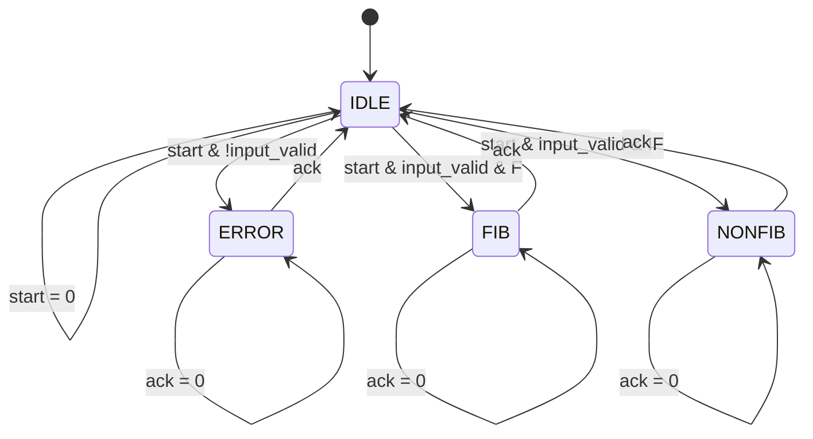
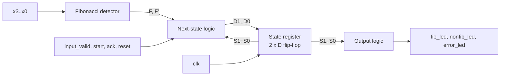

# Fibonacci Number Checker FSM

A synchronous **Moore finite state machine** for Logisim (2.7.1 / Logisim-evolution) that checks whether a 4-bit number is a Fibonacci number. Built only from `NOT`, `AND`, `OR`, `NAND`, `NOR` gates (all 2-input) and **2 D flip-flops**.

## Repository layout

```
fibonacci-checker-fsm/
├── README.md
└── circuits/
    ├── fibonacci_checker_fsm_wired.circ     # fully wired schematic (recommended)
    └── fibonacci_checker_fsm_tunnels.circ   # same netlist using named tunnels
```

## Quick start

1. Open `circuits/fibonacci_checker_fsm_wired.circ` in Logisim.
2. Enable **Simulate → Ticks** (or click the `clk` clock by hand).
3. Use the Poke tool to set inputs, pulse `reset` once, then:
   1. set `x3..x0` and `input_valid`
   2. set `start = 1` across a clock edge and read the LED
   3. set `start = 0`, `ack = 1` across a clock edge to return to IDLE

> **Status:** the netlist was simulated in software for all 16 values of `x` with `input_valid` = 0 and 1 (32 cases), and the wiring geometry was checked for shorts and opens. The `.circ` files have not been opened in Logisim by the author of the generator, so report any unconnected pin as an issue.

## Problem statement

Given a 4-bit unsigned number `x[3:0]` (x3 = MSB), light exactly one LED after `start` is pressed: Fibonacci, not Fibonacci, or error. The result is held until `ack`.

## Inputs and outputs

| Signal | Dir | Meaning |
|---|---|---|
| `x3 x2 x1 x0` | in | Number to test (x3 = MSB) |
| `input_valid` | in | 1 = number on `x` is valid |
| `start` | in | Begin a check (used in IDLE) |
| `ack` | in | Acknowledge result, return to IDLE |
| `reset` | in | Synchronous reset to IDLE |
| `clk` | in | Clock, rising edge |
| `fib_led` | out | `x` ∈ {0, 1, 2, 3, 5, 8, 13} |
| `nonfib_led` | out | `x` ∈ {4, 6, 7, 9, 10, 11, 12, 14, 15} |
| `error_led` | out | `start` pressed while `input_valid = 0` |

## Requirements

- Moore machine, 2 D flip-flops `S1 S0`
- Only NOT / AND / OR / NAND / NOR gates, 2 inputs each (3-input functions built from two 2-input gates)
- Synchronous reset: `reset'` ANDed into `D1` and `D0`
- All inputs, outputs and blocks labelled

## Assumptions

1. `x` is unsigned; x3 is the MSB.
2. Inputs are stable around the rising clock edge.
3. `start` and `ack` are held for at least one clock edge.
4. `input_valid` is only examined when `start` is applied in IDLE.
5. In IDLE, if `start` and `ack` are both 1, `ack` is ignored and `start` is processed.
6. In a result state, `start` is ignored until `ack`.
7. Flip-flops power up at 0 (IDLE) in Logisim; `reset` has priority over all other inputs.

## Constraints

- Gate set and flip-flop count as above; no asynchronous reset.
- Outputs depend only on the state (Moore), so they change one clock edge after `start`.
- Input range 0–15 (13 is the largest Fibonacci number).

## Design

### State encoding

| S1 S0 | State | Outputs |
|---|---|---|
| 00 | IDLE | all LEDs off |
| 01 | FIB | `fib_led` |
| 10 | NONFIB | `nonfib_led` |
| 11 | ERROR | `error_led` |



`reset = 1` forces any state to IDLE on the next clock edge.

### Block diagram



### Fibonacci detector

With A = x3, B = x2, C = x1, D = x0, the K-map gives:

```
F = A'B' + B C' D + B' C' D'
```

- `A'B'` covers 0, 1, 2, 3
- `B C' D` covers 5, 13
- `B' C' D'` covers 0, 8

### Next-state logic

```
t1    = NAND(input_valid, F)       -- 1 for NONFIB / ERROR
t0    = NAND(input_valid, F')      -- 1 for FIB / ERROR
idle  = NOR(S1, S0)
go    = idle AND start
D1    = ((go AND t1) OR (S1 AND ack')) AND reset'
D0    = ((go AND t0) OR (S0 AND ack')) AND reset'
```

### Output logic

```
fib_led    = S1' S0
nonfib_led = S1  S0'
error_led  = S1  S0
```

## Test vectors

| x | input_valid | LED after `start` |
|---|---|---|
| 0, 1, 2, 3, 5, 8, 13 | 1 | `fib_led` |
| 4, 6, 7, 9, 10, 11, 12, 14, 15 | 1 | `nonfib_led` |
| any | 0 | `error_led` |

## Circuit notes

- 31 gates (2-input) + 2 D flip-flops, both on the shared `clk`, rising-edge triggered.
- **Wired version:** each signal has a vertical wire on the left; gate inputs tap it with horizontal wires and each gate output returns to its own vertical wire. Wires that cross without a junction are not connected. Each gate has an `out: name` label.
- **Tunnels version:** identical netlist, using named tunnels.
