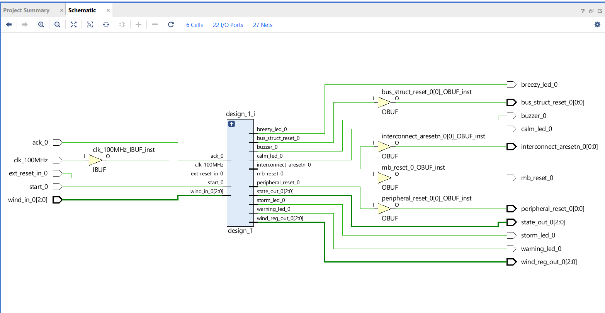
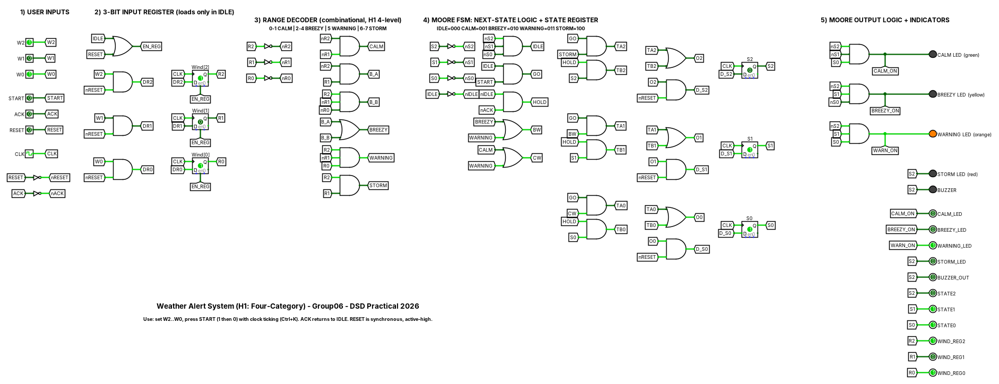
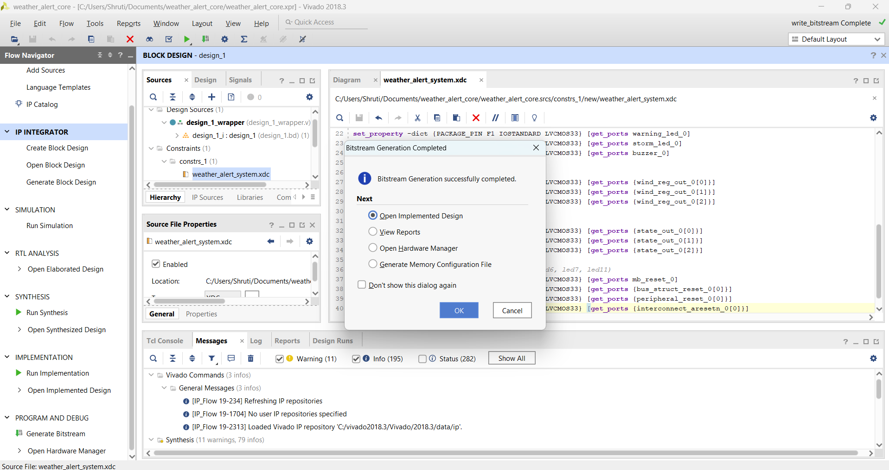

# Digital System Design – Group Project

> Complete every mandatory section. Do not delete headings. Replace bracketed prompts. If a section is not applicable, explain why.

## 1. Team Details
| Role | Student name | Roll number | GitHub username |
|---|---|---|---|
| Group leader | Shruti Sudesh Ingale  | 17 | shrutiingale99-alt |
| Member 2 | Bhumi Umesh Dhuri | 10 | bhumidhuri |
| Member 3 | Soham Jitendra Sarang | 57 | sohamsarang-45 |
| Member 4 | Prajkta Waghchaure | 64 | Prajkta9621 |

**Class:** D9A-D9B  
**Group ID:**  D9A-D9B_Group06 
**Repository URL:** https://github.com/shrutiingale99-alt/DSD-2026-D9A-D9B-Group06
**Final Pull Request URL:** [URL]

## 2. Assigned Problem Statement
- **Number/title:** Weather Alert System, modification **H1: Four-Category Weather Alert (add a Warning level)**.
- **Problem summary:** A 3-bit wind speed (0–7) is set on switches and stored in an input register. A comparator (range decoder) sorts the stored value into a category, and a Moore FSM latches the matching alert until ACK is pressed. H1 adds a fourth level, **WARNING**, for wind = 5.
- **Objective:** Classify the wind as CALM (0–1), BREEZY (2–4), WARNING (5) or STORM (6–7), and light one indicator per level (STORM also turns on the buzzer). Verify the design in Logisim and Vivado, and run it on the FPGA.
- **Inputs and outputs:**

| Signal | Direction | Width | Meaning |
|---|---|---|---|
| `clk` | in | 1 | 100 MHz clock |
| `reset` | in | 1 | Synchronous, active-high reset to IDLE |
| `start` | in | 1 | Classify the stored wind value (acts only in IDLE) |
| `ack` | in | 1 | Acknowledge the alert, return to IDLE |
| `wind_in[2:0]` | in | 3 | Wind value W2 W1 W0 |
| `calm_led`, `breezy_led`, `warning_led`, `storm_led` | out | 1 each | Category indicators |
| `buzzer` | out | 1 | ON in STORM |
| `state_out[2:0]`, `wind_reg_out[2:0]` | out | 3 each | Current state and stored wind value (debug) |

- **Constraints and assumptions:**
  - Moore FSM, so the outputs depend only on the state.
  - 5 states, so 3 state flip-flops are needed.
  - The register loads only in IDLE.
  - The alert holds until ACK. RESET has the highest priority.
  - A 3-bit input cannot exceed 7, so no error state is needed.

## 3. Problem Analysis and Proposed Solution
| Wind | W2 W1 W0 | Category | Indicator |
|---|---|---|---|
| 0 – 1 | 000 – 001 | CALM | Green LED |
| 2 – 4 | 010 – 100 | BREEZY | Yellow LED |
| 5 | 101 | **WARNING** (new) | Orange LED |
| 6 – 7 | 110 – 111 | STORM | Red LED + buzzer |

**Edge cases handled:**
- the boundaries 1|2, 4|5 and 5|6
- START held for several clocks
- START or a switch change during an alert (ignored)
- ACK pressed in IDLE (ignored)
- START and ACK pressed together
- RESET together with other inputs (RESET wins)

**Proposed solution:** a 3-bit input register feeds a range comparator, followed by a 5-state Moore FSM and output logic.

**Distinctive features:**
- The register is enabled only in IDLE, which removes the same-edge race and keeps the stored value fixed during an alert.
- The state and stored wind value are available as debug outputs.

**Feasibility:** 29 LUTs and 46 flip-flops after synthesis, about 0.1 % of the XC7S50.

## 4. Architecture

- **Data flow:** switches → input register → range comparator → Moore FSM → output logic → LEDs and buzzer.
- **Control:** START, ACK and RESET go into the FSM. IDLE enables the input register.
- **Vivado:** the RTL core `weather_alert_core` is used in a block design together with a Processor System Reset IP, which synchronises the reset to the 100 MHz clock.
- **Trade-off:** binary state encoding (3 FFs) was chosen over one-hot (5 FFs) to keep the circuit small.

## 5. FSM Design
The design is a **Moore** FSM with 5 states and 3-bit binary encoding. Reset is synchronous and returns the FSM to IDLE.

| State | S2 S1 S0 | Output |
|---|---|---|
| IDLE | 000 | All off |
| CALM | 001 | Green LED |
| BREEZY | 010 | Yellow LED |
| WARNING | 011 | Orange LED |
| STORM | 100 | Red LED + buzzer |

| Present state | RESET | START | ACK | Wind | Next state |
|---|---|---|---|---|---|
| any | 1 | x | x | x | IDLE |
| IDLE | 0 | 0 | x | x | IDLE |
| IDLE | 0 | 1 | x | 0–1 / 2–4 / 5 / 6–7 | CALM / BREEZY / WARNING / STORM |
| alert state | 0 | x | 0 | x | same (hold) |
| alert state | 0 | x | 1 | x | IDLE |

**Next-state equations** (GO = IDLE·START, HOLD = IDLE'·ACK'):
- D2 = RESET'·(GO·STORM + HOLD·S2)
- D1 = RESET'·(GO·(BREEZY + WARNING) + HOLD·S1)
- D0 = RESET'·(GO·(CALM + WARNING) + HOLD·S0)

**Diagram:** `01_Problem_Analysis/fsm_state_diagram_H1.png`  
**State table:** this section, and `02_FSM_Logisim/README.md`

## 6. Logisim Implementation
- **Logisim version:** Logisim-evolution 5.0.0
- **Circuit file:** `02_FSM_Logisim/weather_alert_H1.circ`
- **Test cases:** all 8 wind values, plus hold, START ignored during an alert, ACK, RESET from STORM, START+ACK together, RESET priority, and 600 random cycles. **647/647 checks passed.**
- **Issues and corrections:**
  - A third state flip-flop was added for the 5th state.
  - The register load was gated with IDLE.
  - Classic flip-flop appearance and HDL-valid labels were used so the file works in Logisim-evolution.
- **Screenshot/evidence:** `05_Results/logism_images/`

## 7. Verilog HDL Implementation
- **Tool/version:** Xilinx Vivado 2018.3, part xc7s50csga324-1
- **Top module and submodules:** `design_1_wrapper` (block design) → `weather_alert_core` + Processor System Reset IP
- **Architecture/coding decisions:**
  - sequential state register
  - combinational next-state `case` and combinational Moore output `case`
  - `localparam` state codes, with `default` sending unused codes to IDLE
- **Synthesizability considerations:** no `initial` blocks or delays in the RTL, default assignments so no latches are inferred, and synchronous reset.
- **RTL:** `03_Verilog_Implementation/RTL/`
- **Testbench:** `03_Verilog_Implementation/Testbench/`

## 8. Verification and Simulation Results
| Test ID | Inputs/conditions | Expected output | Observed output | Pass/Fail |
|---|---|---|---|---|
| T01 | RESET = 1 | IDLE, all LEDs off | IDLE, all LEDs off | Pass |
| T02 | Wind 0, 1 + START | CALM, green LED | CALM, green LED | Pass |
| T03 | Wind 2, 3, 4 + START | BREEZY, yellow LED | BREEZY, yellow LED | Pass |
| T04 | Wind 5 + START | WARNING, orange LED | WARNING, orange LED | Pass |
| T05 | Wind 6, 7 + START | STORM, red LED + buzzer | STORM, red LED + buzzer | Pass |
| T06 | ACK in an alert state | IDLE | IDLE | Pass |
| T07 | Switch change / START during an alert | No change | No change | Pass |
| T08 | RESET from STORM; RESET + ACK | IDLE | IDLE | Pass |

**Tool/version:** Logisim-evolution (automated checks); Vivado 2018.3 behavioural simulation  
**Number passed/failed:** Logisim 647 passed, 0 failed. Vivado: all directed tests passed, and the testbench error counter stayed at 0.  
**Waveform/log path:** `05_Results/vivado_images/waveform vivado.png`, `02_FSM_Logisim/`

## 9. FPGA Hardware Implementation
- **FPGA board/device:** RealDigital Boolean Board, Spartan-7 XC7S50-CSGA324-1
- **Tool/version:** Vivado 2018.3
- **Clock/constraints:** 100 MHz clock, LVCMOS33 pins in `weather_alert_system.xdc`
- **Synthesis/implementation summary:** 29 LUTs (0.09 %) and 46 flip-flops (0.07 %), with no BRAM. Synthesis, implementation and bitstream generation all completed.
- **Programming and hardware test result:** the board was programmed and the demo worked. Every wind value lit the correct indicator, the alert held until ACK, and RESET returned the board to IDLE.
- **Evidence path:** `04_FPGA_Hardware/`, `05_Results/vivado_images/`

There were no functional differences between simulation and hardware. The extra flip-flops (46 rather than 6) come from the Processor System Reset IP in the block design.

## 10. Challenges, Debugging and Improvements
| Issue | Root cause | Correction | Outcome |
|---|---|---|---|
| 5 states don't fit in 2 bits | H1 adds WARNING | 3-bit state register | All states reachable |
| Stale value on the START edge | Register and FSM update on the same edge | Register enabled only in IDLE | Category matches the stored value |
| Logisim-evolution broke the imported circuit | Different flip-flop shape and label rules | Classic flip-flops, HDL-valid labels | Circuit works; 647/647 checks pass |
| Bitstream not generated at first | Vivado project/constraint setup | Rebuilt as a block design with a matching XDC | Bitstream generated; demo successful |

**Future improvements:** a physical buzzer, a 7-segment wind display, category counters (H4), and a CHANGE signal (H5).

## 11. Task Allocation and Individual Contribution
| Student | Assigned responsibility | Actual contribution/evidence |
|---|---|---|
| Shruti Sudesh Ingale (leader) | Vivado, GitHub | Vivado simulation, synthesis and bitstream; GitHub repository; FPGA demo |
| Bhumi Umesh Dhuri | Vivado, presentation and report | Vivado simulation, synthesis and bitstream; presentation and report; FPGA demo |
| Soham Jitendra Sarang | Logisim, GitHub | Logisim circuit and simulation; GitHub repository; FPGA demo |
| Prajkta Vishal Waghchaure | Logisim, presentation and report | Logisim circuit and simulation; presentation and report; FPGA demo |

Every student must be ready to explain the complete design.

## 12. Progress Log
Time-wise updates are maintained in `STATUS.md`.

## 13. Final Results and Conclusion
All H1 requirements were met:
- All 8 wind values are classified correctly, and the new WARNING level has its own state (011) and LED.
- Alerts latch until ACK, and RESET works from every state.
- Logisim passed 647/647 checks, and Vivado simulation matched the expected outputs.
- The design uses 29 LUTs and 46 FFs, the bitstream was generated, and the hardware demo was successful.

## 14. Team Reflection
We learned how to turn a word specification into a Moore FSM: choosing the encoding, deriving the next-state and output logic, and building it in Logisim before writing the Verilog. Gating the register with IDLE showed us why timing matters in synchronous design. Next time we would start the Vivado flow earlier.

