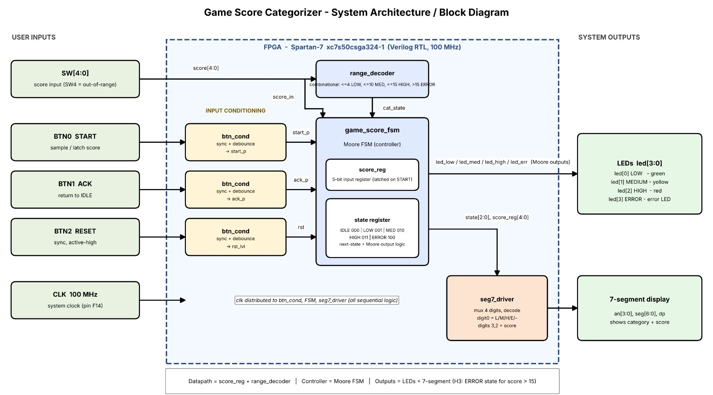

# Digital System Design – Group Project

> Complete every mandatory section. Do not delete headings. Replace bracketed prompts. If a section is not applicable, explain why.

## 1. Team Details
| Role | Student name | Roll number | GitHub username |
|---|---|---|---|
| Group leader | Hardik Patil | 49 | hardikpatil0317-star |
| Member 2 | Kanishka Puthran | 45 | puthrankanishka2323-ai |
| Member 3 | Aran Mishra | 35 | 2025aranmishra-code |
| Member 4 | Harikesh Menon | 33 | 2025harikeshmenon-collab |

**Class:** [D9A/D9B]  
**Group ID:** D9AB_GROUP11  
**Repository URL:** https://github.com/hardikpatil0317-star/DSD-2026-D9AB-GROUP11.git
**Final Pull Request URL:** [URL]

## 2. Assigned Problem Statement
- **Number/title:** Game Score Categorizer – H3: Add Error State for Invalid Input.
- **Problem summary:** The Game Score Categorizer is a digital system designed to classify an input game score into different categories based on predefined score ranges. The system uses a Moore Finite State Machine (FSM) to identify whether the score belongs to the Low, Medium, High or Error category. An additional Error state is incorporated to detect invalid inputs exceeding the maximum valid score of 15.
- **Objective:** To design and implement a digital system that accepts a binary score, classifies it into the appropriate category and displays the corresponding output using LEDs. The system must also detect invalid scores and activate an Error LED. It should return to the IDLE state upon receiving RESET or ACK.
- **Inputs and outputs:** Inputs:
S[4:0] – 5-bit binary score input.
START – Initiates the score classification process.
ACK – Acknowledges the result and returns the system to IDLE.
RESET – Resets the FSM to its initial IDLE state.
Outputs:
LOW – Indicates a score between 0 and 4.
MEDIUM – Indicates a score between 5 and 10.
HIGH – Indicates a score between 11 and 15.
ERROR – Indicates an invalid score greater than 15.
LED indicators display the corresponding category.

- **Constraints and assumptions:** The score is represented using a 5-bit binary input.
Valid scores range from 0 to 15.
Scores greater than 15 are treated as invalid inputs.
The system uses a Moore FSM for sequential control.
Classification is initiated using the START signal.
ACK returns the system to IDLE after displaying the result.
RESET asynchronously returns the system to the initial IDLE state.
Only one category output is active at a time.

## 3. Problem Analysis and Proposed Solution

The Game Score Categorizer is designed to classify numerical game scores into predefined categories using digital logic and a Moore Finite State Machine (FSM).
The system accepts a binary score as input and uses a range decoder to determine the corresponding category. The classification is divided into four categories:
- **Low:** Scores from 0 to 4.
- **Medium:** Scores from 5 to 10.
- **High:** Scores from 11 to 15.
- **Error:** Scores greater than 15, which are considered invalid.
The proposed design consists of an input register, range decoder, Moore FSM controller and output logic. When the START signal is activated, the input score is processed and classified. The FSM transitions to the appropriate category state, activating the corresponding LED indicator. The system remains in the detected category state until an ACK signal is received, returning it to the IDLE state. RESET can also be used to return the system to its initial state.

**Edge Cases:**
- A score of 0 must be correctly classified as LOW.
- Scores at the category boundaries (4, 5, 10 and 11) must be classified correctly.
- A score of 15 must be classified as HIGH.
- Scores greater than 15 must activate the ERROR state and Error LED.
- RESET must return the system to IDLE.
- ACK must clear the current category indication and return the system to IDLE.
- 
**Proposed Solution:**
A Moore FSM is implemented with five states: IDLE, LOW, MEDIUM, HIGH and ERROR. The input score is evaluated using combinational range-decoding logic, and the FSM controls the corresponding output indicators. Since the outputs depend only on the current state, the design provides predictable sequential behaviour.

**Distinctive Features:**
- Four-category score classification.
- Additional ERROR state for invalid score detection.
- Moore FSM-based sequential control.
- LED-based visual indication of the detected category.
- START, ACK and RESET controls for managing system operation.
- 
**Feasibility:**
The design is feasible using basic digital components such as registers, comparators, combinational logic gates and flip-flops. It can be implemented and tested in Logisim and described using Verilog HDL. The modular architecture also makes the system suitable for FPGA implementation and further enhancements.

## 4. Architecture
# Game Score Classifier (Moore FSM)

A synchronous Verilog hardware design that latches a 5-bit score input, classifies it into range categories using a Moore Finite State Machine (FSM), indicates the category via status LEDs, and displays both the latched score and current state on a 4-digit multiplexed 7-segment display.

---

## Architecture & Modules

| Module | Instance(s) | Role |
| :--- | :--- | :--- |
| `btn_cond` | `c_ack`, `c_start`, `c_rst` | Conditions push buttons via a synchronizer, delayed copy (`lvl_d`), and edge detector. `c_ack` and `c_start` output a single-clock pulse; `c_rst` outputs a synchronized level. |
| `game_score_fsm` | `u_fsm` | Moore FSM and datapath. Latches `sw[4:0]` into `score_reg` on `START`, decodes the score range, and drives the state register and LED outputs. |
| `seg7_driver` | `u_seg` | Time-multiplexes the 4-digit 7-segment display (`an[3:0]`, `seg[6:0]`, `dp`) to show the latched score and current FSM state. |

### Top-Level I/O (25 Ports)
* **Inputs:** `clk`, `btn_rst`, `btn_start`, `btn_ack`, `sw[4:0]`
* **Outputs:** `led[3:0]`, `an[3:0]`, `seg[6:0]`, `dp`

---

## Data & Control Flow

### Data Flow
1. The user sets the 5-bit score on `sw[4:0]` and presses `START`.
2. The value is captured into `score_reg[4:0]`.
3. Combinational range-decoding logic in the FSM next-state path classifies the score:

| Score Range | State | Encoding | LED Indicator | Output Pin |
| :--- | :--- | :---: | :--- | :--- |
| *None yet* | `S_IDLE` | `0` | All off | `4'b0000` |
| `0 – 4` | `S_LOW` | `1` | `led_low` | `led[0]` |
| `5 – 10` | `S_MED` | `2` | `led_med` | `led[1]` |
| `11 – 15` | `S_HIGH` | `3` | `led_high` | `led[2]` |
| `> 15` (`16 – 31`) | `S_ERR` | `4` | `led_err` | `led[3]` |

4. The state register drives `led[3:0]` directly and passes the state alongside `score_reg` to `seg7_driver`.

### Control Flow
* **Start:** `S_IDLE` $\rightarrow$ Category state (`S_LOW`, `S_MED`, `S_HIGH`, or `S_ERR`) on `START`.
* **Acknowledge:** Any category state or `S_ERR` $\rightarrow$ `S_IDLE` on `ACK`.
* **Reset:** Any state $\rightarrow$ `S_IDLE` on `RST` (includes recovery from the `S_ERR` out-of-range state).

---

## Verification

The self-checking testbench (`tb_game_score`) validates end-to-end functionality:
* Applies initial reset, then sweeps through score values using repeated `START` and `ACK` sequences.
* Compares FSM state, `led[3:0]`, and `score_reg` against expected values, tracking totals in `pass_cnt` and `fail_cnt`.
* **Expected Waveform Behavior:** State transitions `0 -> 1/2/3 -> 0` per valid score sweep, with LED category transitions occurring cleanly at thresholds `5` and `11`.

---

## Design Trade-Offs & Synthesis

* **Moore vs. Mealy:** Outputs depend strictly on the current state, ensuring glitch-free LED transitions aligned to clock edges at the cost of one clock cycle of latency compared to a Mealy machine.
* **Button Conditioning:** Synchronizing and edge-detecting buttons requires a few extra flip-flops but prevents metastability, eliminates switch bounce, and guarantees a single trigger per press. `RST` remains level-sensitive so reset can take effect immediately.
* **5-Bit Input Width:** Expanding the switch input by 1 bit beyond a standard 4-bit (`0–15`) specification allows explicit detection of out-of-range values (`16–31`) via `S_ERR` rather than silently wrapping around.
* **Binary State Encoding (3-bit):** Compact representation for 5 states (with synthesis free to re-encode). One-hot encoding would reduce decode latency at the expense of extra flip-flops, which is unnecessary at this scale.
* **Multiplexed 7-Segment Display:** Time-multiplexing reduces pin count and combinational logic compared to driving four independent digits, requiring only a lightweight refresh counter.
* **Post-Synthesis Footprint:** **31 cells** and **58 nets**.

## 5. FSM Design

The Game Score Categorizer uses a **Moore Finite State Machine (FSM)** to classify the input score and control the indicator LEDs. The FSM operates using a synchronous clock and has five states.

### State Encoding

The FSM uses 3-bit binary encoding:

| State | Encoding | Description |
|---|---|---|
| IDLE | 000 | Waiting for START; all LEDs OFF |
| LOW | 001 | Score from 0–4; Green LED ON |
| MEDIUM | 010 | Score from 5–10; Yellow LED ON |
| HIGH | 011 | Score from 11–15; Red LED ON |
| ERROR | 100 | Score greater than 15; Error LED ON |

### State Transitions

- **IDLE:** The FSM waits for the START signal. When START is asserted, it checks the 5-bit input score (Score[4:0]) and moves to the corresponding category state.
- **LOW:** Entered when the score is between 0 and 4.
- **MEDIUM:** Entered when the score is between 5 and 10.
- **HIGH:** Entered when the score is between 11 and 15.
- **ERROR:** Entered when the score is greater than 15 (16–31).

When ACK is asserted, the FSM returns from any category state to IDLE. It also returns to IDLE when RESET is asserted.

### Output Behaviour

Since the design follows the Moore model, the outputs depend only on the present state. Each state activates its corresponding LED, while IDLE keeps all indicator LEDs OFF.

### Reset Behaviour

The FSM uses a synchronous, active-high RESET signal. When RESET is asserted, the FSM transitions to the IDLE state, and all indicator LEDs are turned OFF.

### State Diagram and State Table

- **State Diagram:** [View FSM State Diagram](02_FSM_Logisim/state_diagram_corrected.png)
- **State Table:** [View FSM State Table](02_FSM_Logisim/state_table.png)

## 6. Logisim Implementation
- Logisim version: [Version v4.1.0]
- Circuit file: [Path to `https://github.com/hardikpatil0317-star/DSD-2026-D9AB-GROUP11/blob/main/Group_Submissions/D9AB_GROUP11/02_FSM_Logisim/Logism_circuit/D9AB_3H3Group11_Logisim.circ`]
- Test cases and expected/observed behaviour: [Details]
- Issues and corrections: [Details]
- Screenshot/evidence: (https://github.com/hardikpatil0317-star/DSD-2026-D9AB-GROUP11/tree/main/Group_Submissions/D9AB_GROUP11/02_FSM_Logisim/Logisim_evidence)

## 7. Verilog HDL Implementation
- Tool/version: [Details]
- Top module and submodules: [Names]
- Architecture/coding decisions: [Details]
- Synthesizability considerations: [Details]
- RTL: `03_Verilog_Implementation/RTL/`
- Testbench: `03_Verilog_Implementation/Testbench/`

## 8. Verification and Simulation Results

| Test ID | Inputs/conditions | Expected output | Observed output | Pass/Fail |
|---------|-------------------|-----------------|-----------------|-----------|
| T01 | Apply RESET (rst = 1 for one clock) | State = IDLE (000), `score_reg` = 0, all LEDs off | State = IDLE (000), `score_reg` = 0, all LEDs off | PASS |
| T02 | All 16 scores 0-15: set score, pulse START, then change the score input and pulse START again (must be ignored), then pulse ACK | Scores 0-4: LOW (001), green LED. Scores 5-10: MEDIUM (010), yellow LED. Scores 11-15: HIGH (011), red LED. Score latched in `score_reg`. State holds on a second START. ACK returns to IDLE with all LEDs off | Matches expected for all 16 scores (16 x 6 = 96 checks) | PASS |
| T03 | Score = 12 with no START for 3 clocks, then ACK while in IDLE | FSM stays in IDLE, all LEDs off | FSM stays in IDLE, all LEDs off | PASS |
| T04 | RESET applied while in LOW (score 3), MEDIUM (8), HIGH (14) and ERROR (20). Also RESET and START asserted together (score 9) | State returns to IDLE, `score_reg` cleared to 0, all LEDs off. RESET wins over START | State returns to IDLE, `score_reg` = 0, all LEDs off. RESET wins over START | PASS |
| T05 | Hint H3: invalid scores 16-31 (SW4 = 1), pulse START, then ACK | ERROR state (100), error LED on, no other LED on. ACK returns to IDLE | ERROR state (100), error LED on. ACK returns to IDLE (16 scores x 2 = 32 checks) | PASS |

Tool/version: Xilinx Vivado 2018.3, Vivado Simulator (xsim), Behavioral Simulation (Functional), testbench `tb_game_score`, target part xc7s50csga324-1.

Number passed/failed: 145 checks run, 145 passed, 0 failed. The testbench prints `OVERALL RESULT: PASS`.

Waveform/log path: 

## 9. FPGA Hardware Implementation
- FPGA board/device: [Details]
- Tool/version: [Details]
- Clock/constraints: [Details]
- Synthesis/implementation summary: [Details]
- Programming and hardware test result: [Details]
- Evidence path: `04_FPGA_Hardware/`

Explain differences between simulation and hardware results, if any.

## 10. Challenges, Debugging and Improvements
## 10. Challenges, Debugging and Improvements

| Issue | Root cause | Correction | Outcome |
| :--- | :--- | :--- | :--- |
| FSM fired multiple times per button press | Button bounce and long press width | Added `btn_cond` (synchronizer + edge detect) | One clean pulse per press |
| Random state after button press | Asynchronous inputs (metastability) | 2-flop synchronizer on all buttons | Stable state transitions |
| Scores 16–31 misclassified | 5-bit switch input exceeds 0–15 range | Added `S_ERR` state and `led_err` | Invalid input flagged |
| Reset missed in result states | Reset treated as a pulse | `c_rst` outputs a level, reset has top priority | Reset works from any state |

**Future improvements:** To enhance functionality and efficiency, the design can be upgraded to a Mealy FSM (H2) to reduce state count and improve response speed. Additional features include adding category counters (H4) to track classification totals, a `CHANGE` signal (H5) to alert when inputs are modified, and a new "Excellent" classification tier (H1). Finally, generating FPGA board timing and resource utilisation reports will verify hardware performance and logic efficiency.

## 11. Task Allocation and Individual Contribution
| Student | Assigned responsibility | Actual contribution/evidence |
|---|---|---|
| Hardik Patil | [ LOGISIM] | [LOGISIM ] |
| Kanishka Puthran | [LOGISIM,GITHUB ] | [LOGISIM,GITHUB ] |
| Aran Mishra | [TESTING ] | [TESTING,RTL ] |
| Harikesh Menon | [RTL,TESTSBENCH ] | [RTL,TESTBENCH ] |

Every student must be ready to explain the complete design.

## 12. Progress Log
Maintain time-wise updates in `STATUS.md`.

## 13. Final Results and Conclusion
Summarise requirements met, correctness of simulation/hardware results, measured results, limitations and conclusion.
## Requirements Met

| Requirement (from assignment sheet) | Status | Evidence |
|---|---|---|
| Logisim design: 5-bit input register, range decoder, Moore FSM, indicator outputs | Met | Logisim circuit with input register, comparators, state register and LED decode |
| Moore FSM diagram, state encoding and outputs | Met | Section 5, `docs/fsm_diagram.md`, `docs/fsm_state_table.md` |
| Complete system block diagram | Met | Vivado elaborated schematic (`docs/block_diagram.png`) |
| Verilog-only self-checking testbench (reset, START/ACK, expected-result comparison, pass/fail) | Met | `tb_game_score` with `pass_cnt` / `fail_cnt` |
| All four FSM states exercised | Partly met | IDLE, LOW, MED, HIGH seen in the waveform. ERR needs a 16–31 test. |
| Suggested modification (select any 1) | Met (H3) | `S_ERR` state and `led_err` for scores > 15 |
| FPGA implementation (Artix-7 `xc7s50csga324-1`) | Synthesis complete | Vivado reports "Synthesis Complete" |

## Correctness of Simulation Results

| Check | Observed result | Verdict |
|---|---|---|
| Reset | `rst` high at start, `state = 0`, all LEDs off | Correct |
| Score 0–4 | `state = 1`, `led_low` pulses | Correct |
| Score 5–10 | `state = 2`, `led_med` pulses | Correct |
| Score 11–15 | `state = 3`, `led_high` pulses | Correct |
| START/ACK handshake | `state` goes `0 → category → 0` on each START/ACK pair | Correct |
| Input latching | `score_reg` updates only on START, not when `score_in` changes | Correct |
| Self-check counters | `pass_cnt = 0x56` (86), `fail_cnt = 0` | All checks passed |
| `i[31:0]`, `k[31:0]` = X | Testbench-only loop variables | No effect on the design |

## Measured Results

| Metric | Value |
|---|---|
| Simulation length | 1,000 ns (1 µs) |
| Checks passed / failed | 86 / 0 |
| Distinct states observed | 4 of 5 (IDLE, LOW, MED, HIGH) |
| Synthesis (RTL elaboration) | 31 cells, 25 I/O ports, 58 nets |
| Target device | `xc7s50csga324-1` |
| Tool | Vivado 2018.3 |
| Timing and utilisation reports | Not yet recorded |

## Limitations

- The waveform covers scores 0–13 (`0x0D`) in the visible window, so scores 14 and 15 and the ERROR path (16–31) are not shown.
- The Logisim design uses 5 inputs and 3-bit encoding. This differs from the 4-bit, 2-bit-encoded base spec, which was needed for H3.
- Timing, power and resource-utilisation reports have not been recorded.
- Hardware testing on the board has not been confirmed.
- The Moore structure adds one clock of output latency.
- Tests are directed, not exhaustive random or corner-case tests.

## Conclusion

The Game Score Categorizer classifies a latched score into LOW, MEDIUM, HIGH or ERROR using a Moore FSM. The simulation shows correct state sequencing, correct LED outputs and input latching, with 86 checks passed and none failed. Button conditioning gives clean one-clock START and ACK events, and the added ERROR state makes the design robust to invalid input. The design meets the assignment requirements. The main follow-up is to extend the testbench to scores 14–31, record timing and utilisation, and test on the board.

## 14. Team Reflection
What did the team learn? What would you improve?

## What We Learned

- **Moore FSM design:** Separating next-state logic, the state register and output logic makes the design easy to reason about. Outputs that depend only on the state are glitch-free.
- **Input handling matters:** Raw push buttons are asynchronous and bounce. A synchronizer plus edge detector (`btn_cond`) is needed to get one clean START or ACK event per press.
- **Latching inputs:** Storing the score in a register on START means later switch changes cannot corrupt the result.
- **Handling invalid input:** Adding the `S_ERR` state (H3) showed that a design should define behaviour for out-of-range values, not just the expected ones. It also forced a move from 2-bit to 3-bit state encoding.
- **Tool flow:** We moved one design through Logisim (schematic), Verilog (RTL), Vivado simulation, elaboration and synthesis, and saw how each view shows the same logic differently.
- **Self-checking verification:** A testbench with expected-result comparison and `pass_cnt` / `fail_cnt` is faster and more reliable than inspecting waveforms by eye.
- **Reading waveforms:** Testbench-only signals such as `i` and `k` can show `X` without affecting the design, so we learned to separate DUT behaviour from testbench artefacts.

## What We Would Improve

| Area | Improvement | Benefit |
|---|---|---|
| Verification | Extend the testbench to all values 0–31 and add `$error` assertions | Shows the ERROR state and covers every corner case |
| Verification | Add randomised and back-to-back START/ACK tests | Catches priority and timing bugs |
| FPGA | Run on the board and record timing and utilisation reports | Confirms real

## 15. Final Submission Checklist
- [Completed ] Team details and problem analysis complete.
- [Completed ] Architecture/block diagram included.
- [Completed ] FSM diagram/table or justified alternative included.
- [Completed ] Logisim source and simulation evidence uploaded.
- [Completed ] Verilog RTL and testbench uploaded.
- [ Completed] Simulation results and test cases documented.
- [ ] FPGA implementation and hardware evidence uploaded.
- [ ] Results, challenges and conclusion documented.
- [Completed ] Presentation and final report uploaded.
- [Completed ] STATUS.md is up to date.
- [Completed ] Final Pull Request created and URL recorded.
