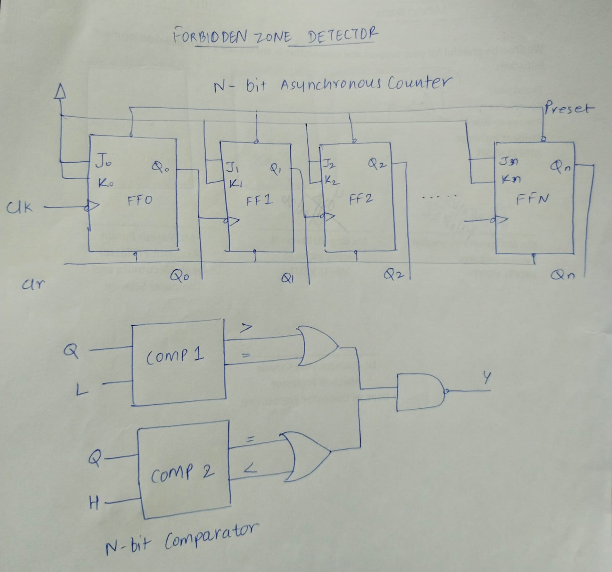

# Digital System Design – Group Project

> Complete every mandatory section. Do not delete headings. Replace bracketed prompts. If a section is not applicable, explain why.

## 1. Team Details
| Role | Student name | Roll number | GitHub username |
|---|---|---|---|
| Group leader | Ankita karmakar | 22 | ankyaaa18 |
| Member 2 | Chaitanya Jadhav | 19 | chaitanyarj49-ux |
| Member 3 | Manas Narkar | 41 | 2025Man-nar |
| Member 4 | Vidyesh Raut | 47 | 2025vidyeshraut-lang |

**Class:** D9A/D9B  
**Group ID:** D9_Group03  
**Repository URL:** [Fork URL](https://github.com/ankyaaa18/DSD_2026_D9A_B_Group3.git)  
**Final Pull Request URL:** [Pull URL](https://github.com/MrugendraVasmatkar/Digital_System_Design_Practical_2026_27_D9A_B/pull/6#issue-6487612856)

## 2. Assigned Problem Statement
- **Number/title:** 6H1 / Forbidden Zone Rejector
- **Problem summary:** The Forbidden Zone Rejector is a digital system designed to identify and reject input values falling within a predefined forbidden range. The system accepts a n-bit binary input (parameterizable) and checks whether its decimal equivalent lies within the forbidden zone which is configurable [L,H].
- **Objective:**
  1. To accept binary input values and detect whether they fall within a specified forbidden range.
  2. To generate an ACCEPT output for values outside the forbidden zone.
  3. To generate a REJECT output for values within the forbidden zone.
  4. To extend the design to support parameterizable input widths and configurable forbidden-zone limits.
  5. To verify the functionality of the circuit through simulation and testbench verification.
- **Inputs and outputs:**
  | Inputs/Output Signal | Width | Description | 
  |---|---|---|
  | X | n | Binary input value to be checked | 
  | L | n | Lower limit of the forbidden zone | 
  | H | n | Higher limit of the forbidden zone. |
  | Y | 1 | Result whether Rejected or accepted |
  
- **Constraints and assumptions:**
  1. The initial implementation uses a 4-bit unsigned binary input, allowing decimal values from 0 to 15.
  2. The default forbidden zone is from 6 to 9, including both boundary values.
  3. The input is considered forbidden when L ≤ X ≤ H.
  4. Values outside the forbidden range are considered acceptable.
  5. The configurable limits must satisfy 0 ≤ L ≤ H ≤ 2^N − 1.

## 3. Problem Analysis and Proposed Solution
The base problem requires a 4-bit circuit that outputs 0 (reject) for inputs 6–9 and 1 (accept) for all other values, using a fixed Boolean expression FZ = X'₃X₂X₁ + X₃X'₂X'₁, Y = FZ'.

For H1 (Parameterized Forbidden Zone), this fixed expression doesn't generalize hence, a new SOP equation would need to be re-derived by hand for every new range [L, H]. The requirement is to make the forbidden range itself a design parameter rather than a baked-in constant, and to verify correctness across multiple ranges (e.g., [4,7], [8,11]) without touching the gate-level logic each time.

Edge cases considered:

1. Boundary values exactly equal to L and H must be rejected (inclusive range).
2. L = H (single forbidden value) should still work.
3. The detector must cover all input combinations, not just the original 6–9 window.

Proposed solution: Replace the fixed two-term SOP expression with a comparator-based range detector: two 4-bit unsigned comparators check X ≥ L and X ≤ H against configurable bound constants, and their outputs are combined (OR/NAND network) into a single Forbidden-Zone signal. Two Comparators compare ranges from lower limit to higher limit and the combined OR/AND network results in the detection of forbidden zone rejection.

Distinctive features:
Reconfiguring the forbidden zone only requires changing the comparator constant inputs (L, H)  no re-derivation of Boolean equations.
Self-exercising test input (the ripple counter) gives continuous, exhaustive coverage of all 16 cases for visual verification on the LED, without manual switch toggling.

Feasibility: Comparators are standard Logisim Arithmetic-library components that natively generalize to any bit width N, satisfying the N ≥ 4 parameterization goal in H1. The ripple counter requires only N J-K flip-flops regardless of range, keeping gate count low.

## 4. Architecture

Modules:
1.Asynchronous Input Counter (J-K Flip-Flops D3–D0): A 4-bit ripple counter, falling-edge triggered, with asynchronous RESET. Generates the test input X[3:0], cycling 0→15, replacing the manual switch bank from the base design.

2.Range Check (COMP1, COMP2 – 4-bit Unsigned Comparators): COMP1 evaluates X ≥ L, COMP2 evaluates X ≤ H, where L and H are the configurable bound constants wired into the comparators.

3. OR Gate Network: Combines the relevant comparator output lines before the final reject decision.

4. NAND Gate (Output Logic): Produces the final output signal driving the LED — combining the two range-check branches into the Forbidden-Zone / Accept decision.

5. LED Indicator: Single LED reflecting Y.

data/control flow:
CLK drives the first J-K flip-flop; each stage's output ripples into the clock of the next stage, producing the 4-bit count. This count fans out in parallel to both comparators via the splitter. Comparator outputs pass through the OR gates into the NAND gate, producing Y, which lights the LED.

Design trade-offs:

An asynchronous ripple counter uses fewer gates and simpler wiring than a synchronous counter, but introduces cumulative propagation delay across stages. This is acceptable here since the counter only generates test stimulus, not a timing-critical datapath signal.
Comparators generalize cleanly to any range/width (meeting the H1 parameterization goal) at the cost of slightly more hardware than a minimized two-term SOP expression tailored to one fixed range.

## 5. FSM Design
- **FSM used?** Yes, in the Verilog design. 
- **Type:** Moore (outputs depend only on the state).
- **States:** IDLE (`00`) and REJECT (`01`). Binary encoding, 2 bits.
- **Outputs:** IDLE → accept_led = 1, reject_led = 0. REJECT → accept_led = 0, reject_led = 1.
- **Reset:** Asynchronous, active-high. Goes to IDLE, x_reg = 0.
- **Why an FSM:** It holds REJECT until the user gives `ack`, so the reject result stays visible.

**Transition conditions** (`fz` = 1 when L ≤ x_reg ≤ H, `start_d` = start delayed by 1 clock):

| Present state | Condition | Next state |
|---|---|---|
| IDLE | start_d = 1 and fz = 1 | REJECT |
| IDLE | otherwise | IDLE |
| REJECT | ack = 1, or (start_d = 1 and fz = 0) | IDLE |
| REJECT | otherwise | REJECT |

**Diagram:** [FSM Diagram](./02_FSM_Logisim/FSM_Diagram.jpeg)  
**State table:** [State Table](./02_FSM_Logisim/State_Table/)  

## 6. Logisim Implementation
- Logisim version: Logisim-evolution v3.9.0
- Circuit file: [Circuit File](./02_FSM_Logisim/logisim_circ_Forbidden_Zone_Rejector_updated.circ)
- Test cases and expected/observed behaviour: The asynchronous counter cycles X[3:0] through all values 0–15 on each CLK pulse. For each value, Y is expected to read 0 (LED reflecting reject) for L ≤ X ≤ H and 1 otherwise. With L=6, H=9, values 6–9 should reject and all others accept, matching the original truth table provided with the problem statement
- Issues and corrections: Comparator wiring fixes and splitter connections
- Screenshot/evidence: [Screenshot](./02_FSM_Logisim/Logisim_circuit.png)

## 7. Verilog HDL Implementation
- Tool/version: Xilinx Vivado Simulator (behavioural simulation), version [add version]
- Top module and submodules:
  - `fz_rejector` (top): input register, 2 comparators, Moore FSM, LED outputs.
  - `COMPARATOR` (sub): N-bit unsigned comparator, outputs GT, LT, EQ.
  - `COUNTER` (extra): N-bit synchronous counter with reset and enable. Not used inside `fz_rejector`.
  - `tb_fz_rejector` (testbench).
- Architecture/coding decisions:
  - `N`, `L`, `H` are module parameters. Default N = 4, L = 6, H = 9. Change them to get a new range, no logic change needed.
  - `x` is stored in `x_reg` when `start` = 1.
  - Two `COMPARATOR` instances compare `x_reg` with L and with H.
  - `fz = (x_reg >= L) && (x_reg <= H)`.
  - Moore FSM with 2 states, outputs come only from the state.
  - Synchronous active-high reset.
- Synthesizability considerations: Only `always @(posedge clk)`, `always @(*)` and parameters are used. No delays or `initial` blocks in RTL. Combinational block has a default `next_state`, so no latches. Comparators are plain `>`, `<`, `==`, which synthesize to LUTs/carry logic.
- RTL: [RTL](./03_Verilog_Implementation/RTL/)
- Testbench: [Testbench](./03_Verilog_Implementation/Testbench/)

## 8. Verification and Simulation Results
| Test ID | Inputs/conditions | Expected output | Observed output | Pass/Fail |
|---|---|---|---|---|
| T01 | Reset = 1 at start | State = IDLE, accept = 1, reject = 0, x_reg = 0 | Same as expected | Pass |
| T02 | X = 0 to 5 (below L), start pulse | IDLE, accept = 1, reject = 0 | Same as expected | Pass |
| T03 | X = 6 (lower boundary) | REJECT, accept = 0, reject = 1 | Same as expected | Pass |
| T04 | X = 7, 8 (inside zone) | REJECT, accept = 0, reject = 1 | Same as expected | Pass |
| T05 | X = 9 (upper boundary) | REJECT, accept = 0, reject = 1 | Same as expected | Pass |
| T06 | X = 10 to 15 (above H) | IDLE, accept = 1, reject = 0 | Same as expected | Pass |
| T07 | Range [4, 7], X = 0 to 15 | REJECT only for X = 4 to 7, ACCEPT otherwise | Same as expected | Pass |
| T08 | Range [8, 11], X = 0 to 15 | REJECT only for X = 8 to 11, ACCEPT otherwise | Same as expected | Pass |

Tool/version: Xilinx Vivado Simulator, version [add version]  
Number passed/failed: 51 passed / 0 failed (3 ranges x (1 reset check + 16 input checks), N = 4)  
Ranges simulated: [6, 9] (default), [4, 7], [8, 11]. Changed by editing `` `L `` and `` `H `` in the testbench.  
Waveform/log path: [waveform](./03_Verilog_Implementation/Testbench/tb_fz_rejector_behav.wcfg)  
Detailed results: see [Result](./05_Results)

## 9. FPGA Hardware Implementation
- FPGA board/device: AMD Spartan-7 FPGA xc7s50csga324-1
- Tool/version: Xilinx Vivado, version 20.18.3
- Clock/constraints: [Clock frequency]. Constraints file (.xdc) maps `x` to switches, `start`, `ack`, `reset` to push buttons, and `accept_led`, `reject_led` to LEDs.
- Synthesis/implementation summary: Design synthesized and implemented with default N = 4, L = 6, H = 9. 
- Programming and hardware test result: Bitstream programmed on the board. For X = 6 to 9 the REJECT LED turns on. For all other X the ACCEPT LED stays on. `ack` returns the FSM to IDLE. Hardware matches the simulation.
- Evidence path: [FPGA Hardware Implementation](./04_FPGA_Hardware/)

Simulation vs hardware: Outputs are the same. On hardware, `start` and `ack` come from push buttons, so a button press can last many clock cycles. 

## 10. Challenges, Debugging and Improvements
| Issue | Root cause | Correction | Outcome |
|---|---|---|---|
| Wrong output in first Logisim circuit | Comparator output lines and splitter bits were connected wrongly | Rewired comparator outputs and splitter | Y matches the truth table for 0–15 |
| Verilog output not ready right after `start` | `x_reg` latches on the first clock, FSM updates on the second clock | Testbench waits 2 clock cycles before checking | All checks pass |
| Fixed Boolean equation only works for 6–9 | SOP is hard-coded | Used comparators with parameters L and H | Any range can be set |

Future improvements: Add a check for L ≤ H. Test bigger N (8, 16 bits). Add button debounce on hardware. Add a self-checking sweep over many (L, H) pairs.

## 11. Task Allocation and Individual Contribution
| Student | Assigned responsibility | Actual contribution/evidence |
|---|---|---|
| Ankita Karmakar | Logisim & Verilog | Logisim, Verilog & Hardware Implementation |
| Chaitanya Jadhav | Logic Building & Logisim  | Logic Building & Logisim Hardware Implementation |
| Manas Narkar| Verilog & Testbench Simulation | Verilog & Testbench Simulation Hardware Implementation |
| Vidyesh Raut | Documentation & Presentation| Documentation & Presentation |

Every student must be ready to explain the complete design.

## 12. Progress Log
Maintain time-wise updates in `STATUS.md`.

## 13. Final Results and Conclusion
- **Requirements met:** The design detects the forbidden zone [L, H] (inclusive) and gives ACCEPT/REJECT. N, L and H are parameters.
- **Logisim:** Counter sweeps X = 0 to 15. Y = 0 for 6–9, Y = 1 otherwise.
- **Verilog:** Testbench sweeps all 16 inputs for three ranges: [6, 9], [4, 7] and [8, 11] (N = 4). 51 of 51 checks passed.
- **Hardware:** Design works on the FPGA board. REJECT LED for forbidden values, ACCEPT LED otherwise.
- **Limitations:** Result is ready 2 clocks after `start`. Hardware buttons need debouncing.
- **Conclusion:** Comparators make the forbidden zone configurable without new Boolean equations. The Moore FSM holds the reject state until `ack`.

## 14. Team Reflection
- **Learned:** Comparator-based range checking, parameterized Verilog, Moore FSM design, testbench writing, Logisim to Verilog flow.
- **Would improve:** More concise and efficient logic

## 15. Final Submission Checklist
- [x] Team details and problem analysis complete.
- [x] Architecture/block diagram included.
- [x] FSM diagram/table or justified alternative included.
- [x] Logisim source and simulation evidence uploaded.
- [x] Verilog RTL and testbench uploaded.
- [x] Simulation results and test cases documented.
- [x] FPGA implementation and hardware evidence uploaded.
- [x] Results, challenges and conclusion documented.
- [x] Presentation and final report uploaded.
- [x] STATUS.md is up to date.
- [x] Final Pull Request created and URL recorded.
