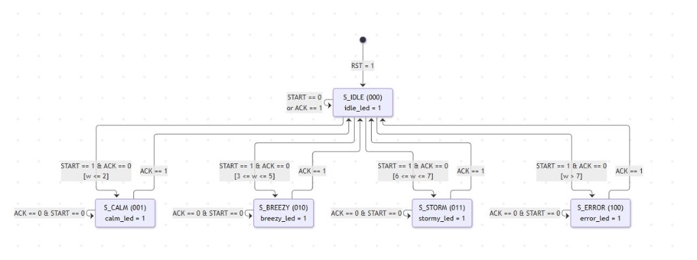
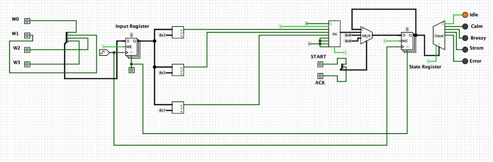
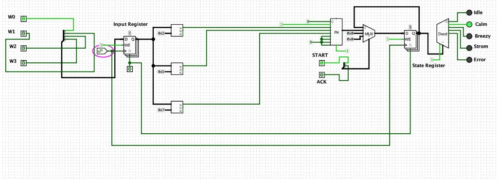
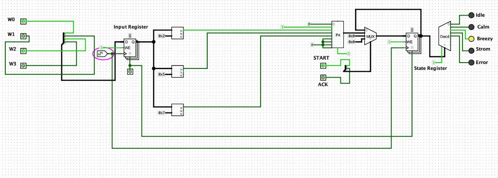
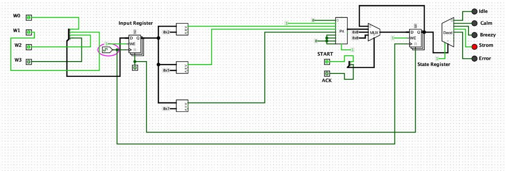
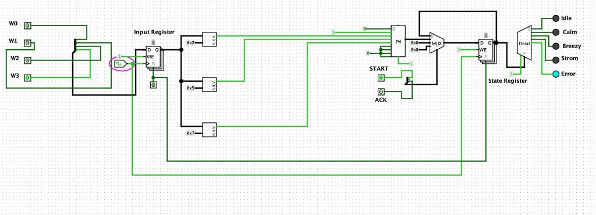

# 02 – FSM and Logisim

## 1. Moore FSM Architecture
The Weather Alert System (Problem 7H3) is controlled by a 5-state synchronous Moore Finite State Machine. Outputs depend strictly on the registered current state, ensuring glitch-free LED indicator outputs.

### State Diagram

## 2. State Encoding and Moore Output Table

| State Name | Encoding (`Q2 Q1 Q0`) | `idle_led` | `calm_led` | `breezy_led` | `stormy_led` | `error_led` | Description |
| :--- | :---: | :---: | :---: | :---: | :---: | :---: | :--- |
| **`S_IDLE`** | `000` | `1` | `0` | `0` | `0` | `0` | Standby state; all weather alert LEDs OFF |
| **`S_CALM`** | `001` | `0` | `1` | `0` | `0` | `0` | Valid wind range `0 <= w <= 2` (`0000–0010`) |
| **`S_BREEZY`** | `010` | `0` | `0` | `1` | `0` | `0` | Valid wind range `3 <= w <= 5` (`0011–0101`) |
| **`S_STORM`** | `011` | `0` | `0` | `0` | `1` | `0` | Valid wind range `6 <= w <= 7` (`0110–0111`) |
| **`S_ERROR`** | `100` | `0` | `0` | `0` | `0` | `1` | Invalid wind range `w > 7` (`1000–1111`, Hint H3) |

## 3. State Transition Table

| Current State | `RST` (`rst`) | `ACK` | `START` | Wind Range (`w`) | Next State | Transition Condition / Behavior |
| :--- | :---: | :---: | :---: | :---: | :---: | :--- |
| Any (`000`–`100`) | `1` | `X` | `X` | Any | **`S_IDLE` (`000`)** | Asynchronous reset overrides all inputs and clears system to `S_IDLE` |
| **`S_IDLE` (`000`)** | `0` | `0` | `0` | Any | **`S_IDLE` (`000`)** | Remain in standby (`START == 0`) |
| **`S_IDLE` (`000`)** | `0` | `1` | `X` | Any | **`S_IDLE` (`000`)** | Remain in standby (`ACK == 1` takes priority) |
| **`S_IDLE` (`000`)** | `0` | `0` | `1` | `w <= 2` | **`S_CALM` (`001`)** | `START == 1 & ACK == 0 [w <= 2]` |
| **`S_IDLE` (`000`)** | `0` | `0` | `1` | `3 <= w <= 5` | **`S_BREEZY` (`010`)** | `START == 1 & ACK == 0 [3 <= w <= 5]` |
| **`S_IDLE` (`000`)** | `0` | `0` | `1` | `6 <= w <= 7` | **`S_STORM` (`011`)** | `START == 1 & ACK == 0 [6 <= w <= 7]` |
| **`S_IDLE` (`000`)** | `0` | `0` | `1` | `w > 7` | **`S_ERROR` (`100`)** | `START == 1 & ACK == 0 [w > 7]` |
| **`S_CALM` / `S_BREEZY` / `S_STORM` / `S_ERROR`** | `0` | `0` | `0` | Any | **Hold Current State** | `ACK == 0 & START == 0` retains latched alert |
| **`S_CALM` / `S_BREEZY` / `S_STORM` / `S_ERROR`** | `0` | `1` | `X` | Any | **`S_IDLE` (`000`)** | `ACK == 1` acknowledges alert/error and returns to `S_IDLE` |

## 4. Reset Behaviour
Asserting active-high `rst = 1` (`RST = 1`) **asynchronously** clears both the 4-bit Input Register (`0000`) and the 3-bit State Register (`000`), forcing the FSM immediately into **`S_IDLE`** from any state (including `S_ERROR`) with all weather alert LEDs turned OFF. In Logisim, `RST` drives the asynchronous register clear (`R`) pins directly; in Verilog, `rst` is implemented as an **asynchronous active-high reset (`always @(posedge clk or posedge rst)`)** to match the hardware schematic cleanly.

## 5. Logisim Circuit Implementation
- **Circuit File:** [DSD_FINAL_PRACTICAL (2).circ](file:///c:/Users/Admin/Downloads/DSD-2026-D9A-B-Group31-main/Group_Submissions/D9A_B_Group31/02_FSM_Logisim/DSD_FINAL_PRACTICAL%20(2).circ)
- **Logisim-evolution Version:** 5.0.0
- **Datapath Components:** 4-bit input register, 3 unsigned threshold comparators (`> 2`, `> 5`, `> 7`), 8-to-3 priority encoder, 4-to-1 3-bit control MUX, 3-bit state register, and 3-to-8 decoder.

## 6. Simulation Verification Evidence

| Case | Wind Switches (`W3 W2 W1 W0`) | `Input Register` (Hex) | `START` / `ACK` | `State Register` (Hex) | Expected Output | Observed Output | Status |
| :--- | :---: | :---: | :---: | :---: | :--- | :--- | :---: |
| **Idle (Reset)** | `0 0 0 0` (`0`) | `0` | `0 / 0` | `0` (`000`) | `Idle` LED ON (others OFF) | `Idle` LED ON (Orange) | Pass |
| **Calm (`0–2`)** | `0 0 0 1` (`1`) | `1` | `1 / 0` | `1` (`001`) | `Calm` LED ON | `Calm` LED ON (Green) | Pass |
| **Breezy (`3–5`)** | `0 1 0 1` (`5`) | `5` | `1 / 0` | `2` (`010`) | `Breezy` LED ON | `Breezy` LED ON (Yellow) | Pass |
| **Storm (`6–7`)** | `0 1 1 1` (`7`) | `7` | `1 / 0` | `3` (`011`) | `Storm` LED ON | `Storm` LED ON (Red) | Pass |
| **Error (`> 7`, H3)** | `1 0 0 0` (`8`) | `8` | `1 / 0` | `4` (`100`) | `Error` LED ON | `Error` LED ON (Cyan) | Pass |
| **Acknowledge (`ACK`)** | Any | Any | `0 / 1` | `0` (`000`) | Return to `Idle` | `Idle` LED ON; alerts OFF | Pass |

### Simulation Screenshots
- **1. Idle State (`w=0`, Reset):**  
  

- **2. Calm State (`w=1` <= 2):**  
  

- **3. Breezy State (`w=5`, 3 <= w <= 5):**  
  

- **4. Storm State (`w=7`, 6 <= w <= 7):**  
  

- **5. Error State (`w=8` > 7, Hint H3):**  
  
