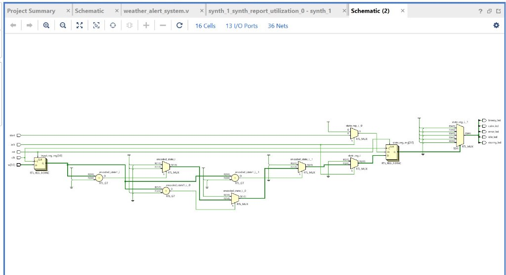
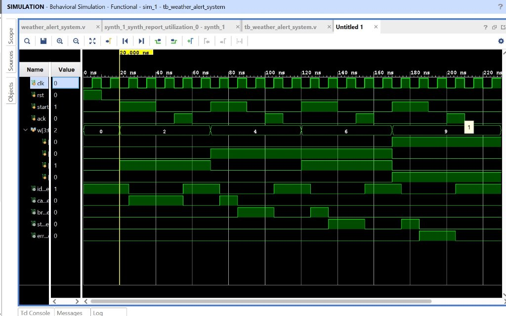

# 03 – Verilog Implementation

## 1. Module Overview
The Weather Alert System is implemented in synthesizable Verilog HDL targeting Xilinx Vivado (verified on Vivado 2018.3). The design mirrors the 5-state Moore FSM and datapath developed in Logisim-evolution.

- **Top RTL Module:** [`RTL/weather_alert_system.v`](file:///c:/Users/Admin/Downloads/DSD-2026-D9A-B-Group31-main/Group_Submissions/D9A_B_Group31/03_Verilog_Implementation/RTL/weather_alert_system.v)
- **Testbench Module:** [`Testbench/tb_weather_alert_system.v`](file:///c:/Users/Admin/Downloads/DSD-2026-D9A-B-Group31-main/Group_Submissions/D9A_B_Group31/03_Verilog_Implementation/Testbench/tb_weather_alert_system.v)

## 2. RTL Architecture and Design Blocks
The module `weather_alert_system` consists of four coordinated blocks:
1. **4-Bit Input Register (`input_reg`):** Synchronously captures 4-bit unsigned wind input `w[3:0]` on `posedge clk`, cleared asynchronously on `rst`.
2. **Threshold Comparators & Priority Encoder:** Combinational `always @(*)` block evaluating `input_reg` against thresholds `> 7`, `> 5`, and `> 2` to generate `encoded_state` (`3'd4` Error, `3'd3` Stormy, `3'd2` Breezy, `3'd1` Calm).
3. **4-to-1 MUX & State Register (`state_reg`):** Controlled sequentially by `{rst, ack, start}` with strict priority: `rst` $\rightarrow$ `ack` $\rightarrow$ `start` $\rightarrow$ hold current state.
4. **Output LED Decoder:** Continuous assignments driving mutually exclusive status outputs (`idle_led`, `calm_led`, `breezy_led`, `stormy_led`, `error_led`) based on `state_reg`.

## 3. Elaborated RTL Schematic
The RTL schematic generated by Xilinx Vivado demonstrates clean hardware mapping with 16 cells, 13 I/O ports, and 36 nets:

## 4. Synthesis Utilization Summary
- **Target Tool:** Xilinx Vivado 2018.3
- **LUT Utilization:** 6 Slice LUTs (0.02%)
- **Register / Flip-Flop Utilization:** 7 Slice Registers (4 for `input_reg[3:0]` + 3 for `state_reg[2:0]`, 0.01%)
- **Inferred Latches:** 0 (cleanly combinational and sequential separation)
- **I/O Ports:** 13

## 5. Verification and Simulation Results
The behavioral testbench [`tb_weather_alert_system.v`](file:///c:/Users/Admin/Downloads/DSD-2026-D9A-B-Group31-main/Group_Submissions/D9A_B_Group31/03_Verilog_Implementation/Testbench/tb_weather_alert_system.v) was simulated in Vivado (`sim_1`).

### Test Vector Results Table
| Test ID | Inputs/conditions (`rst`, `start`, `ack`, `w`) | Expected output | Observed output | Pass/Fail |
|---|---|---|---|---|
| T01 | `rst = 1` | `idle_led = 1`, all alerts OFF | `idle_led = 1`, all alerts OFF | Pass |
| T02 | `w = 2` (`0010`), `start = 1, ack = 0` | `calm_led = 1` (State `001`) | `calm_led = 1` | Pass |
| T03 | `ack = 1` (clear alert) | Return to `idle_led = 1` | `idle_led = 1` | Pass |
| T04 | `w = 4` (`0100`), `start = 1, ack = 0` | `breezy_led = 1` (State `010`) | `breezy_led = 1` | Pass |
| T05 | `ack = 1` (clear alert) | Return to `idle_led = 1` | `idle_led = 1` | Pass |
| T06 | `w = 6` (`0110`), `start = 1, ack = 0` | `stormy_led = 1` (State `011`) | `stormy_led = 1` | Pass |
| T07 | `ack = 1` (clear alert) | Return to `idle_led = 1` | `idle_led = 1` | Pass |
| T08 | `w = 9` (`1001`), `start = 1, ack = 0` | `error_led = 1` (State `100`, Hint H3) | `error_led = 1` | Pass |
| T09 | `ack = 1` (clear alert) | Return to `idle_led = 1` | `idle_led = 1` | Pass |

### Simulation Waveform

