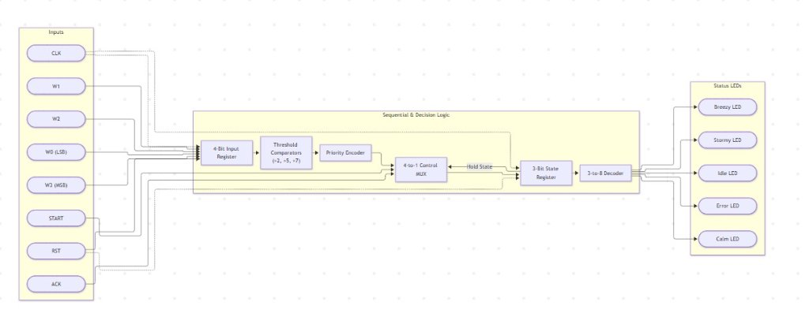
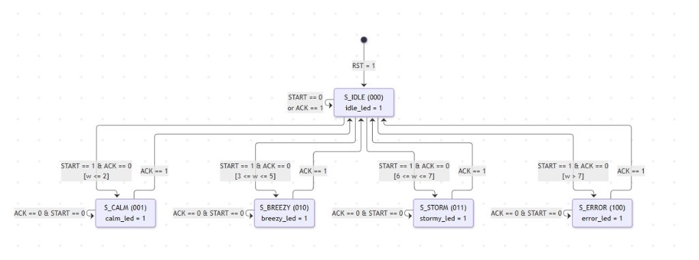

# Digital System Design – Group Project

> Complete every mandatory section. Do not delete headings. Replace bracketed prompts. If a section is not applicable, explain why.

## 1. Team Details
| Role | Student name | Roll number | GitHub username |
|---|---|---|---|
| Group leader | Aditya Parab | 37 | adityaparabvesid25 |
| Member 2 | Harika Darbha | 8 | 2025darbhaharika |
| Member 3 | Shravan Kotian | 26 | ShravanK27 |
| Member 4 | Siddharth Gupta | 14 | SIDV5-95G |

**Class:** D9A/D9B  
**Group ID:** D9A_B_Group31  
**Repository URL:** https://github.com/adityaparabvesid25/DSD-2026-D9A-B-Group31  
**Final Pull Request URL:** [URL]

## 2. Assigned Problem Statement
- **Number/title:** 7H3 — Weather Alert System with Invalid Input `ERROR` State (Hint H3)
- **Problem summary:** Design, simulate, and verify a synchronous digital Weather Alert System built around a datapath and a Moore Finite State Machine (FSM) controller. The system samples wind speed readings, classifies them into three valid alert levels—`CALM` (`0–2`), `BREEZY` (`3–5`), and `STORM` (`6–7`)—and implements modification **H3**, which introduces an `ERROR` state to detect out-of-range inputs (`> 7`), assert an error indicator LED, and return safely to `S_IDLE` upon `ACK` or `RST`.
- **Objective:**
  - Design and simulate the complete datapath (input register and range decoder) and 5-state Moore FSM in Logisim-evolution.
  - Develop the updated 5-state Moore FSM diagram, state encoding table, transition table, and output table covering `S_IDLE`, `S_CALM`, `S_BREEZY`, `S_STORM`, and `S_ERROR`.
  - Implement a synthesizable Verilog RTL module and a self-checking Verilog testbench in Vivado to verify all valid (`0–7`) and invalid (`8–15`) input combinations, `START`/`ACK`/`RST` control transitions, and indicator outputs.
- **Inputs and outputs:**

| Signal Name | Direction | Width | Meaning / Function |
| :--- | :---: | :---: | :--- |
| `w` (`wind_in`, `W3–W0`) | Input | 4-bit | Unsigned wind speed input (`0–2`: Calm, `3–5`: Breezy, `6–7`: Storm, `8–15`: Error) |
| `clk` (`CLK`) | Input | 1-bit | System clock synchronizing the input register and FSM state register |
| `rst` (`reset`, `RST`) | Input | 1-bit | Asynchronous active-high reset (`always @(posedge clk or posedge rst)` in Verilog; `R` clear pin in Logisim) that clears registers and returns the FSM to `S_IDLE` |
| `start` (`START`) | Input | 1-bit | Samples/loads the wind input and transitions the FSM from `S_IDLE` to the classified alert state |
| `ack` (`ACK`) | Input | 1-bit | Acknowledges the active weather alert or error condition and returns the FSM to `S_IDLE` |
| `calm_led` | Output | 1-bit | Green indicator LED asserted in `S_CALM` (`0–2`) |
| `breezy_led` | Output | 1-bit | Yellow indicator LED asserted in `S_BREEZY` (`3–5`) |
| `stormy_led` (`storm_led`) | Output | 1-bit | Red indicator LED / Buzzer asserted in `S_STORM` (`6–7`) |
| `error_led` | Output | 1-bit | Error indicator LED asserted in `S_ERROR` (`> 7`, Hint H3) |
| `idle_led` | Output | 1-bit | Status monitor LED indicating `S_IDLE` while all weather alert LEDs remain OFF |

- **Constraints and assumptions:**
  - **4-Bit Input Expansion (Required for Hint H3):** The base specification uses a 3-bit wind input (`0–7`), which saturates at `111` (`7`) and mathematically cannot represent values `> 7`. Expanding the wind input bus (`w`), input register, and comparators to **4 bits** (`0000–1111`, decimal `0–15`) enables explicit detection of invalid inputs (`8–15`).
  - **3-Bit State Register Expansion:** Adding the fifth state (`S_ERROR`) exceeds the 4-state capacity of a 2-bit register (`00–11`). The FSM state register is therefore expanded to **3 bits** (`000` through `100`).
  - **Unsigned Comparison:** All 4-bit comparators are configured in **unsigned** mode so that binary `1000–1111` are interpreted as `8–15` (`> 7`) rather than negative 2's complement numbers (`-8` to `-1`).
  - **Asynchronous Active-High Reset:** Both the Logisim schematic (register `R` clear pins) and the Vivado Verilog RTL (`always @(posedge clk or posedge rst)`) use an asynchronous active-high reset (`rst`) so the system can immediately clear into `S_IDLE` from any state without waiting for a clock edge.
  - **Moore FSM Output Discipline:** Indicator LEDs depend strictly on the registered current state, preventing combinational glitches on external switches from causing false alerts.
  - **Safe Control Priority:** When both `START` and `ACK` are asserted simultaneously (`ACK = 1, START = 1`), `ACK` takes priority and transitions the system safely back to `S_IDLE`.

## 3. Problem Analysis and Proposed Solution

### Functional Requirements
The system must initialize into a standby `S_IDLE` state with all weather alert indicators OFF, latch and classify wind readings (`w`) upon `START`, hold the active alert state (`S_CALM`, `S_BREEZY`, `S_STORM`, or `S_ERROR`) regardless of subsequent input changes, and return to `S_IDLE` only when `ACK` or `RST` is asserted. Under modification **H3**, any reading greater than `7` (`8–15`) must assert `error_led` and remain latched until acknowledged or reset.

### Edge Cases Analyzed
- **Range Threshold Boundaries (`2/3`, `5/6`, `7/8`):** Implementing separate lower- and upper-bound comparators (`>=` and `<=`) without equality (`=`) paths causes boundary inputs such as `3`, `5`, `6`, or `7` to fail classification. Every integer from `0` through `15` must map cleanly to exactly one state.
- **Distinguishing Wind Speed `0` (`0000`) from `S_IDLE`:** A wind reading of `0` belongs to the valid `S_CALM` (`0–2`) range, whereas `S_IDLE` is a waiting state. Assigning distinct encodings (`S_IDLE = 000`, `S_CALM = 001`) ensures that asserting `START` with `w = 0000` properly activates `calm_led`.
- **Signed vs. Unsigned Comparator Trap:** Defaulting 4-bit comparators to 2's complement causes values `8–15` (`1000–1111`) to evaluate as negative integers, silently breaking `> 7` error detection. Enforcing unsigned comparison resolves this fault.
- **Mid-Alert Input Fluctuations:** Changing `w` (`W3–W0`) while an alert is active (`START = 0, ACK = 0`) must not overwrite the latched alert state.
- **Simultaneous `START` and `ACK` Assertion:** Routing both `10` (`ACK = 1, START = 0`) and `11` (`ACK = 1, START = 1`) MUX selections to `000` guarantees deterministic recovery to `S_IDLE`.
- **Unused State Encodings (`101`, `110`, `111`):** In RTL, a `default` branch returning to `S_IDLE` ensures automatic recovery if a transient fault ever places the 3-bit state register into an unused state.

### Proposed Solution and Distinctive Features
- **3-Comparator + Priority Encoder Architecture:** Instead of using six comparators with multiple `AND`/`OR` gates to check both upper and lower limits of every range, the datapath uses **three 4-bit unsigned comparators** testing only strict upper thresholds (`> 2`, `> 5`, `> 7`) wired directly into an **8-to-3 Priority Encoder (`Pri`)**. Pin `1` (`001`, `S_CALM`) is tied permanently HIGH as the baseline fallback for `0–2`, while the `>` outputs of `0x2`, `0x5`, and `0x7` feed Pins `2` (`S_BREEZY`), `3` (`S_STORM`), and `4` (`S_ERROR`). Because higher-index pins automatically override lower ones, the encoder directly outputs the exact 3-bit state code (`001`–`100`) with zero discrete logic gates and zero boundary-equality bugs.
- **Unified Control & Verification:** A 4-to-1, 3-bit Control MUX driven by `{ACK, START}` handles state holding, new-state loading, and `ACK` clearing into a single 3-bit State Register, mirrored directly in synthesizable Verilog RTL with a self-checking 16-case Vivado testbench.

### Feasibility
The entire design requires minimal hardware resources—one 4-bit register, one 3-bit register, three 4-bit unsigned comparators, one 8-to-3 priority encoder, one 4-to-1 3-bit MUX, and one 3-to-8 decoder. It operates on a single clock domain with asynchronous reset parity and glitch-free Moore outputs, making it straightforward to simulate in Logisim-evolution, verify in Vivado, and synthesize onto standard FPGA hardware.

## 4. Architecture

### Module Breakdown
1. **Input Interface & 4-Bit Input Register:** Combines the four wind input switches (`W0` LSB through `W3` MSB forming `w[3:0]`) into a 4-bit unsigned bus and latches the reading on the rising edge of `CLK` (asynchronously cleared to `0000` on `RST = 1`).
2. **Threshold Comparators (`> 2`, `> 5`, `> 7`) & Priority Encoder (`Pri`):** Three 4-bit unsigned comparators evaluate the registered wind value against constants `0x2`, `0x5`, and `0x7`. Their strict greater-than (`>`) outputs drive Pins `2`, `3`, and `4` of the Priority Encoder (with Pin `1` tied to `1` and Pins `0, 5, 6, 7` tied to `0`), producing the 3-bit next-state category code:
   - `0–2` $\rightarrow$ `001` (`S_CALM`)
   - `3–5` $\rightarrow$ `010` (`S_BREEZY`)
   - `6–7` $\rightarrow$ `011` (`S_STORM`)
   - `8–15` $\rightarrow$ `100` (`S_ERROR`)
3. **4-to-1 Control MUX & 3-Bit State Register:** The 3-bit Control MUX selects the next state using `{ACK, START}`:
   - `00` (`ACK = 0, START = 0`): Feedback loop from State Register `Q` (**Hold State**).
   - `01` (`ACK = 0, START = 1`): Decoded 3-bit category from the Priority Encoder (**Load Alert**).
   - `10` (`ACK = 1, START = 0`) & `11` (`ACK = 1, START = 1`): Constant `000` (**Return to `S_IDLE`**).  
   The 3-bit State Register updates on the rising edge of `CLK` and clears asynchronously to `000` (`S_IDLE`) when `RST = 1`.
4. **3-to-8 Output Decoder & Status LEDs:** Decodes the 3-bit state register directly into mutually exclusive indicator outputs (`Idle LED`, `Calm LED`, `Breezy LED`, `Stormy LED`, and `Error LED`).

### Data Flow and Control Flow
- **Data Flow:** Wind inputs `w` (`W3–W0`) enter the 4-bit Input Register, pass through the unsigned threshold comparators and Priority Encoder to generate a 3-bit category code, route through the 4-to-1 Control MUX into the 3-bit State Register, and feed the 3-to-8 Decoder to drive the status LEDs.
- **Control Flow:** `CLK` drives state updates across both registers. Active-high `RST` (`rst`) asynchronously clears both registers to `S_IDLE (000)`. From `S_IDLE`, asserting `START = 1` (with `ACK = 0`) selects MUX channel `01` to latch the classified state. While `START = 0` and `ACK = 0`, MUX channel `00` holds the active state indefinitely. Asserting `ACK = 1` selects channel `10` (or `11`), returning the State Register to `S_IDLE (000)` on the next clock edge.

### Design Trade-Offs

| Design Decision | Chosen Approach | Alternative Considered | Rationale & Trade-Off |
| :--- | :--- | :--- | :--- |
| **Wind Input Width** | 4-bit (`w[3:0]`, `0–15`) | 3-bit (`0–7`) | Requires 1 extra input bit and flip-flop, but is mathematically necessary to represent out-of-range values (`> 7`) for Hint H3. |
| **Range Decoder Logic** | 3 Unsigned Comparators (`> 2, > 5, > 7`) + Priority Encoder | 6 Comparators + `AND`/`OR` gates | Cuts comparator count in half, removes discrete logic gates, reduces propagation delay, and eliminates `>=`/`<=` boundary-wiring faults. |
| **FSM Type** | Moore FSM | Mealy FSM | Introduces one clock cycle of output latency compared to Mealy, but guarantees stable, glitch-free LED outputs isolated from input noise. |
| **Reset Strategy** | Asynchronous Active-High (`rst`) | Synchronous Reset | Matches Logisim's asynchronous register clear (`R`) pin and ensures immediate recovery to `S_IDLE` even if the clock is halted. |
| **State Encoding** | 3-bit Sequential Binary (`000`–`100`) | 5-bit One-Hot (`00001`–`10000`) | Uses 3 flip-flops instead of 5 and keeps Logisim and Verilog state registers compact and identical, at the minor cost of a 3-to-8 output decoder. |
| **Input Register Pipeline** | Registered Input (`Input Reg` $\rightarrow$ `State Reg`) | Unregistered combinational input | Isolates switch skew/bounce from comparators; in Logisim this adds a 1-clock stage between latching `w` (`W3–W0`) and asserting `START`. |

## 5. FSM Design

Yes, the system uses a **5-state Moore Finite State Machine (FSM)**. A Moore architecture was chosen because outputs depend strictly on the registered current state, ensuring glitch-free alert indicators even when external wind inputs (`w`) change asynchronously.

**Diagram:**

  
**State table:** See the State Encoding, Moore Output, and State Transition tables below.

### State Encoding and Moore Output Table

| State Name | Encoding (`Q2 Q1 Q0`) | `idle_led` | `calm_led` | `breezy_led` | `stormy_led` | `error_led` | Description |
| :--- | :---: | :---: | :---: | :---: | :---: | :---: | :--- |
| **`S_IDLE`** | `000` | `1` | `0` | `0` | `0` | `0` | Standby state; all weather alert LEDs OFF |
| **`S_CALM`** | `001` | `0` | `1` | `0` | `0` | `0` | Valid wind range `0 <= w <= 2` (`0000–0010`) |
| **`S_BREEZY`** | `010` | `0` | `0` | `1` | `0` | `0` | Valid wind range `3 <= w <= 5` (`0011–0101`) |
| **`S_STORM`** | `011` | `0` | `0` | `0` | `1` | `0` | Valid wind range `6 <= w <= 7` (`0110–0111`) |
| **`S_ERROR`** | `100` | `0` | `0` | `0` | `0` | `1` | Invalid wind range `w > 7` (`1000–1111`, Hint H3) |

### State Transition Table

| Current State | `RST` (`rst`) | `ACK` | `START` | Wind Range (`w`) | Next State | Transition Condition / Behavior |
| :--- | :---: | :---: | :---: | :---: | :---: | :--- |
| Any (`000`–`100`) | `1` | `X` | `X` | Any | **`S_IDLE` (`000`)** | Asynchronous reset overrides all inputs and clears system to `S_IDLE` |
| **`S_IDLE` (`000`)** | `0` | `0` | `0` | Any | **`S_IDLE` (`000`)** | Remain in standby (`START == 0`) |
| **`S_IDLE` (`000`)** | `0` | `1` | `X` | Any | **`S_IDLE` (`000`)** | Remain in standby (`ACK == 1` takes priority) |
| **`S_IDLE` (`000`)** | `0` | `0` | `1` | `w <= 2` | **`S_CALM` (`001`)** | `START == 1 & ACK == 0 [w <= 2]` |
| **`S_IDLE` (`000`)** | `0` | `0` | `1` | `3 <= w <= 5` | **`S_BREEZY` (`010`)** | `START == 1 & ACK == 0 [3 <= w <= 5]` |
| **`S_IDLE` (`000`)** | `0` | `0` | `1` | `6 <= w <= 7` | **`S_STORM` (`011`)** | `START == 1 & ACK == 0 [6 <= w <= 7]` |
| **`S_IDLE` (`000`)** | `0` | `0` | `1` | `w > 7` | **`S_ERROR` (`100`)** | `START == 1 & ACK == 0 [w > 7]` |
| **`S_CALM` / `S_BREEZY` / `S_STORM` / `S_ERROR`** | `0` | `0` | `0` | Any | **Hold Current State** | `ACK == 0 & START == 0` retains latched alert |
| **`S_CALM` / `S_BREEZY` / `S_STORM` / `S_ERROR`** | `0` | `1` | `X` | Any | **`S_IDLE` (`000`)** | `ACK == 1` acknowledges alert/error and returns to `S_IDLE` |

### Reset Behaviour
Asserting active-high `rst = 1` (`RST = 1`) **asynchronously** clears both the 4-bit Input Register (`0000`) and the 3-bit State Register (`000`), forcing the FSM immediately into **`S_IDLE`** from any state (including `S_ERROR`) with all weather alert LEDs turned OFF. In Logisim, `RST` drives the asynchronous register clear (`R`) pins directly; in Verilog, `rst` is implemented as an **asynchronous active-high reset (`always @(posedge clk or posedge rst)`)** to match the hardware schematic cleanly.

## 6. Logisim Implementation
- Logisim version: Logisim-evolution v5.0.0
- Circuit file: `02_FSM_Logisim/DSD_FINAL_PRACTICAL (2).circ`
- Test cases and expected/observed behaviour: Verified across all four ranges: `S_CALM` (0–2), `S_BREEZY` (3–5), `S_STORM` (6–7), and `S_ERROR` (8–15). Latching occurs cleanly on `START = 1` and returns to `S_IDLE` on `ACK = 1` or `RST = 1`.
- Issues and corrections: Configured 4-bit comparators to unsigned mode to ensure inputs 8–15 (`1000`–`1111`) are treated as `> 7` rather than negative two's complement numbers.
- Screenshot/evidence: `02_FSM_Logisim/`

## 7. Verilog HDL Implementation
- Tool/version: [Details]
- Top module and submodules: [Names]
- Architecture/coding decisions: [Details]
- Synthesizability considerations: [Details]
- RTL: `03_Verilog_Implementation/RTL/`
- Testbench: `03_Verilog_Implementation/Testbench/`

## 8. Verification and Simulation Results
| Test ID | Inputs/conditions | Expected output | Observed output | Pass/Fail |
|---|---|---|---|---|
| T01 | [ ] | [ ] | [ ] | [ ] |
| T02 | [ ] | [ ] | [ ] | [ ] |
| T03 | [ ] | [ ] | [ ] | [ ] |

Tool/version: [Details]  
Number passed/failed: [Details]  
Waveform/log path: [Path]

## 9. FPGA Hardware Implementation
- FPGA board/device: [Details]
- Tool/version: [Details]
- Clock/constraints: [Details]
- Synthesis/implementation summary: [Details]
- Programming and hardware test result: [Details]
- Evidence path: `04_FPGA_Hardware/`

Explain differences between simulation and hardware results, if any.

## 10. Challenges, Debugging and Improvements
| Issue | Root cause | Correction | Outcome |
|---|---|---|---|
| [ ] | [ ] | [ ] | [ ] |

Future improvements: [Details]

## 11. Task Allocation and Individual Contribution
| Student | Assigned responsibility | Actual contribution/evidence |
|---|---|---|
| Group leader | [ ] | [ ] |
| Member 2 | [ ] | [ ] |
| Member 3 | [ ] | [ ] |
| Member 4 | [ ] | [ ] |

Every student must be ready to explain the complete design.

## 12. Progress Log
Maintain time-wise updates in `STATUS.md`.

## 13. Final Results and Conclusion
Summarise requirements met, correctness of simulation/hardware results, measured results, limitations and conclusion.

[Write here]

## 14. Team Reflection
What did the team learn? What would you improve?

[Write here]

## 15. Final Submission Checklist
- [ ] Team details and problem analysis complete.
- [ ] Architecture/block diagram included.
- [ ] FSM diagram/table or justified alternative included.
- [ ] Logisim source and simulation evidence uploaded.
- [ ] Verilog RTL and testbench uploaded.
- [ ] Simulation results and test cases documented.
- [ ] FPGA implementation and hardware evidence uploaded.
- [ ] Results, challenges and conclusion documented.
- [ ] Presentation and final report uploaded.
- [ ] STATUS.md is up to date.
- [ ] Final Pull Request created and URL recorded.