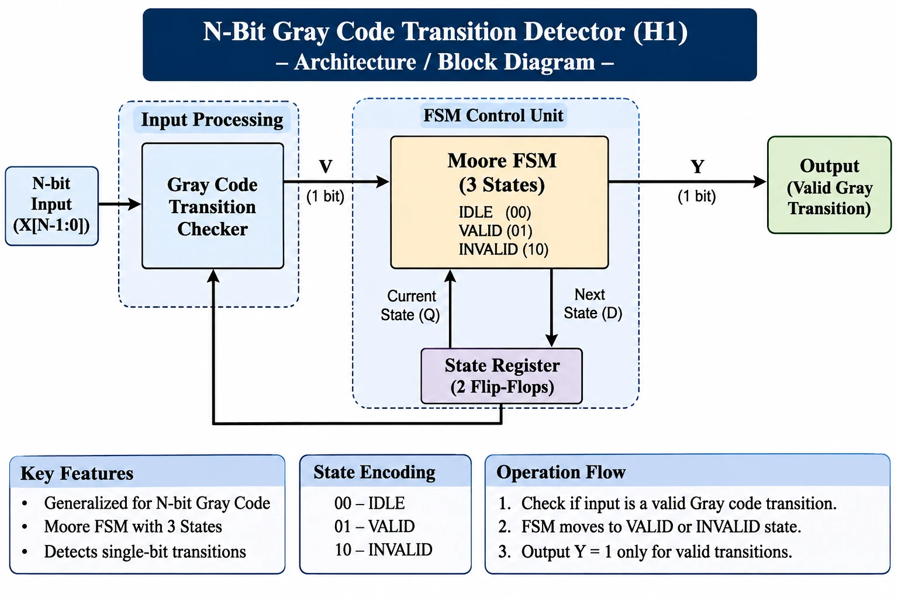

# 01 – Problem Analysis

## 1. Main problem statement (left-hand side of the problem sheet)

**GRAY CODE TRANSITION DETECTOR (4-BIT)**  
*Design a circuit that outputs 1 only when two consecutive 4-bit inputs differ by exactly one bit (valid Gray code transition).*

The sheet has three parts: (1) Logisim design, (2) FSM state diagram (Moore model), (3) complete system block diagram and Verilog-only verification.

### 1.1 Logisim design (Q1)
**Task:** Design and simulate the complete FSM and datapath in Logisim for a Gray code transition detector. Implement the 4-bit input register, one-bit change detector, state register, next-state logic and output logic. Show the circuit diagram and verify it with a suitable input sequence.

**Blocks of the Logisim circuit**

| Block | Description |
|---|---|
| Input register | 4-bit input register `X[3:0]` fed from 4 input switches (`X3 X2 X1 X0`) |
| Previous-input register | 4-bit register `P[3:0]` holding the previous input |
| Transition detector (combinational) | One-bit change detector: `D = X ⊗ P` (bitwise XOR) and `V` |
| Moore FSM controller | State register + next-state logic + output logic; driven by `START` and `ACK` |
| Indicator outputs | VALID LED (V = 1, one-bit change) and INVALID LED (V = 0, zero or more than one bit change) |

**Valid-transition condition (4-bit)**

```
D = X ⊗ P
V = (D3 + D2 + D1 + D0) · ~( D3D2 + D3D1 + D3D0 + D2D1 + D2D0 + D1D0 )
```
`V = 1` when at least one bit changed **and** no pair of bits changed together, i.e. exactly one bit of `D` is 1.

**Example sequence given on the sheet**

| Prev P[3:0] | Curr X[3:0] | D = X ⊗ P | V |
|---|---|---|:-:|
| 0000 | 0001 | 0001 | 1 |
| 0001 | 0011 | 0010 | 1 |
| 0011 | 0111 | 0100 | 1 |
| 0111 | 0101 | 0010 | 1 |
| 0101 | 1101 | 1000 | 1 |
| 1101 | 1100 | 0001 | 1 |
| 1100 | 1111 | 0011 | 0 |
| 1111 | 0000 | 1111 | 0 |

### 1.2 FSM state diagram – Moore model (Q2)
**Task:** Draw the Moore FSM state diagram for the Gray code transition detector and specify the state encoding and state outputs.

| State | Encoding | Moore output | Indicator |
|---|---|---|---|
| `IDLE` | `00` | V = 0 (all off) | Both LEDs off |
| `VALID` | `01` | V = 1 (one-bit change) | Green (VALID) LED on |
| `INVALID` | `10` | V = 0 (zero or more than one bit change) | Red (INVALID) LED on |

- `RESET` takes the FSM to `IDLE`.
- On each loaded sample the next state is `VALID` when `V = 1` and `INVALID` when `V = 0`.
- Outputs depend only on the present state (Moore).

### 1.3 Complete system block diagram and Verilog-only verification (Q3)
**System block diagram (from the sheet)**

| Part | Contents |
|---|---|
| User input (switches and control) | `X[3:0]` (data), `START` (load sample input), `ACK` (return to IDLE), `RESET` (synchronous, active-high) |
| Datapath (Gray transition detector) | 4-bit input register `X[3:0]`; 4-bit previous register `P[3:0]`; one-bit change detector `D = X ⊗ P`, `V = (ΣDᵢ) · ~(ΣDᵢDⱼ)` |
| FSM controller (Moore) | States `IDLE (00)`, `VALID (01)`, `INVALID (10)`; output logic driving the LEDs |
| System outputs (indicators) | `VALID` LED (V = 1) and `INVALID` LED (V = 0) |

**Q3 – Verilog testbench and verification:** write a Verilog testbench (Verilog only) to verify the design. Use a suitable input sequence (for example `0000 → 0001 → 0011 → 0111 → 0101 → 1101 → 1100 → 1111`). Include self-checking expected-result comparison, the test sequence and pass/fail messages.

## 2. Required modification: H1 – N-bit Gray Code Transition Detector
Selected from the "Suggested modification hints (select any 1)" on the right-hand side of the sheet.

- Modify the design for an **N-bit input** (parameterizable, **N ≥ 4**).
- Use a general one-bit change detector:
  - `D = X ⊗ P`
  - `V = (ΣDᵢ) · ~( Σ_{i<j} Dᵢ·Dⱼ )`
- **Verify for different input widths** (for example N = 5 or 8).

The other hints (H2 Mealy FSM, H3 ERROR state, H4 valid/invalid counters, H5 previous-result CHANGE signal) were **not selected**.

## 3. Requirements derived from the sheet and H1
1. Capture the current input `X` and keep the previous input `P` in registers (width N).
2. Compute `D = X ⊗ P` for all N bits.
3. `V = 1` only when exactly one bit of `D` is 1, using the general pair-wise formula of H1.
4. Moore FSM controller with encoding `00 IDLE`, `01 VALID`, `10 INVALID`.
5. VALID LED when `V = 1`; INVALID LED when `V = 0`; both off in `IDLE`.
6. Control inputs `START` (load a sample), `ACK` (return to IDLE) and `RESET` (synchronous, active-high).
7. The same design must work for any N ≥ 4 and be verified for more than one width.
8. Verilog verification must be self-checking with pass/fail messages.

## 4. Inputs and outputs
| Signal | Direction | Width | Description |
|---|---|---:|---|
| `clk` | Input | 1 | System clock |
| `rst` | Input | 1 | Synchronous, active-high reset (state = IDLE, P = 0) |
| `start` | Input | 1 | Take a sample; accepted only in IDLE (`P <= x`, then VALID or INVALID) |
| `ack` | Input | 1 | Returns the FSM from VALID/INVALID to IDLE |
| `x` | Input | N | Input switches `X[N-1:0]` (default N = 4) |
| `valid_led` | Output | 1 | Exactly one bit differs from the previous sample (state VALID) |
| `invalid_led` | Output | 1 | Zero bits or more than one bit differ (state INVALID) |

In `IDLE` both LEDs are off.

## 5. Assumptions and edge cases
- After reset `P = 0…0`, so the first sample is compared with all zeros (this matches the first row of the sheet's example: Prev 0000, Curr 0001).
- `start` is accepted only in `IDLE`; after each sample `ack` must return the FSM to `IDLE` before the next sample.
- Same value twice (no change) gives INVALID; two or more changed bits give INVALID; a change in the MSB alone is a valid transition.
- The LEDs show the result from the clock edge that accepts `start`.

## 6. Proposed solution
- **Datapath:** previous-input register `P` (N bits), bitwise XOR `D = X ^ P`, and the general one-bit-change detector `V = (|D) & ~|(D & (D - 1))` (equivalent to the sheet's pair-wise formula, valid for any N).
- **Controller:** Moore FSM (`IDLE`, `VALID`, `INVALID`) whose outputs depend only on the state.
- **Verification plan:** Logisim run of the sheet's sequence; Verilog self-checking testbench for N = 4 (sheet sequence plus no-change and two-bit cases) and N = 5 (H1 check).

### Block diagram / architecture


Input processing (Gray code transition checker, output V) feeds the Moore FSM (IDLE 00, VALID 01, INVALID 10) with its 2-flip-flop state register; the FSM output indicates a valid Gray code transition.

Where to find the work: `02_FSM_Logisim/` (Logisim, FSM diagram and table), `03_Verilog_Implementation/` (RTL and testbench), `04_FPGA_Hardware/` (constraints). Current progress is in `STATUS.md`.
