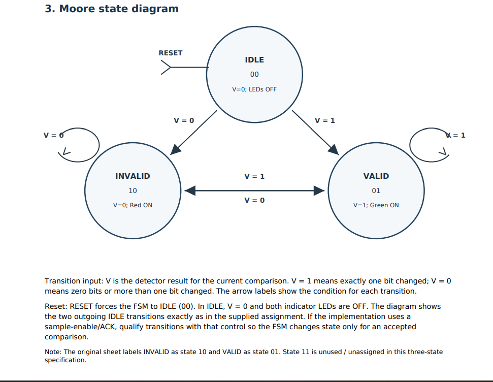
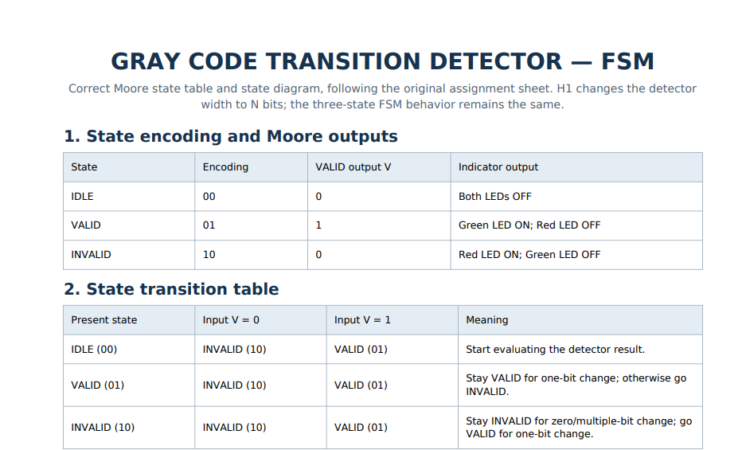
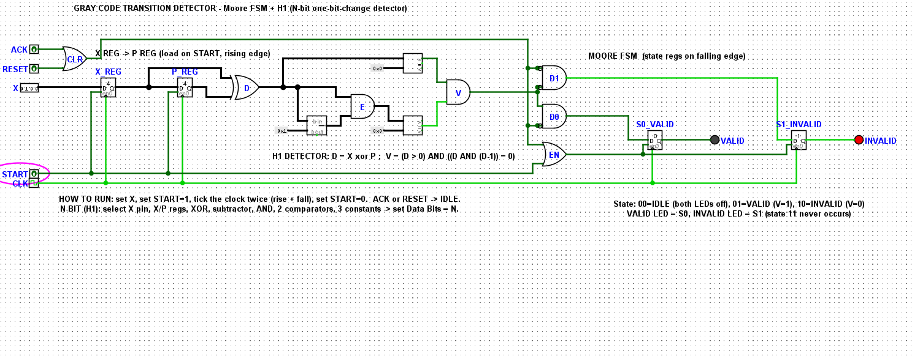
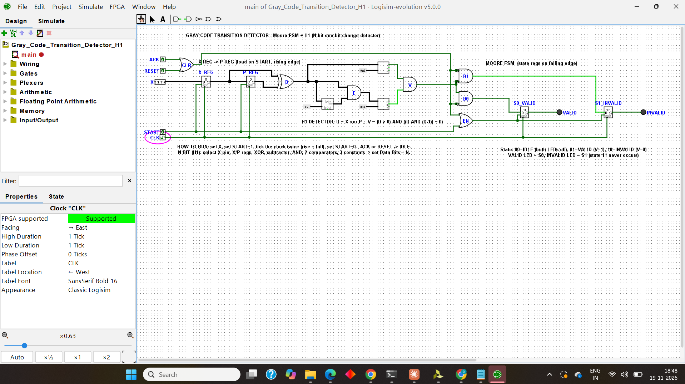

# 02 – FSM and Logisim

Contains the Moore FSM description (state encoding, state table), the Logisim `.circ` sources and the simulation evidence (screenshots).

## Files
| File | Purpose |
|---|---|
| `Gray_Code_Transition_Detector_H1.circ` | Logisim circuit: N-bit (H1) Gray code transition detector with Moore FSM (opens in Logisim-evolution) |
| `H1_NBit_Gray_Detector_N5.circ` | Earlier H1 circuit for N = 5 |
| `H1_N5_test_vector.txt` | Test vector used for the N = 5 circuit (31/31 steps passed in the headless run recorded in `../STATUS.md`) |
| `generate_circ.ps1` | Script used to generate the N = 5 circuit |
| `FSM_Moore_state_diagram.png` | Moore FSM state diagram (IDLE, VALID, INVALID) |
| `FSM_state_table.png` | State encoding / Moore outputs table and state transition table |
| `screenshots/H1_logisim_circuit.png` | Circuit diagram of `Gray_Code_Transition_Detector_H1.circ` |
| `screenshots/H1_logisim_evolution_window.png` | The same circuit open in Logisim-evolution v5.0.0 |

## Moore FSM
| State | Encoding (S1 S0) | Output | Indicator |
|---|---|---|---|
| `IDLE` | 00 | V = 0 (all off) | Both LEDs off |
| `VALID` | 01 | V = 1 (one-bit change) | VALID LED on (S0) |
| `INVALID` | 10 | V = 0 (zero or more than one bit change) | INVALID LED on (S1) |

State 11 never occurs. `ACK` or `RESET` returns the FSM to `IDLE`. Outputs depend only on the state (Moore).

### State transition table
| Present state | Input V = 0 | Input V = 1 | Meaning |
|---|---|---|---|
| `IDLE` (00) | `INVALID` (10) | `VALID` (01) | Start evaluating the detector result |
| `VALID` (01) | `INVALID` (10) | `VALID` (01) | Stay VALID for a one-bit change, otherwise go INVALID |
| `INVALID` (10) | `INVALID` (10) | `VALID` (01) | Stay INVALID for zero or multiple-bit change, go VALID for a one-bit change |

`V` is the detector result for the current comparison: `V = 1` means exactly one bit changed, `V = 0` means zero bits or more than one bit changed. Transitions are taken only when a sample is accepted (`START`), as in the Logisim and Verilog implementations. `RESET` forces `IDLE` (00).

### State diagram and table (images)

## Circuit description (`Gray_Code_Transition_Detector_H1.circ`)
| Block | Components | Function |
|---|---|---|
| Inputs | `X` (N-bit pin), `START`, `ACK`, `RESET`, `CLK` | Data, load sample, return to IDLE, reset, clock |
| Input and previous registers | `X_REG`, `P_REG` (N-bit registers) | `X_REG` loads `X` and `P_REG` loads the old `X` on `START` (rising clock edge) |
| H1 one-bit-change detector | XOR `D`, subtractor `D_MINUS_1`, AND `E`, comparators `D_NONZERO` and `E_ZERO` | `D = X xor P`; `V = (D > 0) AND ((D AND (D-1)) = 0)` – exactly one bit of `D` is set |
| Next-state logic | AND gates `D1`, `D0`, OR gate `EN`, OR gate `CLR` (`ACK` or `RESET`) | `D0` = VALID next, `D1` = INVALID next, cleared by `CLR`; `EN` enables the state registers |
| State registers | `S0_VALID`, `S1_INVALID` (1-bit, falling-edge) | Hold the Moore state |
| Outputs | `VALID` LED (green), `INVALID` LED (red) | Driven directly by the state registers |

**N-bit (H1):** to change the width, select the `X` pin, the X/P registers, the XOR, the subtractor, the AND, the two comparators and the three constants and set Data Bits = N.

## How to run
1. Set `X` to the sample value.
2. Set `START = 1`.
3. Tick the clock twice (rising edge loads X/P, falling edge updates the state).
4. Set `START = 0`.
5. `ACK` or `RESET` returns to `IDLE`.

Suggested sequence from the problem sheet: `0000 → 0001 → 0011 → 0111 → 0101 → 1101 → 1100 → 1111` (VALID for the first six samples, INVALID for the last).

## Simulation evidence
### Circuit diagram

### Circuit in Logisim-evolution v5.0.0

## Status
Circuit built and opened in Logisim-evolution. The per-step results of the sheet's input sequence on this circuit (expected vs observed) are still to be recorded here.
