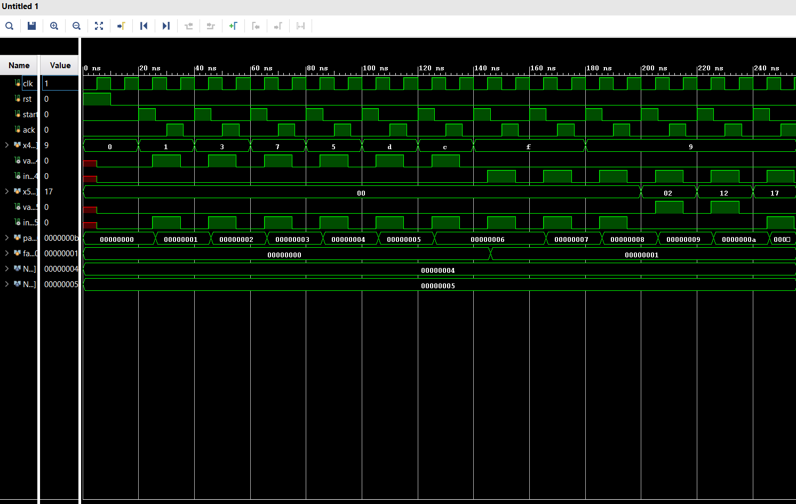

# 03 – Verilog Implementation

Place synthesizable RTL in `RTL/`, testbenches/test vectors in `Testbench/`, and waveforms/logs/verification summaries in `Simulation_Results/`.

## Files
| File | Purpose |
|---|---|
| `RTL/gray_code_nbit.v` | Design: parameter `N` (default 4), previous-input register, general one-bit-change detector and Moore FSM; also the FPGA top module |
| `Testbench/gray_code_nbit_tb.v` | Self-checking testbench with a 4-bit (N = 4) and a 5-bit (N = 5, H1 check) instance |
| `Simulation_Results/gray_code_nbit_tb_waveform.png` | Vivado waveform of the behavioural simulation of `gray_code_nbit_tb` |

## Design summary (`gray_code_nbit`)
| Port | Dir. | Width | Description |
|---|---|---:|---|
| `clk` | In | 1 | Clock |
| `rst` | In | 1 | Synchronous, active-high reset (state = IDLE, P = 0) |
| `start` | In | 1 | Take a sample (accepted in IDLE) |
| `ack` | In | 1 | Return to IDLE from VALID/INVALID |
| `x` | In | N | Input switches |
| `valid_led` | Out | 1 | Lit in state VALID |
| `invalid_led` | Out | 1 | Lit in state INVALID |

- **Previous register:** `p` (N bits) holds the previous accepted input; it is 0 after reset.
- **Difference and detector (H1):** `d = x ^ p`; `at_least_one = |d`; `at_most_one = ~|(d & (d - 1))`; `v = at_least_one & at_most_one` – exactly one bit of `d` is 1, for any N.
- **Moore FSM:** `IDLE = 00`, `VALID = 01`, `INVALID = 10`.
  - In `IDLE`, when `start = 1`: `p <= x` and the next state is `VALID` if `v = 1`, otherwise `INVALID`.
  - In `VALID` or `INVALID`, `ack = 1` returns to `IDLE`; `start` is ignored until then.
  - Outputs depend only on the state (`valid_led = (state == VALID)`, `invalid_led = (state == INVALID)`); in `IDLE` both are off.
- **Reset:** synchronous, active-high.

## Testbench (`gray_code_nbit_tb`)
- 100 MHz clock; each step sets `x`, pulses `start`, checks the LEDs one cycle later and then pulses `ack` to return to IDLE.
- **N = 4 sequence:** `0001, 0011, 0111, 0101, 1101, 1100, 1111, 1111, 1001`.
- **N = 5 sequence (H1):** `00010, 10010, 10111`.
- Prints `PASS`/`FAIL` for each step and a final `Summary: <n> PASSED, <m> FAILED`.

## How to simulate (Vivado)
1. Add `RTL/gray_code_nbit.v` as a design source and `Testbench/gray_code_nbit_tb.v` as a simulation source.
2. Set `gray_code_nbit_tb` as the simulation top and run behavioural simulation.
3. Save the Tcl console log and waveform screenshots in `Simulation_Results/`.

## Verification status
Behavioural simulation was run in Vivado 2018.3 (project `ojasgraycode`, simulation time about 256 ns). The waveform is saved as `Simulation_Results/gray_code_nbit_tb_waveform.png`.

**Result (from the waveform counters): 11 steps passed, 1 failed (12 steps in total).**

| Step | Input | DUT output in the waveform | Result |
|---|---|---|---|
| N=4, 1 – 6 | `0001, 0011, 0111, 0101, 1101, 1100` | VALID | Pass |
| N=4, 7 | `1100 -> 1111` | INVALID (two bits change, `V = 0`, as in the problem sheet) | **Fail** – the testbench expects VALID (wrong expected value in the testbench) |
| N=4, 8 | `1111 -> 1111` | INVALID | Pass |
| N=4, 9 | `1111 -> 1001` | INVALID | Pass |
| N=5, 1 – 2 | `00010, 10010` | VALID | Pass |
| N=5, 3 | `10010 -> 10111` | INVALID | Pass |

The single failure comes from the testbench line `run_step_4bit(4'b1111, 1'b1)`, which labels `1100 -> 1111` as a one-bit change; the design output matches the sheet. Correct the expected value to `1'b0` and re-run to obtain 12/12 passes, then replace the waveform and record the Tcl console log here.

Note: the same `start` pulse is applied to both instances, so the N=5 instance also receives (invalid) samples with `x5 = 0` during the N=4 steps; these are not checked by the testbench.
