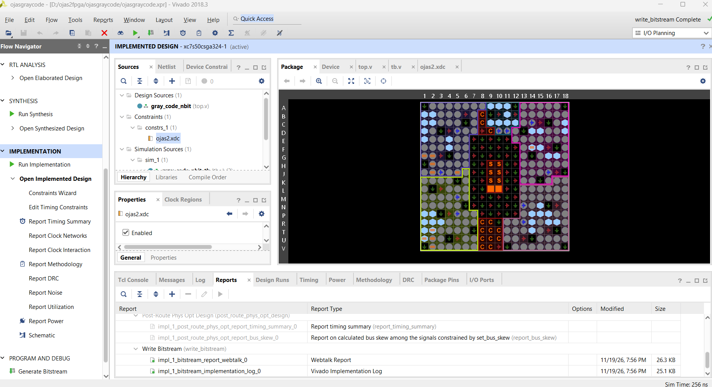

# 04 – FPGA Hardware

## Board and tools
- **Device:** Xilinx Spartan-7 `XC7S50-CSGA324-1`
- **Board:** to be confirmed – the supplied constraints use a clock on pin F14, which is not the Arty S7 clock pin (R2)
- **Tool/version:** Vivado 2018.3 (project `ojasgraycode`)
- **Top module:** `gray_code_nbit` (N = 4)

## Files
| File | Purpose |
|---|---|
| `gray_code_nbit.xdc` | Pin assignments and I/O standards for `gray_code_nbit` (N = 4) |
| `../03_Verilog_Implementation/RTL/gray_code_nbit.v` | Design / top module |
| `gray_code_nbit_synthesized_schematic.png` | Vivado schematic of the synthesized netlist |
| `vivado_implemented_design_xc7s50.png` | Vivado implemented design (device package view) for `xc7s50csga324-1` |

## Pin mapping (`gray_code_nbit.xdc`)
All ports use `LVCMOS33`.

| Port | Function | Pin |
|---|---|---|
| `clk` | Clock | F14 |
| `rst` | Reset (synchronous, active-high) | J2 |
| `start` | START – take a sample | J5 |
| `ack` | ACK – return to IDLE | H2 |
| `x[0]` | Data bit 0 | V2 |
| `x[1]` | Data bit 1 | U2 |
| `x[2]` | Data bit 2 | U1 |
| `x[3]` | Data bit 3 | T2 |
| `valid_led` | VALID LED | G1 |
| `invalid_led` | INVALID LED | G2 |

Notes: the file has no `create_clock` constraint (timing is unconstrained) and the buttons are used without debouncing.

## Hardware test procedure
1. Press `rst`. Both LEDs are off (IDLE).
2. Set `x[3:0]` and press `start`. A one-bit change from the previous sample lights `valid_led`; zero or more than one changed bit lights `invalid_led`.
3. Press `ack` to return to IDLE, then repeat.

## Implementation results (Vivado 2018.3)
Synthesis and implementation were run for `xc7s50csga324-1` and the bitstream was generated: the Vivado window shows "write_bitstream Complete" and the `Write Bitstream` reports (`impl_1_bitstream_report_webtalk_0`, `impl_1_bitstream_implementation_log_0`) dated 11/19/26 7:56 PM. The project's constraint file appears as `ojas2.xdc` (the repository copy is `gray_code_nbit.xdc`) and the design source as `gray_code_nbit`.

### Synthesized schematic

The netlist uses `IBUF`/`OBUF` buffers on `clk`, `rst`, `start`, `ack`, `x[3:0]`, `valid_led` and `invalid_led`, four `FDRE` flip-flops for `p_reg[3:0]`, and three `FDRE` flip-flops `FSM_onehot_state_reg[2:0]` – Vivado re-encoded the 2-bit state into one-hot – plus a few LUTs for the next-state and detector logic.

### Implemented design

### Still to record
- Utilisation and timing summary (the report files exist in the Vivado project; add the numbers or screenshots here).
- Programming the board and the hardware test result (photos/video) following the test procedure above.
