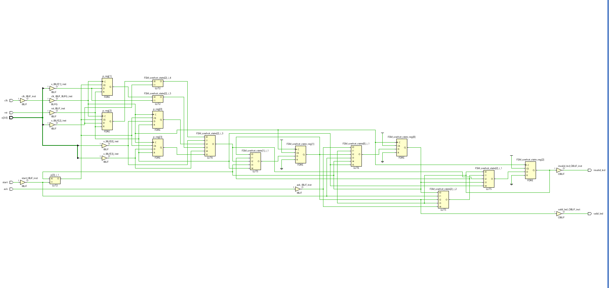
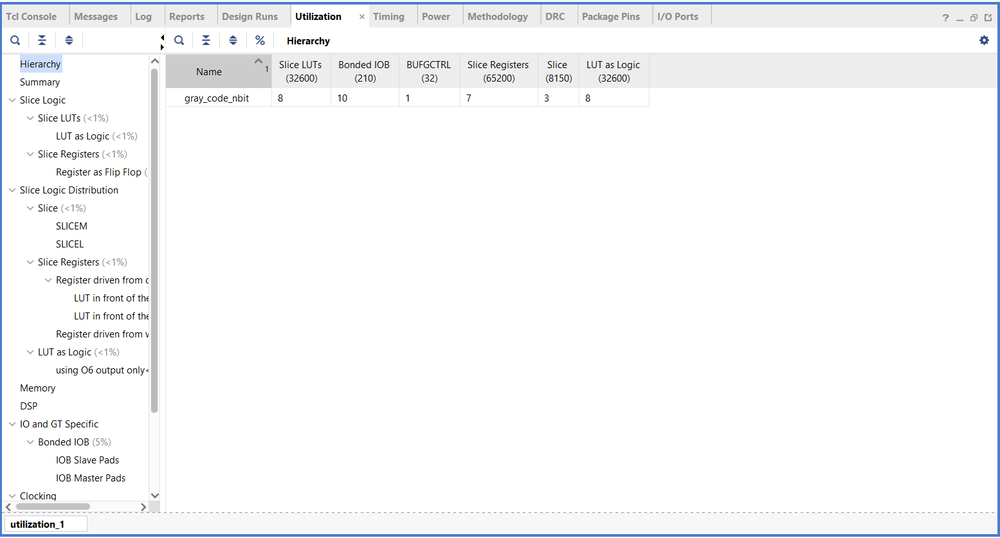
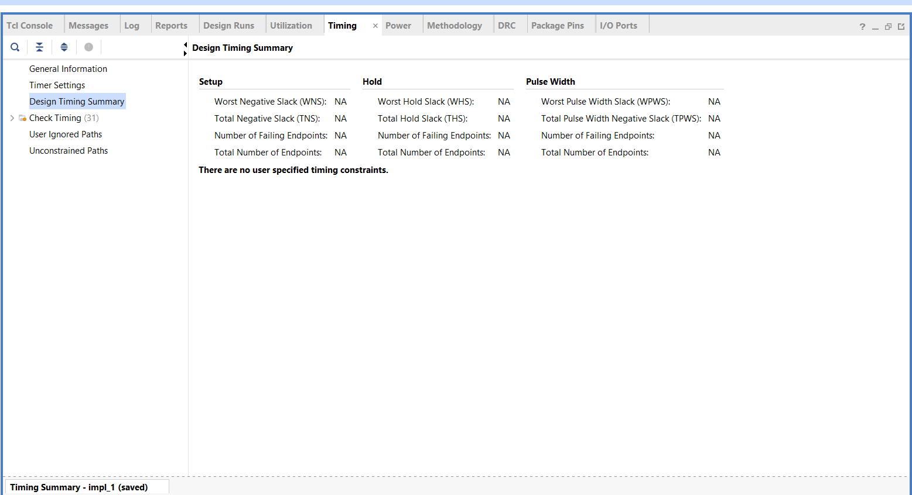
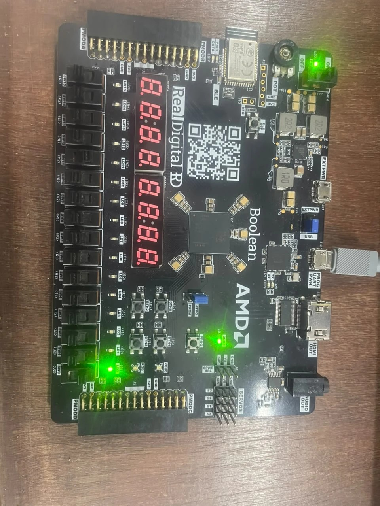
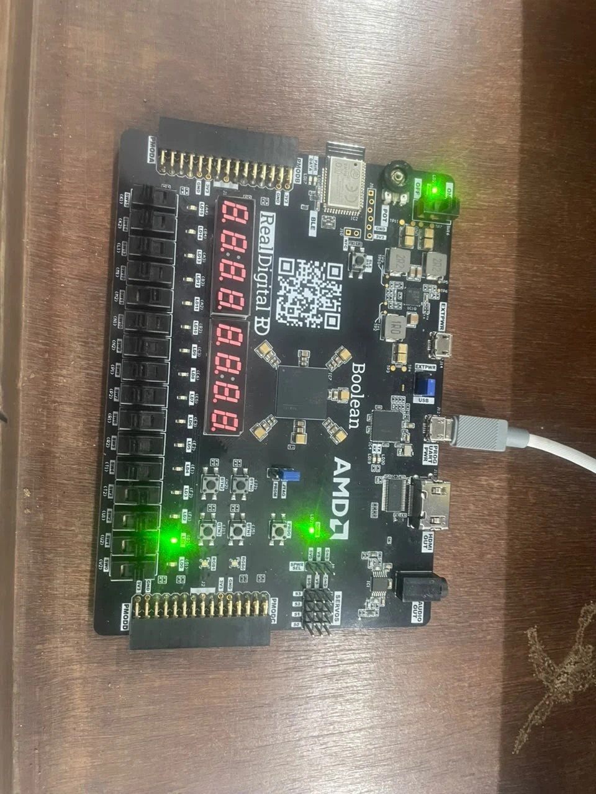

# 04 – FPGA Hardware

## Board and tools
- **Device:** Xilinx Spartan-7 `XC7S50-CSGA324-1`
- **Board:** RealDigital Boolean Board (AMD Spartan-7 `XC7S50-CSGA324`), as printed on the board in the hardware photos; the constraints use the 100 MHz clock on pin F14
- **Tool/version:** Vivado 2018.3 (project `ojasgraycode`)
- **Top module:** `gray_code_nbit` (N = 4)

## Files
| File | Purpose |
|---|---|
| `gray_code_nbit.xdc` | Pin assignments and I/O standards for `gray_code_nbit` (N = 4) |
| `../03_Verilog_Implementation/RTL/gray_code_nbit.v` | Design / top module |
| `gray_code_nbit_synthesized_schematic.png` | Vivado schematic of the synthesized netlist |
| `vivado_implemented_design_xc7s50.png` | Vivado implemented design (device package view) for `xc7s50csga324-1` |
| `vivado_utilization.png` | Vivado utilization report (hierarchy view) |
| `vivado_timing_summary.png` | Vivado design timing summary |
| `boolean_board_demo_1.jpg`, `boolean_board_demo_2.jpg` | Photos of the programmed Boolean board |

## Pin mapping (`gray_code_nbit.xdc`)
All ports use `LVCMOS33`.

| Port | Function | Pin |
|---|---|---|
| `clk` | Clock | F14 |
| `rst` | Reset (synchronous, active-high) | J2 |
| `start` | START – take a sample | J5 |
| `ack` | ACK – return to IDLE | H2 |
| `x[0]` | Data bit 0 | V2 |
| `x[1]` | Data bit 1 | U2 |
| `x[2]` | Data bit 2 | U1 |
| `x[3]` | Data bit 3 | T2 |
| `valid_led` | VALID LED | G1 |
| `invalid_led` | INVALID LED | G2 |

Notes: the file has no `create_clock` constraint (timing is unconstrained) and the buttons are used without debouncing.

## Hardware test procedure
1. Press `rst`. Both LEDs are off (IDLE).
2. Set `x[3:0]` and press `start`. A one-bit change from the previous sample lights `valid_led`; zero or more than one changed bit lights `invalid_led`.
3. Press `ack` to return to IDLE, then repeat.

## Implementation results (Vivado 2018.3)
Synthesis and implementation were run for `xc7s50csga324-1` and the bitstream was generated: the Vivado window shows "write_bitstream Complete" and the `Write Bitstream` reports (`impl_1_bitstream_report_webtalk_0`, `impl_1_bitstream_implementation_log_0`) dated 11/19/26 7:56 PM. The project's constraint file appears as `ojas2.xdc` (the repository copy is `gray_code_nbit.xdc`) and the design source as `gray_code_nbit`.

### Synthesized schematic

The netlist uses `IBUF`/`OBUF` buffers on `clk`, `rst`, `start`, `ack`, `x[3:0]`, `valid_led` and `invalid_led`, four `FDRE` flip-flops for `p_reg[3:0]`, and three `FDRE` flip-flops `FSM_onehot_state_reg[2:0]` – Vivado re-encoded the 2-bit state into one-hot – plus a few LUTs for the next-state and detector logic.

### Implemented design

### Utilization (`xc7s50csga324-1`)

| Resource | Used | Available |
|---|---:|---:|
| Slice LUTs (all used as logic) | 8 | 32600 |
| Slice registers | 7 | 65200 |
| Slices | 3 | 8150 |
| Bonded IOB | 10 | 210 |
| BUFGCTRL | 1 | 32 |

The 7 registers are the 4 previous-input bits and the 3 one-hot state bits; the 10 IOBs are `clk`, `rst`, `start`, `ack`, `x[3:0]`, `valid_led` and `invalid_led`.

### Timing summary

Vivado reports "There are no user specified timing constraints", so all setup, hold and pulse-width values show NA. The constraint file has no `create_clock` line; adding `create_clock -period 10.000 [get_ports clk]` (100 MHz) and re-running implementation will give real slack numbers.

### Hardware demonstration (RealDigital Boolean Board)
The bitstream was programmed onto the board (USB cable connected to the PROG/UART port). In both photos the power LED and the FPGA DONE LED are lit, which indicates the device was configured.

| Photo | Observed result on the board | Meaning |
|---|---|---|
| `boolean_board_demo_1.jpg` | VALID LED lit | Exactly one bit changed from the previous sample |
| `boolean_board_demo_2.jpg` | INVALID LED lit | Zero bits or more than one bit changed |

The switch settings used for each photo are not recorded yet; add them next to the rows above.

### FPGA implementation video
[FPGA implementation video (Google Drive)](https://drive.google.com/drive/folders/1sUIFIuBdsAn9yVEbG7qO0inIdqmfWgPn?usp=sharing)

### Still to record
- Timing slack after adding the clock constraint.
- The switch settings (x[3:0]) and button sequence behind each photo, and further input cases (no change, two-bit change, ACK, RST) if tested.
