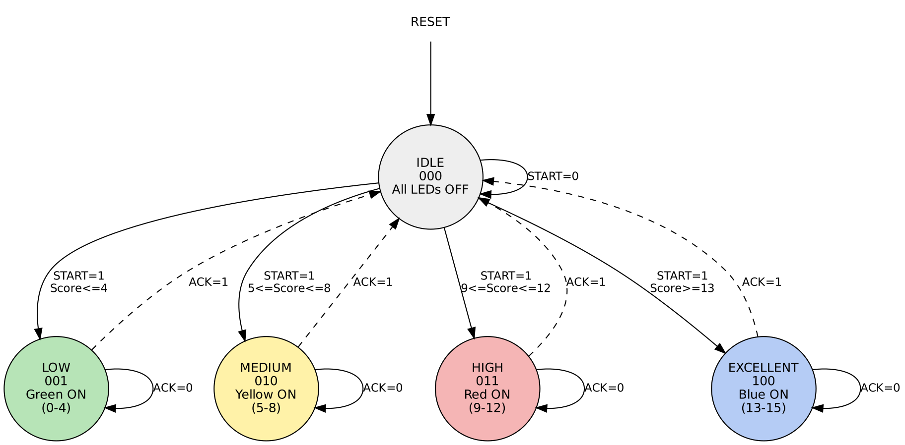

# FSM Design – Game Score Categorizer (H1)

## Model
**Moore FSM.** The LEDs depend only on the present state, not on the inputs.

## State encoding (3-bit binary)
| State | Q2 Q1 Q0 | Meaning | LEDs (G Y R B) |
|---|---|---|---|
| IDLE | 000 | Waiting for START | 0 0 0 0 (all off) |
| LOW | 001 | Score 0–4 | 1 0 0 0 (Green) |
| MEDIUM | 010 | Score 5–8 | 0 1 0 0 (Yellow) |
| HIGH | 011 | Score 9–12 | 0 0 1 0 (Red) |
| EXCELLENT | 100 | Score 13–15 | 0 0 0 1 (Blue) |
| unused | 101, 110, 111 | Not reachable | 0 0 0 0, next state IDLE |

Five states need ⌈log2 5⌉ = 3 flip-flops.

## State diagram

## Transition conditions
| Present state | Condition | Next state |
|---|---|---|
| any | RESET = 1 | IDLE |
| IDLE | START = 0 | IDLE |
| IDLE | START = 1 and Score ≤ 4 | LOW |
| IDLE | START = 1 and 5 ≤ Score ≤ 8 | MEDIUM |
| IDLE | START = 1 and 9 ≤ Score ≤ 12 | HIGH |
| IDLE | START = 1 and Score ≥ 13 | EXCELLENT |
| LOW / MEDIUM / HIGH / EXCELLENT | ACK = 0 | same state |
| LOW / MEDIUM / HIGH / EXCELLENT | ACK = 1 | IDLE |
| 101 / 110 / 111 | – | IDLE |

## State table (RESET = 0)
L, M, H, E are the range decoder outputs. X = don't care.

| Q2 Q1 Q0 | START | ACK | L M H E | Q2+ Q1+ Q0+ | G Y R B |
|---|---|---|---|---|---|
| 000 | 0 | X | XXXX | 000 | 0000 |
| 000 | 1 | X | 1000 | 001 | 0000 |
| 000 | 1 | X | 0100 | 010 | 0000 |
| 000 | 1 | X | 0010 | 011 | 0000 |
| 000 | 1 | X | 0001 | 100 | 0000 |
| 001 | X | 0 | XXXX | 001 | 1000 |
| 001 | X | 1 | XXXX | 000 | 1000 |
| 010 | X | 0 | XXXX | 010 | 0100 |
| 010 | X | 1 | XXXX | 000 | 0100 |
| 011 | X | 0 | XXXX | 011 | 0010 |
| 011 | X | 1 | XXXX | 000 | 0010 |
| 100 | X | 0 | XXXX | 100 | 0001 |
| 100 | X | 1 | XXXX | 000 | 0001 |
| 101–111 | X | X | XXXX | 000 | 0000 |

## Next-state equations (D flip-flops)
Let IDLE = Q2'·Q1'·Q0'.

- D2 = RESET' · [ IDLE·START·E + Q2·Q1'·Q0'·ACK' ]
- D1 = RESET' · [ IDLE·START·(M + H) + Q2'·Q1·ACK' ]
- D0 = RESET' · [ IDLE·START·(L + H) + Q2'·Q0·ACK' ]

## Output equations (Moore)
In Logisim these are produced by one 3-to-8 Decoder on Q2 Q1 Q0 (outputs 1, 2, 3, 4); output 0 gives IDLE.
- GREEN (LOW) = Q2'·Q1'·Q0
- YELLOW (MEDIUM) = Q2'·Q1·Q0'
- RED (HIGH) = Q2'·Q1·Q0
- BLUE (EXCELLENT) = Q2·Q1'·Q0'

## Input register
`LOAD = IDLE`. In Logisim this is one 4-bit Register component with Enable = IDLE. The register copies the switches on every clock edge while the FSM is in IDLE, and holds its value in all other states.

## Range decoder (comparators)
Implemented with three 4-bit unsigned comparators (verified for all 16 inputs). Each comparator compares the registered score with a constant:

| Comparator | Compares | Output |
|---|---|---|
| C1 | Score > 4 | GT4 |
| C2 | Score > 8 | GT8 |
| C3 | Score > 12 | GT12 |

- L = GT4'  (Score ≤ 4)
- M = GT4 · GT8'  (5 ≤ Score ≤ 8)
- H = GT8 · GT12'  (9 ≤ Score ≤ 12)
- E = GT12  (Score ≥ 13)

Equivalent gate-level (sum-of-products) form, useful for viva questions:
- L = S3'·S2' + S3'·S1'·S0'
- M = S3'·S2·(S1 + S0) + S3·S2'·S1'·S0'
- H = S3·S2'·(S1 + S0) + S3·S2·S1'·S0'
- E = S3·S2·(S1 + S0)

All equations were checked by script against the specification for every combination of state, START, ACK and the 16 scores.
