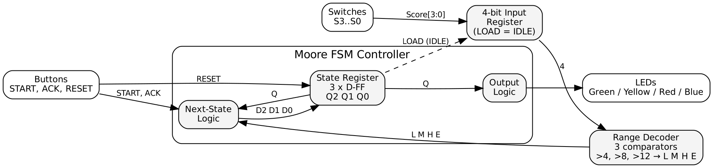

# Digital System Design – Group Project

## 1. Team Details
| Role | Student name | Roll number | GitHub username |
|---|---|---|---|
| Group leader | Kulkarni Keshavraj Yogesh | D9A-29 | Keshavkulkarni0706 |
| Member 2 | Manthan Sunil Januskar | D9A-23 | manthan-januskar |
| Member 3 | Nandini Ananthasubramaniam | D9B-40 | 2025nandinia-debug |
| Member 4 | Palaksh Pratap Singh | D9B-59 | chocolatedipper |

**Class:** D9A (members from D9A and D9B)  
**Department:** Electronics and Telecommunication, Vivekanand Education Society's Institute of Technology (VESIT), University of Mumbai  
**Group ID:** D9A_Group04  
**Repository URL:** https://github.com/Keshavkulkarni0706/DSD-2026-D9A-Group04  
**Final Pull Request URL:** https://github.com/MrugendraVasmatkar/Digital_System_Design_Practical_2026_27_D9A_B/pull/28

## 2. Assigned Problem Statement
- **Number/title:** Game Score Categorizer – Suggested modification H1: Four-Category Score Categorizer (Add Excellent)
- **Problem summary:** A 4-bit score from switches is sampled when START is pressed and classified into Low, Medium, High or Excellent. A Moore FSM keeps the result on an indicator LED until ACK is pressed.
- **Objective:** Correctly classify all 16 scores (0–15), hold the result until acknowledged, and return to IDLE on ACK or RESET.
- **Inputs and outputs:** `Score[3:0]` (switches), `START`, `ACK`, `RESET` (synchronous, active-high), `Clock`; outputs `LED_LOW` (green), `LED_MEDIUM` (yellow), `LED_HIGH` (red), `LED_EXCELLENT` (blue).
- **Constraints and assumptions:** Low 0–4, Medium 5–8, High 9–12, Excellent 13–15. Score is unsigned so all inputs are valid. START and switches are ignored outside IDLE. Unused state codes return to IDLE. Details in `01_Problem_Analysis/README.md`.

## 3. Problem Analysis and Proposed Solution
The system is split into a datapath (4-bit input register and a comparator-based range decoder) and a Moore FSM controller (3-bit state register, next-state logic, output logic). The input register loads the switches on every clock while the FSM is in IDLE and holds the value in all other states, so the FSM always decides from a stable registered score and the result cannot change after START. Edge cases covered: range boundaries, START held down, START and ACK together, ACK in IDLE, switch changes during a result, RESET in any state.

**Distinctive feature:** an optimised Logisim implementation. The input register is a single 4-bit Register component and the outputs come from one 3-to-8 decoder on the state, which cuts the circuit from 43 gates and 7 flip-flops to 23 gates, 3 flip-flops, one register and one decoder. Unused state codes return to IDLE.

The design is feasible: one 4-bit register, 3 state flip-flops, 3 comparators, one decoder and about 20 gates in Logisim, and a small fraction of the Spartan-7 resources on the FPGA.

## 4. Architecture

| Block | Function |
|---|---|
| Input register | One 4-bit register, Enable = IDLE |
| Range decoder | 3 comparators (> 4, > 8, > 12) + gates give L, M, H, E from the registered score |
| Next-state logic | D2, D1, D0 from state, START, ACK, RESET and L/M/H/E |
| State register | 3 D flip-flops (Q2 Q1 Q0) |
| Output logic | 3-to-8 decoder on the state, one LED per category state (Moore) |

## 5. FSM Design
Moore FSM, 5 states, 3-bit binary encoding: IDLE 000, LOW 001, MEDIUM 010, HIGH 011, EXCELLENT 100. IDLE goes to the category of the registered score when START = 1; every category state returns to IDLE when ACK = 1. Synchronous active-high RESET forces IDLE. Codes 101–111 go to IDLE.

**Diagram:** `02_FSM_Logisim/state_diagram.png`  
**State table:** `02_FSM_Logisim/FSM_Design.md`

## 6. Logisim Implementation
- Logisim version: Logisim Evolution 5.0.0
- Circuit file: `02_FSM_Logisim/Game_Score_Categorizer.circ`
- Test cases and expected/observed behaviour: all 16 scores with START, hold, ACK and RESET; see `02_FSM_Logisim/README.md` and `logisim_netlist_check.txt` (16/16 pass)
- Issues and corrections: first version used 4 D flip-flops with AND-OR load logic for the input register and AND gates for the outputs; optimised to one 4-bit Register (Enable = IDLE) and one 3-to-8 Decoder, re-verified for all 16 scores
- Screenshot/evidence: `02_FSM_Logisim/screenshots/` (full circuit, and the LOW, MEDIUM, HIGH and EXCELLENT LEDs lit in Logisim Evolution 5.0.0)

## 7. Verilog HDL Implementation
- Tool/version: Vivado 2018.3
- Top module: `Game_Score_Categorizer` (input register, range decoder and Moore FSM in one module)
- Architecture/coding decisions: `parameter` state codes, `case` on the state with `begin/end` per state and `if/else` transitions, Moore outputs assigned in every state, synchronous reset
- Synthesizability considerations: all outputs assigned in every branch (no latches), `default` branches for unused codes, single clock domain
- RTL: `03_Verilog_Implementation/RTL/`
- Testbench: `03_Verilog_Implementation/Testbench/`

## 8. Verification and Simulation Results
| Test ID | Inputs/conditions | Expected output | Observed output | Pass/Fail |
|---|---|---|---|---|
| T01 | RESET | IDLE, LEDs off | IDLE, LEDs off | Pass |
| T02 | START = 0 in IDLE | IDLE | IDLE | Pass |
| T03 | ACK in IDLE | IDLE | IDLE | Pass |
| T04 | All 16 scores + START, switch change, ACK | Correct category, held, then IDLE | Correct category for 0–15, held, IDLE after ACK | Pass |
| T05 | START held | One transition | Pending (run all) | Pending |
| T06 | START + ACK together | START in IDLE, ACK in category | Pending (run all) | Pending |
| T07 | RESET from every category | IDLE | Pending (run all) | Pending |
| T08 | Boundaries 4, 5, 8, 9, 12, 13 | Correct category | Correct category (covered in T04) | Pass |

Tool/version: Vivado 2018.3 behavioural simulation (`vivado_behavioral_sim_waveform.jpg`)  
Number passed/failed: 66 passed, 0 failed in the first 1000 ns (T01–T04, which also covers the boundary scores); T05–T07 run after 1000 ns  
Waveform/log path: `03_Verilog_Implementation/Simulation_Results/`

## 9. FPGA Hardware Implementation
- FPGA board/device: RealDigital Boolean board, Xilinx Spartan-7 xc7s50csga324-1
- Tool/version: Vivado 2018.3
- Clock/constraints: 100 MHz on F14; pin map in `04_FPGA_Hardware/boolean.xdc`
- Synthesis/implementation summary: 9 LUTs, 9 flip-flops, 1 F7 mux (0.03 % of the device); see `04_FPGA_Hardware/vivado_utilization.jpg`
- Programming and hardware test result: bitstream generated and the xc7s50 programmed successfully (Tcl log: "End of startup status: HIGH"); the group observed the category LEDs LD0–LD3 responding to the switches, START and ACK
- Evidence path: `04_FPGA_Hardware/` (schematics, utilization, `board_demo/` video and frames)

Explain differences between simulation and hardware results, if any: none observed. On the board the FSM runs directly on the 100 MHz clock; a button press spans many clocks, but START is ignored outside IDLE and ACK is ignored in IDLE, so each press causes exactly one transition.

## 10. Challenges, Debugging and Improvements
| Issue | Root cause | Correction | Outcome |
|---|---|---|---|
| Score read in the same clock as it is loaded would use the old value | Register update and FSM decision happen on the same edge | Register loads continuously in IDLE and freezes when the FSM leaves IDLE | FSM always uses a stable sampled score |
| Five states do not fit in 2 bits | H1 adds EXCELLENT | 3-bit state register, unused codes go to IDLE | Safe recovery from illegal states |
| A button press lasts millions of 100 MHz clocks and bounces | Mechanical push buttons | START only acts in IDLE and ACK only acts in a category state | Single clean transition per press, no debouncer needed |
| Logisim circuit larger than necessary | Register and output decoding built from individual gates | One 4-bit Register and one 3-to-8 Decoder | 43 gates + 7 FFs reduced to 23 gates + 3 FFs, re-verified |

Future improvements: show the score on the 7-segment display, add category counters (H4), add a CHANGE signal (H5).

## 11. Task Allocation and Individual Contribution
| Student | Assigned responsibility | Actual contribution/evidence |
|---|---|---|
| Group leader (Keshavraj Kulkarni) | GitHub, documentation, Logisim, presentation | Forked the faculty repository, renamed it to DSD-2026-D9A-Group04 and set up the D9A_Group04 submission folder. Wrote and maintained the documentation: group README, STATUS log, problem analysis, FSM design notes and final report. Built and verified the Logisim circuit, including the optimised version with a 4-bit register and a 3-to-8 decoder. Prepared the presentation and the final Pull Request. |
| Member 2 (Manthan Januskar) | Verilog RTL and testbench | Wrote the Verilog RTL for the Moore FSM (`Game_Score_Categorizer.v`) using parameter state codes, a case statement on the state and a synchronous reset. Wrote the self-checking testbench that covers all 16 scores, reset, START/ACK sequencing and the boundary scores, and prints PASS/FAIL for every check. |
| Member 3 (Nandini Ananthasubramaniam) | Logisim design | Worked on the Logisim implementation with the group leader: the input register, the comparator-based range decoder, the next-state logic and the LED outputs. Tested the circuit for all 16 scores, including the boundary values 4/5, 8/9 and 12/13. |
| Member 4 (Palaksh Pratap Singh) | FPGA simulation and synthesis (Vivado) | Ran the design in Vivado 2018.3: behavioural simulation of the testbench, RTL elaboration and synthesis for the Spartan-7 xc7s50csga324-1 on the Boolean board. Prepared the pin constraints (XDC) and collected the utilization report (9 LUTs, 9 flip-flops) and the RTL and synthesis schematics as evidence. |

Every student must be ready to explain the complete design.

## 12. Progress Log
Maintain time-wise updates in `STATUS.md`.

## 13. Final Results and Conclusion
In Logisim, all 16 scores are classified correctly into four categories, the result is held until ACK, and RESET returns to IDLE from any state. Vivado 2018.3 behavioural simulation of the same design passed all 66 checks in the first 1000 ns with no failures. The design synthesised to 9 LUTs and 9 flip-flops, and the Boolean board was programmed and demonstrated. Limitation: one score per transaction, ACK required before the next.

## 14. Team Reflection
Keshavraj led the group from the first reading of the problem sheet to the final Pull Request. He set the plan early: agree the H1 ranges and the state encoding first, then build Logisim, Verilog and the FPGA flow on the same design, so every stage could be checked against the one before it. He kept the repository, the STATUS log and the documentation up to date while dividing the work so that each member owned one part: Nandini and Keshavraj the Logisim circuit, Manthan the Verilog, and Palaksh the Vivado and FPGA flow.

The most useful lesson was how much the timing of the input register matters. Loading the score and taking the decision on the same clock edge would have used the old value, so the register loads only in IDLE and freezes once the FSM leaves it. We also learned that a design that works can still be made simpler: under Keshavraj's direction the Logisim circuit was reduced from 43 gates to 23 without changing its behaviour. Working through simulation first and hardware second meant that the board worked the first time it was programmed.

## 15. Final Submission Checklist
- [x] Team details and problem analysis complete.
- [x] Architecture/block diagram included.
- [x] FSM diagram/table or justified alternative included.
- [x] Logisim source and simulation evidence uploaded.
- [x] Verilog RTL and testbench uploaded.
- [x] Simulation results and test cases documented.
- [x] FPGA implementation and hardware evidence uploaded.
- [x] Results, challenges and conclusion documented.
- [x] Presentation and final report uploaded.
- [x] STATUS.md is up to date.
- [x] Final Pull Request created and URL recorded.
