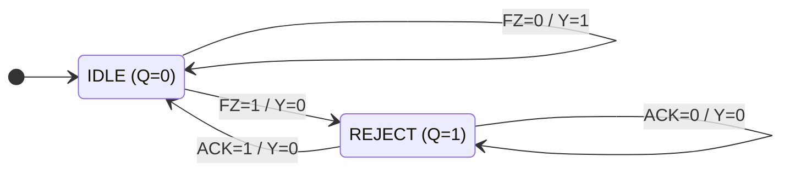

# Digital System Design – Group Project

> Complete every mandatory section. Do not delete headings. Replace bracketed prompts. If a section is not applicable, explain why.

## 1. Team Details
| Role | Student name | Roll number | GitHub username |
|---|---|---|---|
| Group leader | Snehal Gharmude | 16 | lumora-driod |
| Member 2 | Sachin Mane | 30 | 2025sachinmane |
| Member 3 | Sheetal Panda | 44 | Sheetal-VESIT |
| Member 4 | Vidisha Bagwe | 02 | VidishaBagwe |

**Class:** D9A  
**Group ID:** D9A_Group07  
**Repository URL:** https://github.com/lumora-droid/DSD-2026-D9A_B-Group07  
**Final Pull Request URL:** https://github.com/MrugendraVasmatkar/Digital_System_Design_Practical_2026_27_D9A_B/pull/24

## 2. Assigned Problem Statement
- **Number/title:** 6-H2 – Forbidden Zone Rejector (4-bit), modification H2: Mealy FSM with immediate output
- **Problem summary:** A 4-bit input X[3:0] is checked. Values 6 to 9 (0110 to 1001) are forbidden and give Y = 0 (REJECT, red LED). All other values give Y = 1 (ACCEPT, green LED). Once a forbidden value is seen, the rejection is remembered until it is acknowledged.
- **Objective:** Redesign the Moore FSM as a Mealy FSM so the output responds to the input immediately, without waiting for the next clock edge.
- **Inputs and outputs:**

  | Signal | Direction | Width | Meaning |
  |---|---|---|---|
  | X3, X2, X1 | Input | 1 each | Input bits used by the logic (X0 is a don't care and is not used) |
  | ACK | Input | 1 | Acknowledge: returns the FSM from REJECT to IDLE |
  | CLK | Input | 1 | Clock for the state flip-flop |
  | Y | Output | 1 | 1 = ACCEPT (LED LD0), immediate |
  | Y_bar | Output | 1 | REJECT (LED LD1), inverse of Y |

- **Constraints and assumptions:**
  - The forbidden range is fixed at 6 to 9 (not parameterised).
  - The design has one state flip-flop (2 states). The output must depend on the present state and present input (Mealy), so there is no clock delay on Y.
  - In the REJECT state the output stays 0 until ACK = 1. In IDLE, ACK has no effect.
  - The design has no RESET input; ACK is used to clear the state (the testbench holds ACK = 1 at the start).
  - Target board: Real Digital Boolean (Spartan-7 xc7s50csga324-1), using its switches, button and LEDs.

## 3. Problem Analysis and Proposed Solution
Explain the requirements, edge cases, proposed solution, distinctive features and why the design is feasible.

**Requirements:** read a 4-bit input, detect the forbidden zone 6 to 9, output ACCEPT or REJECT immediately, remember a rejection until ACK, then implement in Logisim, Verilog and on the FPGA.

**Forbidden zone equation:** FZ = X3'·X2·X1 + X3·X2'·X1'. The first term covers 6 and 7, the second covers 8 and 9. X0 does not affect the result.

| X3 X2 X1 X0 | Decimal | Result (in IDLE) |
|---|---|---|
| 0 1 1 X | 6, 7 | REJECT (Y = 0) |
| 1 0 0 X | 8, 9 | REJECT (Y = 0) |
| 0 0 0 X, 0 0 1 X, 0 1 0 X | 0 to 5 | ACCEPT (Y = 1) |
| 1 0 1 X, 1 1 X X | 10 to 15 | ACCEPT (Y = 1) |

Summary: X0 never affects the result. Values 6 to 9 are rejected (4 values). Values 0 to 5 and 10 to 15 are accepted (12 values).

**Edge cases:**
- Forbidden value while IDLE: Y goes to 0 immediately; the state becomes REJECT at the next clock edge.
- X changes to an allowed value while in REJECT: Y stays 0 (rejection is held).
- ACK = 1 while in REJECT: return to IDLE at the next clock edge.
- ACK = 1 while in IDLE: ignored.

**Proposed solution:** a 2-state Mealy FSM. Next state D = Q'·FZ + Q·ACK'. Output Y = Q'·FZ'.

**Distinctive feature:** Y comes straight from FZ and Q through gates, with no flip-flop between X and the LED, so the LED reacts immediately when X changes (the H2 requirement). Only Q is clocked, and it exists to remember the rejection.

**Feasibility:** the design needs one flip-flop and a few gates, so it fits easily on the Spartan-7 (see Section 9: 1 LUT, 1 flip-flop). With only 16 input values and 2 states it can be verified exhaustively.

## 4. Architecture
Insert/link the block diagram and explain modules, data/control flow and design trade-offs.
<Group_Submissions/D9A_Group07/02_FSM_Logisim/state diagram and state table.jpg>

**Modules:**
- Forbidden-zone detector: combinational logic that computes FZ from X3, X2, X1.
- State register: one D flip-flop (Q) updated on the rising clock edge. IDLE = 0, REJECT = 1.
- Output logic: Y = Q'·FZ' (combinational, Mealy), Y_bar = inverse of Y.

**Data/control flow:** X3, X2, X1 feed the detector to produce FZ. FZ and Q go to the output logic (immediate path to the LEDs) and to the next-state logic, whose result D is stored in Q at the clock edge. ACK is a control input to the next-state logic.

**Trade-offs:** a Mealy output is faster than Moore because it does not wait for the clock, but the output can change whenever the input changes, so inputs should be stable. Using one state bit keeps the area very small.

## 5. FSM Design
State whether the design uses an FSM. If yes, specify Moore/Mealy, states/encoding, state diagram, state table, transition conditions and reset behaviour. If not, justify the alternative.

**Uses an FSM:** Yes. **Type:** Mealy (output depends on present state and present input), 2 states.
**Encoding:** IDLE = 0, REJECT = 1.
**Transition conditions:** IDLE to REJECT when FZ = 1; REJECT to IDLE when ACK = 1; otherwise stay.
**Reset behaviour:** the design has no separate RESET input. ACK = 1 returns the FSM to IDLE (the testbench uses this to initialise Q).

Arrow labels are input / output, because in a Mealy machine the output sits on the arrow.

**Diagram:** `02_FSM_Logisim/FSM_diagram.png` (and the diagram above)  
**State table:**

| Present Q | FZ | ACK | Next Q | Y |
|---|---|---|---|---|
| 0 (IDLE) | 0 | X | 0 | 1 |
| 0 (IDLE) | 1 | X | 1 | 0 |
| 1 (REJECT) | X | 0 | 1 | 0 |
| 1 (REJECT) | X | 1 | 0 | 0 |

X means don't care.

## 6. Logisim Implementation
- Logisim version: 5.0.0
- Circuit file: `02_FSM_Logisim/logisim.circ`
- Test cases and expected/observed behaviour:
- Switches are written SW2 SW1 SW0 (1 = up). LD0 = ACCEPT (Y), LD1 = REJECT (Y_bar). Exactly one of the two LEDs is on at any time. Fill the Observed column from the real board.

| # | Action | Expected | Observed |
|---|---|---|---|
| 1 | Switches 000, press and release BTN0 | LD0 on, LD1 off | LD0 on, LD1 off |
| 2 | 001, 010, 101, 110, 111 | LD0 on, LD1 off | LD0 on, LD1 off |
| 3 | 011 (values 6, 7) | LD0 off, LD1 on, immediately | LD0 off, LD1 on, immediately |
| 4 | Back to 000 | LD1 stays on (latched) | LD1 stays on (latched) |
| 5 | Press BTN0 | LD0 on, LD1 off | LD0 on, LD1 off  |
| 6 | 100 (values 8, 9) | LD0 off, LD1 on, immediately | LD0 off, LD1 on, immediately |
| 7 | Back to 000 | LD1 stays on (latched) | LD1 stays on (latched) |
| 8 | Press BTN0 | LD0 on, LD1 off | LD0 on, LD1 off |
 
- Screenshot/evidence: `02_FSM_Logisim/[screenshot file names]`

## 7. Verilog HDL Implementation
- Tool/version: Vivado v2018.3 (win64), Vivado Simulator (XSim)
- Top module and submodules: top module `FRZ` (single module, no submodules); testbench `FRZ_tb`
- Architecture/coding decisions: FZ = (~X3 & X2 & X1) | (X3 & ~X2 & ~X1). One state register Q updated in a clocked always block. Next state D = (~Q & FZ) | (Q & ~ACK). Output Y = ~Q & ~FZ written with a continuous assign, so there is no clock in the path from X to Y. Y_bar = ~Y. The Verilog follows the same gates as the Logisim circuit.
- Synthesizability considerations: no delays (#) or initial blocks in the RTL, no latches (every path assigns a value), output logic uses assign, state register in a clocked always block. Vivado reported 0 latches.
- RTL: `03_Verilog_Implementation/RTL/`
- Testbench: `03_Verilog_Implementation/Testbench/`

## 8. Verification and Simulation Results
The testbench `FRZ_tb` generates a 10 ns clock, clears Q using ACK, steps X3X2X1 through 000 to 111 (2 ns each, faster than the clock), latches a rejection with 011 at a clock edge, then clears it with ACK. Results are checked by inspecting the waveform (the testbench has no automatic PASS/FAIL messages).

| Test ID | Inputs/conditions | Expected output | Observed output | Pass/Fail |
|---|---|---|---|---|
| T01 | ACK = 1 for 12 ns, X = 000 | Q cleared to IDLE | [ ] | [ ] |
| T02 | X3X2X1 stepped 000 to 111, Q = 0 | Y = 0 only for 011 and 100, else Y = 1; Y changes immediately | [ ] | [ ] |
| T03 | X = 011 at a clock edge, then X = 000 and 101 | Q = 1; Y stays 0 (rejection latched) | [ ] | [ ] |
| T04 | ACK = 1 at the next clock edge | Q returns to 0; Y returns to 1 | [ ] | [ ] |

Tool/version: Vivado v2018.3, XSim  
Number passed/failed:4/0
Waveform/log path: `03_Verilog_Implementation/Simulation_Results/[FRZ_waveform.png, simulation_log.txt]`

## 9. FPGA Hardware Implementation
- FPGA board/device: Real Digital Boolean, Xilinx Spartan-7 xc7s50csga324-1
- Tool/version: Vivado v2018.3 (win64)
- Clock/constraints: onboard 100 MHz oscillator on pin F14, `create_clock -period 10.00`. Constraints file `FRZ.xdc` (LVCMOS33): X3 = SW2 (U1), X2 = SW1 (U2), X1 = SW0 (V2), ACK = BTN0 (J2), Y = LD0 (G1), Y_bar = LD1 (G2). Check these against your final XDC.
- Synthesis/implementation summary: 1 slice LUT, 1 flip-flop, 2 slices, 0 latches, 0 CARRY4, 0 Block RAM, 7 bonded IOs (3.33%). Post-route timing: setup slack (WNS) 6.982 ns, hold slack (WHS) 1.028 ns, pulse-width slack 4.500 ns, 0 failing endpoints. All user specified timing constraints are met.
- Programming and hardware test result: programmed through Vivado Hardware Manager (Open Target, Auto Connect, Program Device with the .bit file); the DONE LED lit. Board test results: [Fill after testing: 000 gives LD0 on; 011 or 100 gives LD1 on; LD1 stays on after returning to 000; BTN0 clears it.]
- Evidence path: `04_FPGA_Hardware/`

Hardware and Software simulation matched .

## 10. Challenges, Debugging and Improvements
| Issue | Root cause | Correction | Outcome |
|---|---|---|---|
| LEDs and switches did not respond on the board | First XDC used pins for a different board (Digilent Arty S7); our board is the Real Digital Boolean with the same FPGA but different pins | Rewrote FRZ.xdc with the Boolean pins, checked against the labels printed on the board | Matched with the expected output |
| Q was unknown (X) at the start of simulation | The design has no RESET, so the flip-flop has no starting value | Testbench holds ACK = 1 for 12 ns to clear Q | Q starts at 0 and simulation is valid |
| Making the output immediate (H2) | The Moore design updates the LED only after the clock edge | Used a Mealy output Y = Q'·FZ' from gates, with no flip-flop between X and Y | Y changes as soon as X changes |
| Documentation did not match the design | Early README text listed RESET and X0 ports that the Verilog module does not have | Removed them; ACK clears the state and X0 is a don't care | README matches the code |
| No automatic pass/fail in simulation | Testbench has no $display checks | Verified by comparing the waveform with the expected table | Results checked manually |

Future improvements:
- Add an asynchronous RESET input.
- Make the forbidden range a parameter, and extend to an 8-bit input.
- Add self-checking testbench statements with $display and PASS/FAIL.
- Debounce the push button for ACK.

## 11. Task Allocation and Individual Contribution
| Student | Assigned responsibility | Actual contribution/evidence |
|---|---|---|
| Group leader (Snehal Gharmude) | VERILOG/ FPGA Implementation | [ ] |
| Member 2 (Sachin Mane) |  |  |
| Member 3 (Sheetal Panda) | Logisim/State diagram | [ ] |
| Member 4 (Vidisha Bagwe) | Logisim | [ ] |

Every student must be ready to explain the complete design.

## 12. Progress Log
Maintain time-wise updates in `STATUS.md`.

## 13. Final Results and Conclusion
Summarise requirements met, correctness of simulation/hardware results, measured results, limitations and conclusion.

**Requirements met:** the design rejects 6 to 9 and accepts all other values, the output responds immediately (Mealy, H2), and a rejection is held until ACK. It was built in Logisim, Verilog and on the Boolean FPGA board.

**Measured results:** 1 LUT, 1 flip-flop, 7 IOs, 0 Block RAM; setup slack 6.982 ns and hold slack 1.028 ns at 100 MHz, with all timing constraints met.

**Simulation correctness:** In the Vivado waveform, Y dropped to 0 and Y_bar rose to 1 immediately when X3X2X1 became 011 or 100 (at about 18 ns and 20 ns), in the middle of a clock cycle, and Y stayed 1 for all other combinations. After 011 was applied at a clock edge, Y stayed 0 even when X changed to 000 and 101, so the rejection is latched. Applying ACK returned Y to 1. These results match the expected behaviour, and the output is confirmed to be immediate (Mealy).
 
**Hardware correctness:**Matched the simulation correctness.

**Limitations:** fixed forbidden range (6 to 9); no RESET input; testbench checked by waveform only; push button not debounced.

**Conclusion:** The Forbidden Zone Rejector was implemented using a Mealy FSM. The system correctly identifies inputs from 6 to 9 as forbidden and generates the corresponding output immediately based on the current input, while all remaining input values are accepted.

## 14. Team Reflection
What did the team learn? What would you improve?
learned Moore to Mealy conversion of FSM, Vivado Simulation and FPGA Implementation.

## 15. Final Submission Checklist
- [done] Team details and problem analysis complete.
- [done] Architecture/block diagram included.
- [done] FSM diagram/table or justified alternative included.
- [done] Logisim source and simulation evidence uploaded.
- [done] Verilog RTL and testbench uploaded.
- [done] Simulation results and test cases documented.
- [done] FPGA implementation and hardware evidence uploaded.
- [done] Results, challenges and conclusion documented.
- [done] Presentation and final report uploaded.
- [done] STATUS.md is up to date.
- [done] Final Pull Request created and URL recorded.
