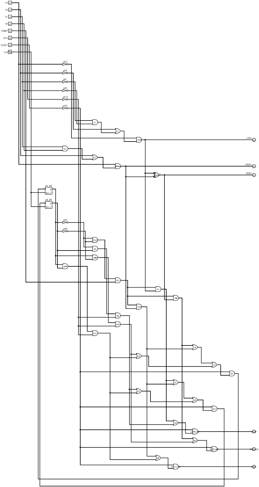
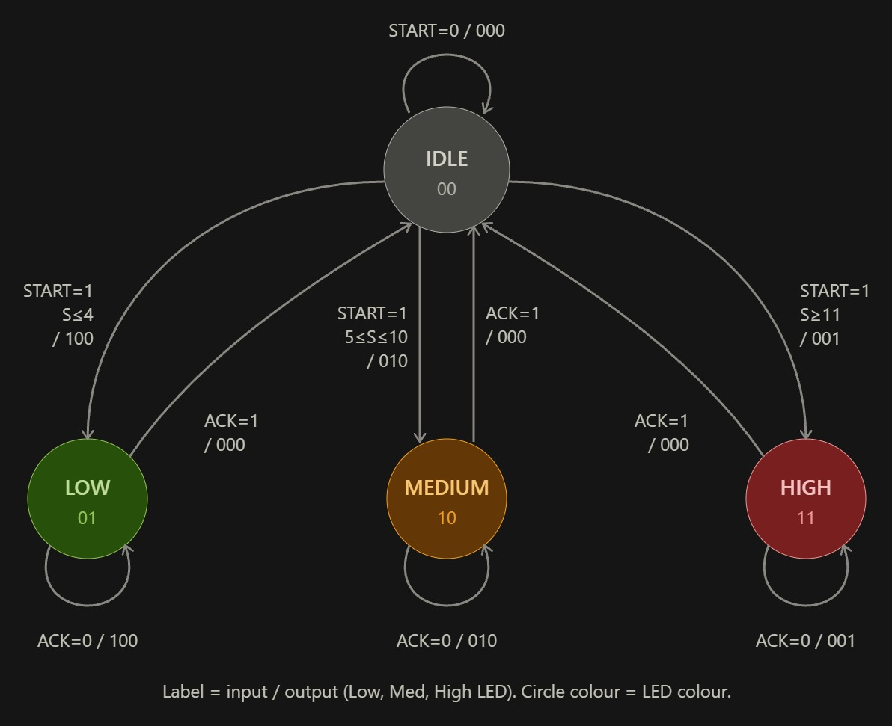

# Digital System Design – Group Project

> Complete every mandatory section. Do not delete headings. Replace bracketed prompts. If a section is not applicable, explain why.

## 1. Team Details
| Role | Student name | Roll number | GitHub username |
|---|---|---|---|
| Group leader | Samruddhi Samant | D9A-49 | planetsamzz77 |
| Member 2 | Siddharth Sanjeev Tiwari | D9A-58 | Siddharthqzz29 |
| Member 3 | Deven Shailendra Bhadane | D9B-2 | DevenBhadane |
| Member 4 | Ojas Nitin Kadam | D9B-20 | OjasKadam07 |

**Class:** D9A / D9B (Group 14)  
**Group ID:** D9A_Group14  
**Repository URL:** https://github.com/planetsamzz77/DSD-2026-D9A-Group14  
**Final Pull Request URL:** [URL]

## 2. Assigned Problem Statement
- **Group number:** 14 (D9A_Group14)
- **Number/title:** Game Score Categorizer (Mealy FSM) — official problem statement number/title [to be confirmed against the assigned statement]
- **Problem summary:** A 4-bit game score is entered and `start` is pressed. The system classifies the score as LOW, MEDIUM or HIGH and lights the matching LED until the user presses `ack`, then returns to idle.
- **Objective:** Classify the score (LOW 0–4, MEDIUM 5–10, HIGH 11–15), show exactly one LED, hold it until `ack`, using a Mealy FSM.
- **Inputs and outputs:** Inputs `clk`, `reset`, `start`, `ack` (1 bit each) and `score[3:0]`. Outputs `low_led`, `med_led`, `high_led` (1 bit each). Full table with FPGA pins: [`01_Problem_Analysis/io_specification.md`](01_Problem_Analysis/io_specification.md).
- **Constraints and assumptions:** Synchronous active-high reset; `start` only acted on in `IDLE`; `ack` only acted on in result states. Full list in [`01_Problem_Analysis/problem_statement.md`](01_Problem_Analysis/problem_statement.md).

## 3. Problem Analysis and Proposed Solution
Explain the requirements, edge cases, proposed solution, distinctive features and why the design is feasible.

Full analysis: [`01_Problem_Analysis/problem_statement.md`](01_Problem_Analysis/problem_statement.md).

In short: a 4-state Mealy FSM (2 flip-flops plus gates). Boundary scores 4/5 and 10/11, `start` held high, `ack` in `IDLE`, and `reset` mid-round are handled as listed there. Feasible on any FPGA: 11 I/O pins, 2 flip-flops.

## 4. Architecture
Insert/link the block diagram and explain modules, data/control flow and design trade-offs.

Single module `mealy_simple`: a 2-bit state register, next-state logic (score comparators plus `start`/`ack`/`reset`) and combinational Mealy output logic. There is no separate datapath.

- **Block diagram:** [to be added]
- Gate-level circuit screenshot:

## 5. FSM Design
State whether the design uses an FSM. If yes, specify Moore/Mealy, states/encoding, state diagram, state table, transition conditions and reset behaviour. If not, justify the alternative.

**Type:** Mealy FSM. **Encoding:** `IDLE`=00, `LOW`=01, `MED`=10, `HIGH`=11. **Reset:** synchronous, active-high, returns to `IDLE`.

**State table** (from `mealy_simple.v`):

| Present state | Condition | Next state | Outputs (low, med, high) |
|---|---|---|---|
| IDLE | `start`=0 | IDLE | 0 0 0 |
| IDLE | `start`=1, score ≤ 4 | LOW | 1 0 0 |
| IDLE | `start`=1, 5 ≤ score ≤ 10 | MED | 0 1 0 |
| IDLE | `start`=1, score ≥ 11 | HIGH | 0 0 1 |
| LOW | `ack`=0 | LOW | 1 0 0 |
| LOW | `ack`=1 | IDLE | 0 0 0 |
| MED | `ack`=0 | MED | 0 1 0 |
| MED | `ack`=1 | IDLE | 0 0 0 |
| HIGH | `ack`=0 | HIGH | 0 0 1 |
| HIGH | `ack`=1 | IDLE | 0 0 0 |

**State diagram** (label = input / output as Low, Med, High LED; circle colour = LED colour):

File: `02_FSM_Logisim/fsm_state_diagram.png`

## 6. Logisim Implementation
- Logisim version: file saved in the Logisim 2.7.1 format (`project source="2.7.1"`)
- Circuit file: `02_FSM_Logisim/Game_Score_Categorizer_H2_Mealy_Machine.circ`
- Test cases and expected/observed behaviour: [simulation not yet documented]
- Issues and corrections: [Details]
- Screenshot/evidence: `02_FSM_Logisim/circuit_overview.png` (circuit only; simulation screenshots pending)

## 7. Verilog HDL Implementation
- Tool/version: [Details]
- Top module and submodules: `mealy_simple` (single module, no submodules)
- Architecture/coding decisions: 2-bit state register with synchronous reset; Mealy outputs as continuous assignments from state and inputs.
- Synthesizability considerations: only synthesizable constructs (`always @(posedge clk)`, `assign`); `state` has no power-up value, so reset must be applied after power-up.
- RTL: `03_Verilog_Implementation/RTL/mealy_simple.v`
- Testbench: `03_Verilog_Implementation/Testbench/game_tb.v`

## 8. Verification and Simulation Results
Testbench `game_tb.v` has 3 test cases. **Not yet simulated**: the "Observed output" column must be filled from an actual run.

| Test ID | Inputs/conditions | Expected output | Observed output | Pass/Fail |
|---|---|---|---|---|
| T01 | score=2, `start`=1 (then `ack`) | LOW LED on (1 0 0); all off after `ack` | [not yet run] | [ ] |
| T02 | score=7, `start`=1 (then `ack`) | MEDIUM LED on (0 1 0); all off after `ack` | [not yet run] | [ ] |
| T03 | score=13, `start`=1 (then `ack`) | HIGH LED on (0 0 1); all off after `ack` | [not yet run] | [ ] |

Tool/version: [Details]  
Number passed/failed: [Details]  
Waveform/log path: [Path]

## 9. FPGA Hardware Implementation
- FPGA board/device: [Details]
- Tool/version: [Details]
- Clock/constraints: `04_FPGA_Hardware/constraints.xdc` (LVCMOS33; clk F14, reset T1, start J2, ack J1, score V2/U2/U1/T2, LEDs G1/G2/F1). No `create_clock` constraint yet.
- Synthesis/implementation summary: [Details]
- Programming and hardware test result: [Details]
- Evidence path: `04_FPGA_Hardware/`

Explain differences between simulation and hardware results, if any.

## 10. Challenges, Debugging and Improvements
| Issue | Root cause | Correction | Outcome |
|---|---|---|---|
| [ ] | [ ] | [ ] | [ ] |

Future improvements: debouncing/synchronising `start` and `ack`; seven-segment display of the score; parameterised thresholds.

## 11. Task Allocation and Individual Contribution
| Student | Assigned responsibility | Actual contribution/evidence |
|---|---|---|
| Group leader | [ ] | [ ] |
| Member 2 | [ ] | [ ] |
| Member 3 | [ ] | [ ] |
| Member 4 | [ ] | [ ] |

Every student must be ready to explain the complete design.

## 12. Progress Log
Maintain time-wise updates in `STATUS.md`.

## 13. Final Results and Conclusion
Summarise requirements met, correctness of simulation/hardware results, measured results, limitations and conclusion.

[Write here]

## 14. Team Reflection
What did the team learn? What would you improve?

[Write here]

## 15. Final Submission Checklist
- [ ] Team details and problem analysis complete.
- [ ] Architecture/block diagram included.
- [ ] FSM diagram/table or justified alternative included.
- [ ] Logisim source and simulation evidence uploaded.
- [x] Verilog RTL and testbench uploaded.
- [ ] Simulation results and test cases documented.
- [ ] FPGA implementation and hardware evidence uploaded.
- [ ] Results, challenges and conclusion documented.
- [ ] Presentation and final report uploaded.
- [ ] STATUS.md is up to date.
- [ ] Final Pull Request created and URL recorded.
