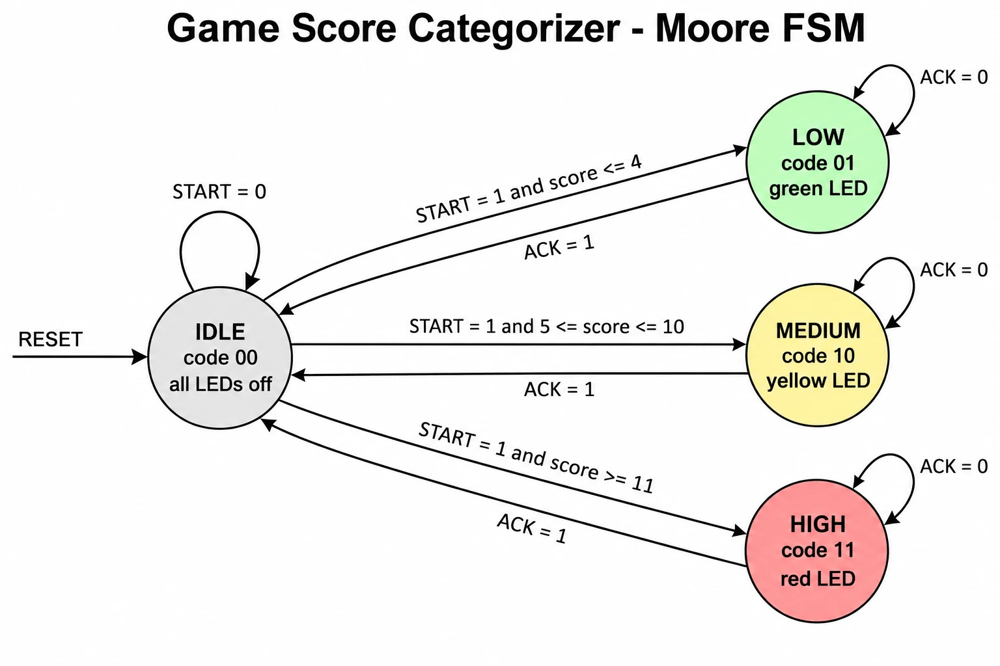

# FSM Design – Game Score Categorizer (Moore FSM)

## 1. State diagram

The FSM is a **Moore** machine: the LED outputs depend only on the present state.

## 2. State encoding and outputs

| State | Code `Q1Q0` | LOW_LED (green) | MEDIUM_LED (yellow) | HIGH_LED (red) |
|---|---|---|---|---|
| IDLE | 00 | 0 | 0 | 0 |
| LOW | 01 | 1 | 0 | 0 |
| MEDIUM | 10 | 0 | 1 | 0 |
| HIGH | 11 | 0 | 0 | 1 |

## 3. State transition table
Inputs: `START`, `ACK` and the score category from the range decoder
(LOW: score 0–4, MEDIUM: score 5–10, HIGH: score 11–15). `X` = don't care.

| Present state | START | ACK | Score category | Next state | H4 counter action |
|---|:---:|:---:|---|---|---|
| IDLE (00) | 0 | X | X | IDLE | none |
| IDLE (00) | 1 | X | LOW (0–4) | LOW | LOW_COUNT + 1 |
| IDLE (00) | 1 | X | MEDIUM (5–10) | MEDIUM | MEDIUM_COUNT + 1 |
| IDLE (00) | 1 | X | HIGH (11–15) | HIGH | HIGH_COUNT + 1 |
| LOW (01) | X | 0 | X | LOW | none |
| LOW (01) | X | 1 | X | IDLE | none |
| MEDIUM (10) | X | 0 | X | MEDIUM | none |
| MEDIUM (10) | X | 1 | X | IDLE | none |
| HIGH (11) | X | 0 | X | HIGH | none |
| HIGH (11) | X | 1 | X | IDLE | none |

`RESET` (asynchronous, active-high) forces the state to IDLE and clears all three counters from any state.

Notes:
- In IDLE, `ACK` is ignored; only `START` leaves IDLE, and the score decides which category state is entered.
- In a category state, `START` and the score are ignored; only `ACK` returns to IDLE (`ACK` has priority).
- A counter increments only on the IDLE-to-category transition, so each detection is counted once even if `START` is held.

## 4. Boolean equations (implemented in Logisim and Verilog)
With `L` = score < 5, `H` = score > 10, `M` = neither:

- `GO = ¬Q1 · ¬Q0 · START`
- `D1 = GO · ¬L + Q1 · ¬ACK`
- `D0 = GO · (L + H) + Q0 · ¬ACK`
- `LOW_LED = ¬Q1 · Q0`, `MEDIUM_LED = Q1 · ¬Q0`, `HIGH_LED = Q1 · Q0`
- Counter enables: `EN_LOW = GO · L`, `EN_MED = GO · M`, `EN_HIGH = GO · H`
