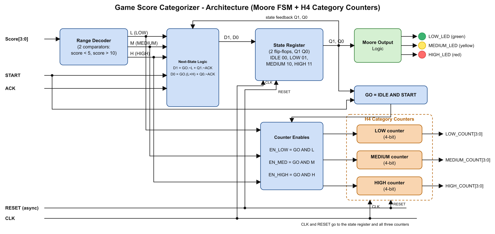

# Digital System Design – Group Project

> Complete every mandatory section. Do not delete headings. Replace bracketed prompts. If a section is not applicable, explain why.

## 1. Team Details
| Role | Student name | Roll number | GitHub username |
|---|---|---|---|
| Group leader | Jasneevsingh Kalra | D9A - 26 | JasneevKalra |
| Member 2 | Tanmay Sahadeo Taware | D9A - 57 | tanmaytaware-droid |
| Member 3 | Suraj Ramnath Dalvi | D9B - 7 | 2025surajdalvi |
| Member 4 | Yash Abhijit Khuperkar | D9B - 25 | yashkhuperkar |

**Class:** D9A (Group 15, mixed D9A/D9B)  
**Group ID:** D9A_Group15  
**Repository URL:** https://github.com/JasneevKalra/DSD-2026-D9A-Group15  
**Final Pull Request URL:** https://github.com/MrugendraVasmatkar/Digital_System_Design_Practical_2026_27_D9A_B/pull/9

## 2. Assigned Problem Statement
- **Number/title:** Game Score Categorizer (Moore FSM), selected modification **H4 – Category Counters**.
- **Problem summary:** A 4-bit score (0–15) is classified into LOW (0–4), MEDIUM (5–10) or HIGH (11–15). A Moore FSM holds the detected category and lights one LED per category until the user acknowledges. With H4, three counters record how many times each category has been detected.
- **Objective:** Classify every score correctly, hold the category until `ACK`, count each detection exactly once in its category counter, and clear everything on `RESET`; verify in Logisim, simulate in Verilog and implement on the Real Digital Boolean Board (xc7s50csga324-1).
- **Inputs and outputs:**

| Signal | Direction | Width | Meaning |
|---|---|---|---|
| `Score[3:0]` | Input | 4 | Score from the switches |
| `START` | Input | 1 | Classify and latch the score (acted on only in IDLE) |
| `ACK` | Input | 1 | Return from a category state to IDLE |
| `RESET` | Input | 1 | Clear state and counters (asynchronous, active-high) |
| `CLK` | Input | 1 | Clock |
| `LOW_LED`, `MEDIUM_LED`, `HIGH_LED` | Output | 1 each | Category indicators |
| `LOW_COUNT`, `MEDIUM_COUNT`, `HIGH_COUNT` | Output | 4 each | Category counters (H4) |

- **Constraints and assumptions:** The score range is 0–15, so every 4-bit value is valid and no error state is needed. `START` and `ACK` are single-clock pulses on the board (after debouncing). Counters are 4 bits and wrap from 15 to 0. While in a category state, further `START` pulses and score changes are ignored.

## 3. Problem Analysis and Proposed Solution
Full analysis: `01_Problem_Analysis/problem_analysis.md`.

- **Requirements:** category by comparing the score with two thresholds (score < 5 is LOW, score > 10 is HIGH, otherwise MEDIUM); the score is read only on `START` in IDLE; the FSM stays in the category state until `ACK`; exactly one counter increments per detection; `RESET` clears the state and all counters.
- **Edge cases:** boundary scores 4, 5, 10 and 11; `START` held for several clocks; `START` applied again in a category state; `ACK` applied in IDLE; counter overflow; `RESET` in a category state.
- **Proposed solution:** two comparators as the range decoder, a 2-bit Moore FSM (IDLE 00, LOW 01, MEDIUM 10, HIGH 11) and three 4-bit counters enabled by `GO x category`, where `GO = IDLE . START`.
- **Distinctive features:** counts once per detection (the enable is tied to the IDLE-to-category transition, not to the held `START` level); asynchronous reset; on the board, debounced single-pulse `START`/`ACK` and a multiplexed 7-segment display of the state and the three counts.
- **Feasibility:** the implemented design uses 92 LUTs, 118 flip-flops and 20 CARRY4 on a device with 32,600 LUTs, and meets timing at 100 MHz (see section 9).

## 4. Architecture

- **Modules:** range decoder (two comparators), next-state logic, 2-bit state register, Moore output logic, three category counters.
- **Data/control flow:** the score feeds the comparators; `START`, `ACK` and the decoder outputs drive the next-state logic; the state register drives the LEDs; the counter enables are `GO x category`.
- **Trade-offs:** the score is read live at the `START` edge instead of being held in a separate input register, which keeps the design small; the category is held in the state register.

## 5. FSM Design
The design uses a **Moore** FSM with four states: IDLE (00), LOW (01), MEDIUM (10) and HIGH (11). Outputs depend only on the present state. In IDLE, `START` moves to the category chosen by the score (LOW 0–4, MEDIUM 5–10, HIGH 11–15). In a category state, `ACK` returns to IDLE and otherwise the state is held. `RESET` forces IDLE (asynchronous) and clears the counters.

**Diagram:** `02_FSM_Logisim/fsm_state_diagram.webp`  
**State table, outputs and Boolean equations:** `02_FSM_Logisim/fsm_state_table.md`

## 6. Logisim Implementation
- Logisim version: Logisim-evolution v5.0.0
- Circuit file: `02_FSM_Logisim/Game_Score_Categorizer_H4.circ`
- Test cases and expected/observed behaviour: 14 tests, all passed (reset, LOW 3 and 4, MEDIUM 5/7/9/10, HIGH 11/12, ACK, state hold, count-once, repeated detections, reset clearing non-zero counters). Table: `02_FSM_Logisim/simulation/simulation_results.md`.
- Issues and corrections: see section 10.
- Screenshot/evidence: `02_FSM_Logisim/simulation/` (`sim_01` to `sim_15`).

## 7. Verilog HDL Implementation
- Tool/version: Vivado v2018.3 (64-bit)
- Top module and submodules: top `top_boolean`; submodules `game_score_categorizer` (FSM and counters) and `debounce` (3 instances).
- Architecture/coding decisions: the Logisim logic is kept in `game_score_categorizer`; `top_boolean` adds input synchronizers, 20 ms debouncing, single-pulse `START`/`ACK` and a multiplexed 7-segment display (state and the three counts). Asynchronous reset matches the Logisim circuit.
- Synthesizability considerations: all RTL is synthesizable (registered state, counters and debouncers, combinational next-state and decode); only the testbench uses delays. Vivado synthesis and implementation completed with a bitstream.
- RTL: `03_Verilog_Implementation/RTL/`
- Testbench: `03_Verilog_Implementation/Testbench/`

## 8. Verification and Simulation Results
| Test ID | Inputs/conditions | Expected output | Observed output | Pass/Fail |
|---|---|---|---|---|
| T01 | Every score 0–15 with `START`, then a second `START` with another score, then `ACK` | Correct category, counted once, state held, back to IDLE on `ACK` | As expected (49 checks) | Pass |
| T02 | `START` held for 3 clocks | Counted once | As expected (2 checks) | Pass |
| T03 | No `START`; score changes and `ACK` in IDLE | Stays IDLE | As expected (2 checks) | Pass |
| T04 | 16 LOW detections | 4-bit counter wraps to its old value | As expected (32 checks) | Pass |
| T05 | Asynchronous `RESET` in HIGH state | State and all counts cleared | As expected (3 checks) | Pass |

Tool/version: Vivado v2018.3 (64-bit), behavioral simulation (XSim)  
Number passed/failed: 88 checks run, 0 errors, TEST PASSED (finished at 1760 ns)  
Waveform/log path: `03_Verilog_Implementation/Simulation_Results/` (`simulation_results.md`, `sim_console_test_passed.png`, `sim_waveform_all_16_scores.png`, `sim_waveform_zoom_detections.png`)

## 9. FPGA Hardware Implementation
- FPGA board/device: Real Digital Boolean Board, xc7s50csga324-1 (Spartan-7)
- Tool/version: Vivado v2018.3 (64-bit)
- Clock/constraints: 100 MHz clock on pin F14 (10 ns period); `04_FPGA_Hardware/boolean_board.xdc` (`sw[3:0]` score, `btn[0]` START, `btn[1]` ACK, `btn[2]` RESET, `led[2:0]` category LEDs, `D0_a`/`D0_seg` 7-segment display)
- Synthesis/implementation summary: 92 Slice LUTs, 118 flip-flops, 20 CARRY4, 57 slices, 23 bonded IOBs, no Block RAM or DSP. Timing met: WNS 5.534 ns, WHS 0.173 ns, WPWS 4.500 ns, 0 failing endpoints. Bitstream generated. Details: `04_FPGA_Hardware/fpga_results.md`.
- Programming and hardware test result: bitstream programmed on the Boolean Board on 20/11/2026 (DONE LED lit). In the photographed case, score 5 gave the MEDIUM LED (LD1) and the display read 2 0 1 0 (state 2, MEDIUM count 1), as expected. The group recorded a video of the full demonstration (Google Drive): https://drive.google.com/drive/folders/1mQUoD12ULA3UzhSWuDmA_176wDbxy463 . In the video (scores 1111 for HIGH, 0001 for LOW, 0101 for MEDIUM) the display moves through: reset 0 0 0 0, HIGH 3 0 0 1, back to IDLE, LOW 1 1 0 1, back to IDLE, MEDIUM 2 1 1 1, state and counts unchanged while the controls are operated, and a final reset to 0 0 0 0 (details in `04_FPGA_Hardware/fpga_results.md`).
- Evidence path: `04_FPGA_Hardware/` (`utilization_report.png`, `timing_summary.png`, `hardware_photo_board_score5_medium.jpg`, `hardware_photo_display_score5_closeup.jpg`)

Explain differences between simulation and hardware results, if any: none observed: the board gave the same states and counter values as the simulation in the photographed case and in the video (group to confirm).

## 10. Challenges, Debugging and Improvements
| Issue | Root cause | Correction | Outcome |
|---|---|---|---|
| Overlapping clock and reset wires in the first Logisim layout | The register and counter `CLK` and `CLR` pins sit at the same height, so the wires merged | Routed these wires out of the bottom of each component | Circuit opens with every net separate and simulates correctly |
| First FSM state table did not match the design | It ignored the score category in IDLE and the priority of `ACK` in category states | Rewrote the table with the score category, `ACK` priority and counter actions | Table now matches the Logisim and Verilog behaviour |
| Vivado DRC error on bank 34 (`sw[3]`, SSTL135 VREF) | Constraints for the wrong board (Arty S7 pins) were used | Replaced them with the Boolean Board pins (LVCMOS33) | Synthesis, implementation and bitstream completed |
| Vivado simulation showed no "TEST PASSED" | Default run time of 1000 ns stopped before the testbench finished | Ran the simulation to completion with `run all` | 88 checks, 0 errors, TEST PASSED |
| First Logisim screenshots showed no pin values | They were exported in printer view | Re-captured the screenshots in simulation mode | Evidence shows live LEDs, pins and counts |

Future improvements: an error state for invalid input, saturating counters instead of wrap-around, a Mealy version with immediate output, and sending the counts to a PC over UART.

## 11. Task Allocation and Individual Contribution
| Student | Assigned responsibility | Actual contribution/evidence |
|---|---|---|
| Jasneevsingh Kalra (group leader) | Logisim; GitHub documentation | Logisim circuit and simulation (`02_FSM_Logisim/`); repository, README, STATUS and checklist (`README.md`, `STATUS.md`) |
| Tanmay Sahadeo Taware | Logisim | Logisim circuit and simulation (`02_FSM_Logisim/`) |
| Suraj Ramnath Dalvi | Verilog; presentation; final report | Verilog RTL and testbench (`03_Verilog_Implementation/`); final presentation (`06_Presentation/`); final report (`07_Final_Report/`) |
| Yash Abhijit Khuperkar | Verilog; hand-written report | Verilog RTL and testbench (`03_Verilog_Implementation/`); hand-written report (submitted separately, not in the repository) |

Every student must be ready to explain the complete design.

## 12. Progress Log
Maintain time-wise updates in `STATUS.md`.

## 13. Final Results and Conclusion
Summarise requirements met, correctness of simulation/hardware results, measured results, limitations and conclusion.

The Game Score Categorizer (Moore FSM with H4 category counters) classifies scores 0 to 15 into LOW (0 to 4), MEDIUM (5 to 10) and HIGH (11 to 15) correctly, holds the category until ACK, counts each detection exactly once and clears everything on reset. The Logisim circuit passed 14 tests, the Verilog testbench passed 88 checks with 0 errors, and the Boolean Board showed the same states and counts (display 3 0 0 1 for HIGH, 1 1 0 1 for LOW, 2 1 1 1 for MEDIUM, 0 0 0 0 after reset). The design uses 92 LUTs, 118 flip-flops and 20 CARRY4 and meets timing at 100 MHz (WNS 5.534 ns). Full tables: `05_Results/results.md`; full report: `07_Final_Report/Game_Score_Categorizer_Final_Report.docx`. Limitations: the 4-bit counters wrap from 15 to 0 and there is no error state. Future improvements: saturating counters, a Mealy version, UART output of the counts.

## 14. Team Reflection
What did the team learn? What would you improve?

**What we learned**
- How to design a digital system as a Moore FSM: choosing the state encoding, writing the state table and Boolean equations, and keeping the same design from Logisim to Verilog to the FPGA.
- How to verify in stages: Logisim tests (14), a self-checking Verilog testbench (88 checks, 0 errors) and then the Boolean Board, instead of trusting only one level.
- The practical side of the tools: wiring and simulating in Logisim, and the Vivado flow with pin constraints, DRC messages, utilization and timing reports.
- Real-hardware details such as debouncing buttons, turning START and ACK into single pulses and multiplexing a 7-segment display.
- Working as a team with Git and GitHub: a fork, regular STATUS updates, evidence in the right folders and a pull request.

**What we would improve**
- Check the target board and its pin constraints before running synthesis, because constraints for the wrong board caused a Vivado DRC error.
- Review the state table against the design earlier; the first version missed the score category and the priority of ACK.
- Capture simulation evidence as we go (live values, full run) instead of re-taking screenshots later.
- Start the hardware test earlier and test more cases on the board, such as the boundary scores 4, 5, 10 and 11.
- Extend the design with saturating counters, an error state, a Mealy version and the score shown on the second 7-segment display.

## 15. Final Submission Checklist
- [x] Team details and problem analysis complete.
- [x] Architecture/block diagram included.
- [x] FSM diagram/table or justified alternative included.
- [x] Logisim source and simulation evidence uploaded.
- [x] Verilog RTL and testbench uploaded.
- [x] Simulation results and test cases documented.
- [x] FPGA implementation and hardware evidence uploaded.
- [x] Results, challenges and conclusion documented.
- [x] Presentation and final report uploaded.
- [x] STATUS.md is up to date.
- [x] Final Pull Request created and URL recorded.
