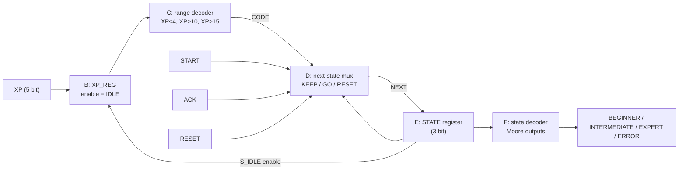

# Problem Analysis – Gaming XP Level Decoder (H3)

**Group:** D9A_Group20 **Problem:** 8 – Gaming XP Level Decoder **Modification:** H3 (ERROR state for invalid input)

## 1. Problem summary
A gaming system reads a player's experience points (XP) and shows which skill level the player is at.
The system is a **Moore FSM**. Modification **H3** adds an **ERROR** state: if the input is outside the valid range (> 15) the error LED is asserted, and the machine returns to IDLE after RESET or ACK.
The problem sheet's base design has a 4-bit XP input (0–15). The group widened it to **5 bits** (0–31) so that out-of-range values can actually occur and be detected.

### What the problem sheet asks for, and where it is covered
| Sheet item | Where |
|---|---|
| Q1: Logisim design and simulation (input register, range decoder, state register, next-state logic, output logic, all input combinations) | `02_FSM_Logisim/Gaming_XP_Decoder_H3_simple.circ` |
| Q2: Moore FSM state diagram with state encoding and outputs | `02_FSM_Logisim/FSM_Design.md` |
| Q3: Verilog testbench: all XP values, all FSM states, reset, START/ACK, LED outputs, expected-vs-observed, pass/fail messages | `03_Verilog_Implementation/Testbench/`, `Simulation_Results/` |
| Sheet's block diagram: input register → range decoder → Moore FSM controller → indicator outputs | Section 6 below |
| H3: ERROR state, error LED, return to IDLE after RESET or ACK | States ERR (100), requirement R4, R7, R8 |

## 2. Requirements
| ID | Requirement |
|---|---|
| R1 | XP 0–3 → BEGINNER |
| R2 | XP 4–10 → INTERMEDIATE |
| R3 | XP 11–15 → EXPERT |
| R4 | XP 16–31 → ERROR (H3: invalid input) |
| R5 | Exactly one level LED is on in a level state; no LED in IDLE |
| R6 | Outputs depend only on the current state (Moore) |
| R7 | A level is held until the user acknowledges it (ACK), then the machine returns to IDLE |
| R8 | Synchronous active-high RESET returns the machine to IDLE and has top priority |
| R9 | Unused state codes (101, 110, 111) must light no LED and recover to IDLE |

## 3. Inputs and outputs
| Signal | Dir | Width | Meaning |
|---|---|---|---|
| `clk` | in | 1 | System clock, rising edge |
| `reset` | in | 1 | Synchronous, active high |
| `start` | in | 1 | In IDLE, decide the level from the captured XP |
| `ack` | in | 1 | In a level state, return to IDLE |
| `xp` | in | 5 | Experience points, unsigned 0–31 |
| `led_beginner` | out | 1 | On in state BEG |
| `led_intermediate` | out | 1 | On in state INT |
| `led_expert` | out | 1 | On in state EXP |
| `led_error` | out | 1 | On in state ERR |

## 4. Assumptions
- XP is unsigned. Values 0–15 are valid; 16–31 are invalid (this is what H3 detects).
- XP is captured into `XP_REG` on every clock **while in IDLE**; `start` then selects the level from `XP_REG`.
- Because of this register, the level is decided from the XP of the **previous** clock edge. XP should be stable for one clock before `start`.
- `start` is ignored outside IDLE; `ack` is ignored in IDLE.
- 3-bit state encoding: IDLE 000, BEG 001, INT 010, EXP 011, ERR 100. (The sheet's base design uses 2 bits for four states; the fifth state, ERROR, needs a third bit.)
- The sheet says "outside the valid range (> 15) or undefined". In hardware every 5-bit pattern is a defined number, so 16–31 covers all invalid inputs. Undefined values (X/Z) exist only in simulation and are not tested.

## 5. Edge cases
| Case | Behaviour |
|---|---|
| XP exactly on a boundary (3/4, 10/11, 15/16) | Covered by directed tests and an exhaustive sweep of all 32 values |
| `start` held while in a level state | Ignored; state holds |
| XP changes while a level is held | Ignored; state holds |
| `ack` pressed in IDLE | Ignored |
| `reset` and `start` together | `reset` wins → IDLE |
| Illegal state 101/110/111 (e.g. glitch) | All LEDs off; next clock → IDLE |

## 6. Proposed solution
Six blocks (same lettering as the Logisim circuit):
- **A** Inputs: XP (5-bit), START, ACK, RESET, CLK
- **B** Input register `XP_REG` (5-bit, enabled only in IDLE)
- **C** Range decoder: three unsigned comparators (`XP<4`, `XP>10`, `XP>15`) and gates give BEG/INT/EXP/ERR, encoded into a 3-bit `CODE`
- **D** Next-state logic: three 2-to-1 multiplexers (keep / load new level / reset)
- **E** 3-bit `STATE` register
- **F** 3-to-8 state decoder; Moore outputs drive the four LEDs

## 7. Why it is feasible
Everything is combinational comparators and multiplexers plus two small registers (5 + 3 flip-flops). It fits any FPGA easily and runs well above the clock a board demo needs.
The Verilog is a direct translation of the Logisim circuit, block for block, so the two can be compared side by side.

## 8. Distinctive features
- Registered XP capture with a START/ACK handshake (the level is held until the user acknowledges).
- H3 ERROR state for 16–31, using the fifth XP bit.
- Illegal state codes recover to IDLE instead of locking up.
- Self-checking testbench with an exhaustive 0–31 sweep, reset priority tests and illegal-state tests.
