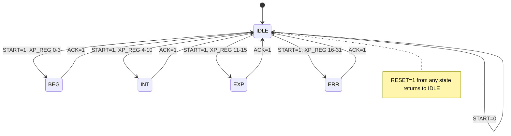

# FSM Design – Gaming XP Level Decoder (H3)

**Type:** Moore (outputs depend only on `STATE`) **Encoding:** 3-bit binary **Reset:** synchronous, active high, → IDLE

## State table
| State | Code | LED outputs (B, I, X, E) | Meaning |
|---|---|---|---|
| IDLE | 000 | 0000 | Waiting for START |
| BEG | 001 | 1000 | XP 0–3 |
| INT | 010 | 0100 | XP 4–10 |
| EXP | 011 | 0010 | XP 11–15 |
| ERR | 100 | 0001 | XP 16–31 (invalid, H3) |
| unused | 101, 110, 111 | 0000 | Recover to IDLE on next clock |

## Transition table
`LVL` = level chosen from `XP_REG`: BEG if XP_REG < 4, INT if 4 ≤ XP_REG ≤ 10, EXP if 11 ≤ XP_REG ≤ 15, ERR if XP_REG ≥ 16.

| Present state | RESET | START | ACK | Next state |
|---|---|---|---|---|
| any | 1 | x | x | IDLE |
| IDLE | 0 | 0 | x | IDLE |
| IDLE | 0 | 1 | x | LVL |
| BEG / INT / EXP / ERR | 0 | x | 0 | same state (hold) |
| BEG / INT / EXP / ERR | 0 | x | 1 | IDLE |
| 101 / 110 / 111 | 0 | x | x | IDLE |

## State diagram

## Next-state code (block C → CODE)
| Level | CODE[2] | CODE[1] | CODE[0] |
|---|---|---|---|
| BEG | 0 | 0 | 1 |
| INT | 0 | 1 | 0 |
| EXP | 0 | 1 | 1 |
| ERR | 1 | 0 | 0 |

Equations used in the circuit and the RTL:
- `CODE[2] = ERR`
- `CODE[1] = INT + EXP`
- `CODE[0] = BEG + EXP`

with `BEG = (XP_REG < 4)`, `GT10 = (XP_REG > 10)`, `ERR = (XP_REG > 15)`, `INT = NOT(BEG + GT10)`, `EXP = GT10 · NOT(ERR)`.

Next-state logic (blocks D/E): `KEEP = ACTIVE · NOT(ACK)`, `GO = S_IDLE · START`, where `ACTIVE = S_BEG + S_INT + S_EXP + S_ERR`.
`NEXT = RESET ? 000 : GO ? CODE : KEEP ? STATE : 000`.

## Logisim implementation
- File: `Gaming_XP_Decoder_H3_simple.circ` (Logisim 2.7.1 file format), single `main` circuit.
- Blocks A–F as in `01_Problem_Analysis/Problem_Analysis.md`.
- Four LEDs: BEGINNER (green), INTERMEDIATE (yellow), EXPERT (red), ERROR (orange).
- How to run: poke the 5-bit XP pin, then press Ctrl+T to tick the clock; set START for one tick; set ACK to return to IDLE.

## Logisim simulation results (19 Nov 2026)
One clock cycle = Ctrl+T twice (CLK 0 → 1 → 0). All screenshots taken with CLK = 0 and START/ACK released.

| Shot | Steps | Expected | Observed | Result |
|---|---|---|---|---|
| `logisim_1_idle.png` | RESET pulse | STATE 0, all LEDs off | STATE 0, all LEDs off | Pass |
| `logisim_2_beginner.png` | XP = 2, clock, START | STATE 1, BEGINNER on | STATE 1, BEGINNER on, XP_REG = 02 | Pass |
| `logisim_3_hold.png` | From BEG: XP changed to 31, 3 clocks, no ACK | Level held | STATE 1, BEGINNER still on, XP_REG still 02 | Pass |
| `logisim_4_intermediate.png` | ACK, XP = 7, clock, START | STATE 2, INTERMEDIATE on | STATE 2, INTERMEDIATE on, XP_REG = 07 | Pass |
| `logisim_5_expert.png` | ACK, XP = 13, clock, START | STATE 3, EXPERT on | STATE 3, EXPERT on, XP_REG = 0d | Pass |
| `logisim_6_error.png` | ACK, XP = 20, clock, START | STATE 4, ERROR on (H3) | STATE 4, ERROR on, XP_REG = 14 (hex) | Pass |
| `logisim_7_ack_idle.png` | ACK | STATE 0, all LEDs off | STATE 0, all LEDs off | Pass |

Note on shot 7: XP_REG still shows 14 just after ACK. It reloads from the XP pin on the next clock in IDLE. This is the one-clock input delay described in `05_Results/` (Limitations).

## Issue found and fixed in Logisim
| Issue | Root cause | Correction | Outcome |
|---|---|---|---|
| ACTIVE wire shown red (error) in a level state; KEEP not reliably 1, so the level would not hold until ACK | Two inputs (S_INT, S_EXP) of the 4-input OR gate that makes ACTIVE were not connected to the gate pins (blue, floating) | Deleted the gate, placed a new 4-input OR gate and reconnected all four inputs and the output | ACTIVE and KEEP correct (bright green in a level state); hold verified (`logisim_3_hold.png`) |

Evidence: `logisim_fix_before_or_gate.png` (red ACTIVE, blue inputs) and `logisim_fix_after_or_gate.png` (all four inputs connected).

## Full circuit (fixed version)
Shown in the EXPERT state with XP = 14: `logisim_blocks_A-C_expert.png` (inputs, input register, range decoder), `logisim_blocks_D-E_expert.png` (next-state logic, state register), `logisim_block_F_expert.png` (state decoder, LEDs).
