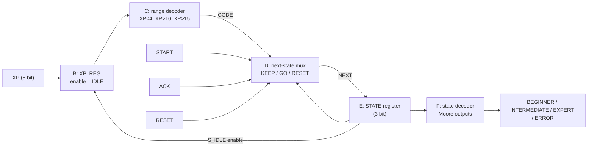

# Digital System Design – Group Project

> Complete every mandatory section. Do not delete headings. Replace bracketed prompts. If a section is not applicable, explain why.

## 1. Team Details
| Role | Student name | Roll number | GitHub username |
|---|---|---|---|
| Group leader | PARTH AMIT JOSHI | 25 | pxrthj |
| Member 2 | SHRADDHA BHARAT LAMANE | 29 | 2025shraddhalamane-eng |
| Member 3 | MAITREYEE DAHIWALE | 06 | 2025maitreyeedahiwale-coder |
| Member 4 | SUMIT SAMIR SANE | 50 | toberichsam |

**Class:** D9A (group leader and Member 4); Members 2 and 3 are listed as D9B in the faculty group sheet  
**Group ID:** D9A_Group20  
**Repository URL:** [https://github.com/pxrthj/DSD-2026-D9A-Group20](https://github.com/pxrthj/DSD-2026-D9A-Group20)  
**Final Pull Request URL:** `[TO FILL after the Pull Request is created]`

## 2. Assigned Problem Statement
- **Number/title:** Problem 8 – Gaming XP Level Decoder (Moore FSM), with suggested modification **H3: Add ERROR state for invalid input**
- **Problem summary:** A 5-bit experience-points (XP) value is classified into a player level by a Moore FSM. A START input captures the level, the level is shown on LEDs and held until ACK, and XP values outside the valid range raise an ERROR state (H3).
- **Objective:** Show exactly one of BEGINNER, INTERMEDIATE, EXPERT or ERROR for the XP value given at START, hold it until ACK, then return to IDLE; RESET always returns to IDLE.
- **Inputs and outputs:**

| Signal | Dir | Width | Meaning |
|---|---|---|---|
| `clk` | in | 1 | Clock (rising edge) |
| `reset` | in | 1 | Synchronous, active high |
| `start` | in | 1 | In IDLE, decide the level from the captured XP |
| `ack` | in | 1 | In a level state, go back to IDLE |
| `xp` | in | 5 | Experience points 0–31 |
| `led_beginner` | out | 1 | XP 0–3 |
| `led_intermediate` | out | 1 | XP 4–10 |
| `led_expert` | out | 1 | XP 11–15 |
| `led_error` | out | 1 | XP 16–31 (invalid) |

- **Constraints and assumptions:** The problem sheet's base design has a 4-bit XP input (0–15); the group widened it to 5 bits so that H3's out-of-range case (> 15) can actually occur. XP is unsigned; 0–15 valid, 16–31 invalid (H3). XP is captured into a register on every clock while in IDLE, so XP should be stable for one clock before START. `start` is ignored outside IDLE and `ack` is ignored in IDLE. 3-bit state encoding: IDLE 000, BEG 001, INT 010, EXP 011, ERR 100; codes 101–111 are unused and recover to IDLE.

## 3. Problem Analysis and Proposed Solution
Requirements R1–R9, edge cases, the block-by-block solution and the distinctive features are in `01_Problem_Analysis/Problem_Analysis.md`.

In short: a registered XP input, three comparators (`XP<4`, `XP>10`, `XP>15`) that give a 3-bit level code, three multiplexers for next-state logic (keep / load level / reset), a 3-bit state register, and a state decoder driving the four LEDs. It is small (8 flip-flops plus comparators and multiplexers), so it is easily feasible on any FPGA board.

Distinctive features: START/ACK handshake with the level held until acknowledged; H3 ERROR state using the fifth XP bit; illegal state codes recover to IDLE; self-checking testbench with an exhaustive 0–31 sweep.

## 4. Architecture
Blocks: **A** inputs, **B** XP register (enabled only in IDLE), **C** range decoder, **D** next-state logic, **E** state register, **F** state decoder and Moore outputs.

Trade-off: registering XP gives a stable value for the comparators but delays the decision by one clock (see Section 10).

## 5. FSM Design
Yes, the design is a **Moore FSM** with five states (IDLE, BEG, INT, EXP, ERR), 3-bit binary encoding, synchronous active-high reset to IDLE, and unused codes 101–111 recovering to IDLE.

**Diagram:** `02_FSM_Logisim/FSM_Design.md` (state diagram)  
**State table:** `02_FSM_Logisim/FSM_Design.md` (state table, transition table, next-state equations)

## 6. Logisim Implementation
- Logisim version: Logisim 2.7.1 (Carl Burch, SourceForge release)
- Circuit file: `02_FSM_Logisim/Gaming_XP_Decoder_H3_simple.circ`
- Test cases and expected/observed behaviour: 7 tests (reset/IDLE, BEGINNER XP=2, hold with XP changed, INTERMEDIATE XP=7, EXPERT XP=13, ERROR XP=20, ACK→IDLE), all passed; table in `02_FSM_Logisim/FSM_Design.md`
- Issues and corrections: the 4-input OR gate that makes ACTIVE had two unconnected inputs, so ACTIVE showed an error value and the level would not reliably hold; the gate was replaced and rewired, and the hold was re-verified (see Section 10)
- Screenshot/evidence: `02_FSM_Logisim/logisim_1_idle.png` … `logisim_7_ack_idle.png`, plus before/after images of the fix

## 7. Verilog HDL Implementation
- Tool/version: Vivado v2018.3 (64-bit), XSim for behavioural simulation
- Top module and submodules: FSM `gaming_xp_decoder` (simulation DUT); board top `gaming_xp_top` (synchronizers + `gaming_xp_decoder`); testbench `tb_gaming_xp_decoder`
- Architecture/coding decisions: direct block-for-block translation of the Logisim circuit (blocks B–F); Moore outputs are continuous assignments from the state decoder; one clocked process for `xp_reg` and one for `state`.
- Synthesizability considerations: only synthesizable constructs in the RTL (no delays, no initial blocks except register power-up values `state = IDLE`, `xp_reg = 0`, which Xilinx FPGAs support); comparators against constants map to LUTs/carry logic.
- RTL: `03_Verilog_Implementation/RTL/`
- Testbench: `03_Verilog_Implementation/Testbench/`

## 8. Verification and Simulation Results
| Test ID | Inputs/conditions | Expected output | Observed output | Pass/Fail |
|---|---|---|---|---|
| T01 | Power-up RESET | IDLE, LEDs off | IDLE, LEDs off | Pass |
| T02 | XP=0 / 3, START | BEG, BEGINNER LED | BEG, BEGINNER LED | Pass |
| T03 | XP=4 / 7 / 10, START | INT, INTERMEDIATE LED | INT, INTERMEDIATE LED | Pass |
| T04 | XP=11 / 15, START | EXP, EXPERT LED | EXP, EXPERT LED | Pass |
| T05 | XP=16 / 31, START | ERR, ERROR LED | ERR, ERROR LED | Pass |
| T06 | Hold, XP changed, START pulsed, then ACK | Hold, then IDLE | Hold, then IDLE | Pass |
| T07 | RESET with START, RESET in EXPERT | IDLE | IDLE | Pass |
| T08 | Forced states 101/110/111 | LEDs off, then IDLE | LEDs off, then IDLE | Pass |
| T09 | Sweep XP = 0..31 | Correct level for all | 32/32 correct | Pass |

Tool/version: Vivado 2018.3 XSim (behavioural simulation); also cross-checked in Icarus Verilog 12.0  
Number passed/failed: 81 passed / 0 failed (same result in both simulators)  
Waveform/log path: `03_Verilog_Implementation/Simulation_Results/` (Vivado Tcl console and waveform screenshots, `sim_log_iverilog.txt`, `Verification_Summary.md`)

## 9. FPGA Hardware Implementation
- FPGA board/device: Real Digital Boolean Board, Spartan-7 `xc7s50csga324-1`
- Tool/version: Vivado v2018.3 (64-bit)
- Clock/constraints: 100 MHz on-board clock (F14, 10 ns `create_clock`); XP on SW4–SW0, START/ACK/RESET on BTN0/BTN1/BTN2, LEDs on LD0–LD3. Board top module `gaming_xp_top` adds 2-FF synchronizers. Files: `04_FPGA_Hardware/boolean_gaming_xp.xdc`, `03_Verilog_Implementation/RTL/gaming_xp_top.v`; steps in `04_FPGA_Hardware/FPGA_Steps.md`
- Synthesis/implementation summary (top `gaming_xp_top`, post-route, Vivado 2018.3):

| Resource | Used | Available | Util % |
|---|---:|---:|---:|
| Slice LUTs | 8 | 32,600 | 0.02 |
| Flip-flops | 24 (8 FSM + 16 synchronizer) | 65,200 | 0.04 |
| Bonded IOB | 13 | 210 | 6.19 |
| BUFG | 1 | 32 | 3.13 |
| CARRY4 / Block RAM / DSP | 0 | – | 0 |

  Timing at 100 MHz: WNS = +7.656 ns, WHS = +0.173 ns, 0 failing endpoints – all constraints met. DRC: 0 violations; methodology checks: 0 violations; 0 critical warnings in synthesis and implementation. Estimated on-chip power 0.073 W (0.001 W dynamic). The I/O report confirms all 13 pins placed as in the XDC. Reports: `04_FPGA_Hardware/reports/`; bitstream: `04_FPGA_Hardware/gaming_xp_top.bit`.
- Programming and hardware test result: **Not yet done – board not available to the group.** The bitstream is generated and ready; the test sequence is in `04_FPGA_Hardware/FPGA_Steps.md`.
- Evidence path: `04_FPGA_Hardware/`

Explain differences between simulation and hardware results, if any: not yet known, because the board demonstration has not been done. Note: the board top `gaming_xp_top` synchronizes switches and buttons with 2-FF synchronizers; no debouncer is needed because START is ignored outside IDLE and ACK is ignored in IDLE, so a held or bouncing button still gives one action.

## 10. Challenges, Debugging and Improvements
| Issue | Root cause | Correction | Outcome |
|---|---|---|---|
| START in the first IDLE cycle after ACK can give a stale level (found in review, reproduced in simulation) | XP_REG loads only in IDLE, so after a held level it still holds the XP from before the previous START | Documented limitation: keep XP stable for one clock before START (`[team to decide whether to change the RTL]`) | Known limitation, see `05_Results/` |
| Testbench does not detect removal of the XP_REG IDLE enable | No test applies START right after ACK | Suggested extra test in `Verification_Summary.md` | Open |
| Logisim: ACTIVE wire red (error), level did not reliably hold until ACK | S_INT and S_EXP inputs of the 4-input OR gate were not connected to the gate pins (floating) | Replaced the OR gate and reconnected all four inputs and the output | Hold verified in Logisim (`02_FSM_Logisim/logisim_3_hold.png`) |
| Vivado: first behavioural simulation run ended with an empty log and an XSim crash file | Run did not complete (cause not identified) | Re-ran Behavioral Simulation → Run All | ALL TESTS PASSED (81 checks) |

Future improvements: load XP_REG every clock to remove the stale case; add the missing test; show the XP value on the 7-segment display.

## 11. Task Allocation and Individual Contribution
| Student | Assigned responsibility | Actual contribution/evidence |
|---|---|---|
| Group leader (Parth Joshi) | Logisim design and simulation (with Member 3) | `02_FSM_Logisim/` |
| Member 2 (Shraddha Lamane) | Verilog RTL, testbench and FPGA implementation (with Member 4) | `03_Verilog_Implementation/`; `04_FPGA_Hardware/` (hardware evidence still to upload) |
| Member 3 (Maitreyee Dahiwale) | Logisim design and simulation (with Group leader) | `02_FSM_Logisim/` |
| Member 4 (Sumit Sane) | Verilog RTL, testbench and FPGA implementation (with Member 2) | `03_Verilog_Implementation/`; `04_FPGA_Hardware/` (hardware evidence still to upload) |

Every student must be ready to explain the complete design.

## 12. Progress Log
Maintain time-wise updates in `STATUS.md`.

## 13. Final Results and Conclusion
- **Logisim:** 7/7 tests passed (IDLE, BEGINNER, hold until ACK, INTERMEDIATE, EXPERT, ERROR, ACK → IDLE) after fixing an unconnected OR gate in the next-state logic.
- **Verilog simulation:** 81/81 checks passed in Vivado 2018.3 XSim (also in Icarus Verilog): all 32 XP values give the correct level, outputs are Moore, the level is held until ACK, RESET has top priority, and unused state codes 101–111 recover to IDLE.
- **FPGA:** the design synthesizes and implements on the Boolean Board's Spartan-7 using 8 LUTs and 24 flip-flops, with timing met at 100 MHz (WNS +7.656 ns) and 0 DRC violations. Bitstream generated.
- **Hardware demonstration:** not yet performed, because a board was not available. This is the one requirement not yet shown.
- **Limitation:** one-clock input delay – XP must be stable for one clock in IDLE before START (Section 10).

**Conclusion:** the H3 Gaming XP Level Decoder meets requirements R1–R9 in Logisim and in RTL simulation, and is ready to program on the FPGA. Details in `05_Results/Results_and_Conclusion.md`.

## 14. Team Reflection
- **What we learned:** how a Moore FSM is split into an input register, a range decoder, next-state multiplexers, a state register and an output decoder, and how the same blocks map one-to-one from Logisim to Verilog. Writing a self-checking testbench with an exhaustive sweep caught more than single test cases would. Board inputs need synchronizers because switches and buttons are not in step with the clock.
- **Debugging:** an unconnected input on a 4-input OR gate in Logisim (shown as blue and red wires) stopped the level from holding. Reading Logisim's wire colours located it quickly.
- **What we would improve:** run the board demonstration earlier, load XP_REG every clock to remove the one-clock input delay, add a testbench case for START right after ACK, and show the XP value on the 7-segment display.

## 15. Final Submission Checklist
- [x] Team details and problem analysis complete.
- [x] Architecture/block diagram included.
- [x] FSM diagram/table or justified alternative included.
- [x] Logisim source and simulation evidence uploaded.
- [x] Verilog RTL and testbench uploaded.
- [x] Simulation results and test cases documented (Vivado XSim and Icarus, 81/81 pass).
- [ ] FPGA implementation and hardware evidence uploaded (implementation reports and bitstream uploaded; board demo pending).
- [ ] Results, challenges and conclusion documented (hardware part pending).
- [ ] Presentation and final report uploaded.
- [x] STATUS.md is up to date.
- [ ] Final Pull Request created and URL recorded.
