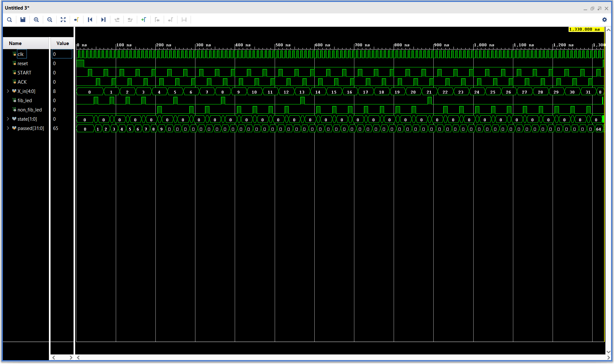

# Results, Verification Analysis, and Conclusions

## 1. Functional & Control Test-Case Table

| Test ID | Test Scenario | Input Conditions (`X_in`, Controls) | Expected Behaviour | Observed Behaviour (Vivado & Logisim) | Status |
|---|---|---|---|---|---|
| **T01** | Power-on / Reset | `reset = 1`, `START = 0`, `ACK = 0` | `state = 00` (`IDLE`), `fib_led = 0`, `non_fib_led = 0` | `state = 00`, `fib_led = 0`, `non_fib_led = 0` | Pass |
| **T02** | Lower-Bound Fibonacci | `X_in = 0` (`00000`), pulse `START` | `F = 1`, `state = 01` (`FIB`), `fib_led = 1`, `non_fib_led = 0` | `state = 01`, `fib_led = 1`, `non_fib_led = 0` | Pass |
| **T03** | Base 4-Bit Fibonacci Set | `X_in ∈ {1, 2, 3, 5, 8, 13}`, pulse `START` | `F = 1`, `state = 01` (`FIB`), `fib_led = 1`, `non_fib_led = 0` | All 6 values asserted `fib_led = 1` in `state = 01` | Pass |
| **T04** | Extended 5-Bit Fibonacci (`H1`) | `X_in = 21` (`10101`), pulse `START` | `F = 1`, `state = 01` (`FIB`), `fib_led = 1`, `non_fib_led = 0` | `state = 01`, `fib_led = 1`, `non_fib_led = 0` | Pass |
| **T05** | Non-Fibonacci Classification | `X_in = 4` (`00100`), pulse `START` | `F = 0`, `state = 10` (`NON_FIB`), `fib_led = 0`, `non_fib_led = 1` | `state = 10`, `fib_led = 0`, `non_fib_led = 1` | Pass |
| **T06** | Comparator Edge Case (`xx101`) | `X_in = 29` (`11101`), pulse `START` | Blocked by `¬(X4·X3)`; `state = 10` (`NON_FIB`), `non_fib_led = 1` | `state = 10`, `fib_led = 0`, `non_fib_led = 1` | Pass |
| **T07** | Upper-Bound Non-Fibonacci | `X_in = 31` (`11111`), pulse `START` | `F = 0`, `state = 10` (`NON_FIB`), `fib_led = 0`, `non_fib_led = 1` | `state = 10`, `fib_led = 0`, `non_fib_led = 1` | Pass |
| **T08** | Result Hold & `ACK` Return | Hold `ACK = 0`, then assert `ACK = 1` | Holds result LED while `ACK = 0`; returns to `IDLE (00)` on `ACK = 1` | Held LED steady until `ACK = 1`, then returned to `00` | Pass |
| **T09** | `ACK` Ignored in `IDLE` | `state = 00`, assert `ACK = 1` | Remains in `IDLE (00)`, both LEDs `0` | Remained in `00`, both LEDs `0` | Pass |
| **T10** | Mid-Operation Reset | `state = 01` or `10`, assert `reset = 1` | Immediate return to `IDLE (00)`, registers and LEDs cleared | Immediately cleared to `state = 00`, LEDs `0` | Pass |

---

## 2. Simulation Waveform Evidence

*Figure: Vivado `xsim` behavioral simulation waveform of `top_module_tb` sweeping all 32 unsigned decimal inputs (`0`–`31`), showing `fib_led` asserted strictly on `{0, 1, 2, 3, 5, 8, 13, 21}`, `non_fib_led` on the remaining 24 values, `START`/`ACK` state transitions, and `passed = 65` at `1,330.000 ns`.*

---

## 3. Expected-versus-Observed Comparison (Exhaustive 0–31 Sweep)

Every 5-bit unsigned integer (`0` to `31`) was evaluated in `top_module_tb` with `START`/`ACK` handshaking and verified against the reference Fibonacci set `{0, 1, 2, 3, 5, 8, 13, 21}`:

| Decimal (`X_in`) | Binary (`X_in[4:0]`) | Expected Class | Expected (`state`, `fib_led`, `non_fib_led`) | Observed (`state`, `fib_led`, `non_fib_led`) | Match |
|---:|:---:|:---:|:---:|:---:|:---:|
| 0 | `00000` | Fibonacci | `01`, `1`, `0` | `01`, `1`, `0` | Pass |
| 1 | `00001` | Fibonacci | `01`, `1`, `0` | `01`, `1`, `0` | Pass |
| 2 | `00010` | Fibonacci | `01`, `1`, `0` | `01`, `1`, `0` | Pass |
| 3 | `00011` | Fibonacci | `01`, `1`, `0` | `01`, `1`, `0` | Pass |
| 4 | `00100` | Non-Fibonacci | `10`, `0`, `1` | `10`, `0`, `1` | Pass |
| 5 | `00101` | Fibonacci | `01`, `1`, `0` | `01`, `1`, `0` | Pass |
| 6 | `00110` | Non-Fibonacci | `10`, `0`, `1` | `10`, `0`, `1` | Pass |
| 7 | `00111` | Non-Fibonacci | `10`, `0`, `1` | `10`, `0`, `1` | Pass |
| 8 | `01000` | Fibonacci | `01`, `1`, `0` | `01`, `1`, `0` | Pass |
| 9 | `01001` | Non-Fibonacci | `10`, `0`, `1` | `10`, `0`, `1` | Pass |
| 10 | `01010` | Non-Fibonacci | `10`, `0`, `1` | `10`, `0`, `1` | Pass |
| 11 | `01011` | Non-Fibonacci | `10`, `0`, `1` | `10`, `0`, `1` | Pass |
| 12 | `01100` | Non-Fibonacci | `10`, `0`, `1` | `10`, `0`, `1` | Pass |
| 13 | `01101` | Fibonacci | `01`, `1`, `0` | `01`, `1`, `0` | Pass |
| 14 | `01110` | Non-Fibonacci | `10`, `0`, `1` | `10`, `0`, `1` | Pass |
| 15 | `01111` | Non-Fibonacci | `10`, `0`, `1` | `10`, `0`, `1` | Pass |
| 16 | `10000` | Non-Fibonacci | `10`, `0`, `1` | `10`, `0`, `1` | Pass |
| 17 | `10001` | Non-Fibonacci | `10`, `0`, `1` | `10`, `0`, `1` | Pass |
| 18 | `10010` | Non-Fibonacci | `10`, `0`, `1` | `10`, `0`, `1` | Pass |
| 19 | `10011` | Non-Fibonacci | `10`, `0`, `1` | `10`, `0`, `1` | Pass |
| 20 | `10100` | Non-Fibonacci | `10`, `0`, `1` | `10`, `0`, `1` | Pass |
| 21 | `10101` | Fibonacci | `01`, `1`, `0` | `01`, `1`, `0` | Pass |
| 22 | `10110` | Non-Fibonacci | `10`, `0`, `1` | `10`, `0`, `1` | Pass |
| 23 | `10111` | Non-Fibonacci | `10`, `0`, `1` | `10`, `0`, `1` | Pass |
| 24 | `11000` | Non-Fibonacci | `10`, `0`, `1` | `10`, `0`, `1` | Pass |
| 25 | `11001` | Non-Fibonacci | `10`, `0`, `1` | `10`, `0`, `1` | Pass |
| 26 | `11010` | Non-Fibonacci | `10`, `0`, `1` | `10`, `0`, `1` | Pass |
| 27 | `11011` | Non-Fibonacci | `10`, `0`, `1` | `10`, `0`, `1` | Pass |
| 28 | `11100` | Non-Fibonacci | `10`, `0`, `1` | `10`, `0`, `1` | Pass |
| 29 | `11101` | Non-Fibonacci | `10`, `0`, `1` | `10`, `0`, `1` | Pass |
| 30 | `11110` | Non-Fibonacci | `10`, `0`, `1` | `10`, `0`, `1` | Pass |
| 31 | `11111` | Non-Fibonacci | `10`, `0`, `1` | `10`, `0`, `1` | Pass |

### Cross-Platform Verification Summary

| Platform | Tool / Hardware | Verification Scope | Observed Result |
|---|---|---|---|
| **Gate-Level Schematic** | Logisim-evolution v5.0.0 | Interactive testing of Fibonacci, non-Fibonacci, edge (`29`, `31`), `START`/`ACK`, and `reset` | All outputs (`F`, `S1`, `S0`, `fib_led`, `non_fib_led`) matched truth table |
| **Behavioral Simulation** | Xilinx Vivado 2018.3 (`xsim`) | Self-checking `top_module_tb` across all 32 inputs + `ACK` + reset (`1318 ns`–`1330 ns`) | `TOTAL PASSED = 33`, `TOTAL FAILED = 0` (Tcl console); `65` checks passed, `0` failed (waveform) |
| **FPGA Hardware Build** | RealDigital Boolean Board (`xc7s50csga324-1`) | Synthesis, place-and-route, XDC pin mapping, bitstream generation (`top_module.bit`) | `write_bitstream Complete`; 4 RTL cells, 13 I/O ports, 20 nets; switch-to-LED behaviour matched simulation |

---

## 4. Accuracy and Correctness Analysis

- **100% Classification Accuracy (`32 / 32`):** All 8 Fibonacci inputs (`0, 1, 2, 3, 5, 8, 13, 21`) produced true positives (`fib_led = 1`, `state = 01`) and all 24 non-Fibonacci inputs produced true negatives (`non_fib_led = 1`, `state = 10`), yielding **0 false positives** and **0 false negatives**.
- **Cycle-Accurate Synchronization:** Delaying `START` by one clock cycle via `start_delayed_reg` guaranteed that `X_in[4:0]` was fully latched into `input_register` (`U1`) and resolved by `fibonacci_comparator` (`U2`) before `fsm_controller` (`U3`) evaluated `fib_detect`, eliminating stale-data sampling bugs.
- **Glitch-Free Moore Outputs:** Because `fib_led` and `non_fib_led` depend solely on the registered FSM state (`state[1:0]`), LED transitions remain clean and immune to intermediate combinational switching inside the comparator.
- **Boundary & Fault Safety:** The minimized Boolean expression accurately excluded `29` (`11101`) despite sharing the `xx101` suffix with `5`, `13`, and `21`, and the FSM `default` branch safely recovers from the unused state `11` back to `IDLE (00)`.
- **Logisim-to-RTL Structural Match:** Both the Logisim gate-level implementation and the Vivado Elaborated Design maintain identical partitioning (5-bit input register, combinational comparator, 1-bit `START` delay flip-flop, and 2-bit Moore FSM) and consistent state encoding.

---

## 5. Known Limitations

- **Fixed 5-Bit Input Width:** The combinational comparator is hardcoded for the 5-bit Fibonacci set (`0–31`). Scaling to wider inputs (e.g., 6-bit or 8-bit) requires widening the register bus and updating the comparator logic.
- **One-Cycle Evaluation Latency:** Introducing `start_delayed_reg` adds one extra clock cycle between asserting `START` and updating the Moore FSM state/LED outputs (10 ns at 100 MHz—imperceptible to human users, but relevant in tight pipelined systems).
- **No Hardware Debouncing:** Physical slide switches and the `BTN0` reset pushbutton on the Boolean Board can exhibit mechanical contact bounce, which is not filtered in hardware. Stable operation relies on keeping `X_in` steady before asserting `START`.
- **Asynchronous Reset Convention:** The implemented Verilog modules and Logisim flip-flops use an asynchronous active-high reset (`RTL_REG_ASYNC` / D-FF clear pin) for immediate startup recovery, whereas the original base prompt listed a synchronous active-high reset.
- **Base + `H1` Scope Only:** Optional modification hints beyond `H1`—such as an `ERROR` state (`H3`), Fibonacci/non-Fibonacci counters (`H4`), or a `CHANGE` indicator (`H5`)—are not implemented in this version.

---

## 6. Conclusions

The 5-bit Extended Fibonacci Number Detector (`5H1`) successfully satisfies all functional, architectural, and verification requirements across Logisim-evolution, Vivado behavioral simulation, and Spartan-7 FPGA implementation. Partitioning the circuit into a 5-bit input register, minimized combinational comparator, 1-cycle `START` delay register, and 3-state Moore FSM achieved **100% accuracy across all 32 input states (`0` failures)** with clean `START`/`ACK` handshaking and a complete bitstream build (`write_bitstream Complete`) for the RealDigital Boolean Board (`xc7s50csga324-1`). Future revisions can extend hardware robustness by adding input debouncers/synchronizers for physical buttons, offering a strictly synchronous reset option, and incorporating optional counter or error-detection states.
