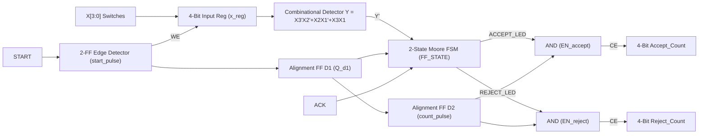

# 01 – Problem Analysis: Forbidden Zone Rejector (4-Bit) with H4 Counters

**Group:** Group 08 | **Target FPGA:** Xilinx Spartan-7 `xc7s50csga324-1` (Speed Grade `-1`) | **Modification:** H4 (Add Counters)

## 1. Problem Statement

Design, simulate, and implement a 4-bit digital system (**Forbidden Zone Rejector**) that evaluates a 4-bit binary input `X[3:0]` (decimal `0` to `15`) and outputs:
* **`Y = 0` (`REJECT`, Red LED ON)** for binary values **`0110` to `1001` (decimal `6` to `9` inclusive)**.
* **`Y = 1` (`ACCEPT`, Green LED ON)** for all other binary values (**`0` to `5`** and **`10` to `15`**).

**Assigned Modification — H4 (Add Counters):**
* Extend the baseline architecture with two 4-bit synchronous up-counters: **`Accept_Count[3:0]`** and **`Reject_Count[3:0]`**.
* Increment the corresponding counter by `1` whenever a sampled input is classified as allowed (`ACCEPT`) or forbidden (`REJECT`).

## 2. Functional Requirements & Design Constraints

* **Synchronous Active-High Reset (`RESET`):** Clears the 4-bit input register, returns the Moore FSM to `IDLE (00)`, clears alignment flip-flops, and resets both H4 counters to `0000` on the rising clock edge.
* **Event-Driven Sampling (`START`):** User sets the 4-bit switch value `X[3:0]` first and presses `START` to latch the sample; changing switches alone must not trigger transitions or false counts.
* **Reject Acknowledgement (`ACK`):** Returns the Moore FSM from `REJECT (01)` to `IDLE (00)` without incrementing either counter.
* **Zero Gated Clocks:** All flip-flops, registers, and counters share a single global clock (`CLK` / `BUFG`), using dedicated Clock Enable (`CE` / `WE`) pins for conditional updates.
* **No Counter Overflow on Exhaustive Test:** An exhaustive `0`–`15` sweep produces `12` accepted values and `4` rejected values, requiring at least **4-bit counters** (`0`–`15`; 3-bit counters would overflow at `8`).

## 3. Design Assumptions

* In Logisim (Stage 1), `START` is modeled with a toggle input pin paired with a 2-FF rising-edge pulse generator so holding `START = 1` generates exactly one sample pulse.
* On the physical Spartan-7 FPGA (Stage 3), an optional 10 ms pushbutton debouncer wrapper can be placed ahead of `START` and `ACK` to suppress mechanical switch bounce at 100 MHz without modifying the core RTL.
* `START` and `ACK` are not asserted simultaneously within the 20 ns (`2`-cycle) internal pipeline window during normal human or testbench operation.

## 4. Input / Output Definitions

| Signal | Direction | Width | Active Level / Type | Description |
| :--- | :--- | :---: | :--- | :--- |
| `clk` | Input | 1-bit | Rising-edge | Global system clock (100 MHz on Spartan-7) |
| `reset` | Input | 1-bit | Synchronous, Active-High | Clears `x_reg`, FSM (`IDLE`), pipeline FFs, and counters |
| `start` | Input | 1-bit | Rising-edge triggered | Loads `x_in[3:0]` into `x_reg` and triggers evaluation + counting |
| `ack` | Input | 1-bit | Active-High | Clears `REJECT (01)` back to `IDLE (00)` without counting |
| `x_in[3:0]` | Input | 4-bit | Binary (`0000`–`1111`) | 4-bit user switch input (`X3` MSB to `X0` LSB) |
| `accept_led` (`y_out`) | Output | 1-bit | Active-High (Moore) | Green LED: `1` in `IDLE (00)`, `0` in `REJECT (01)` |
| `reject_led` | Output | 1-bit | Active-High (Moore) | Red LED: `1` in `REJECT (01)`, `0` in `IDLE (00)` |
| `accept_count[3:0]` | Output | 4-bit | Binary / Hex (`0`–`F`) | Total count of accepted inputs (`12` / `0xC` after full `0`–`15` sweep) |
| `reject_count[3:0]` | Output | 4-bit | Binary / Hex (`0`–`F`) | Total count of rejected inputs (`4` / `0x4` after full `0`–`15` sweep) |

## 5. Truth Table & Boolean Derivation (K-Map Minimization)

| `X3 X2 X1 X0` | Decimal | Zone | `Y` (Accept) | `FZ = Y'` (Forbidden) |
| :---: | :---: | :--- | :---: | :---: |
| `0000` – `0101` | `0` – `5` | Allowed | `1` | `0` |
| `0110` – `1001` | `6` – `9` | **Forbidden** | **`0`** | **`1`** |
| `1010` – `1111` | `10` – `15` | Allowed | `1` | `0` |

* **Minimized Accept Equation (derived from truth table K-map):**
  * `Y = X3'X2' + X2X1' + X3X1`
* **Equivalent Forbidden Zone Equation:**
  * `FZ = Y' = X3'X2X1 + X3X2'X1'`
* **Key Optimization:** `X0` is completely eliminated because forbidden pairs `(6, 7)` and `(8, 9)` are independent of the LSB `X0`, reducing gate depth while `x_reg[3:0]` still latches all 4 bits.

## 6. Proposed Architecture (4-Cycle Synchronous Pipeline)

To prevent combinational `Y` from directly gating the counters—and to eliminate stale-register races—the design pairs the 2-state Moore FSM with two alignment flip-flops (`D1`, `D2`):

* **Cycle 1 (`start_pulse_gen`):** Captures `START` rising edge and produces 1-cycle `start_pulse`.
* **Cycle 2 (`x_reg` & `D1`):** Latches `X[3:0]` so `Y` settles cleanly; `D1` asserts `Q_d1 = 1`.
* **Cycle 3 (`FF_STATE` & `D2`):** Moore FSM updates `ACCEPT_LED` / `REJECT_LED`; `D2` asserts `count_pulse = 1`.
* **Cycle 4 (`h4_counters`):** Selected 4-bit counter increments via `CE` (total latency = **40 ns at 100 MHz**).
