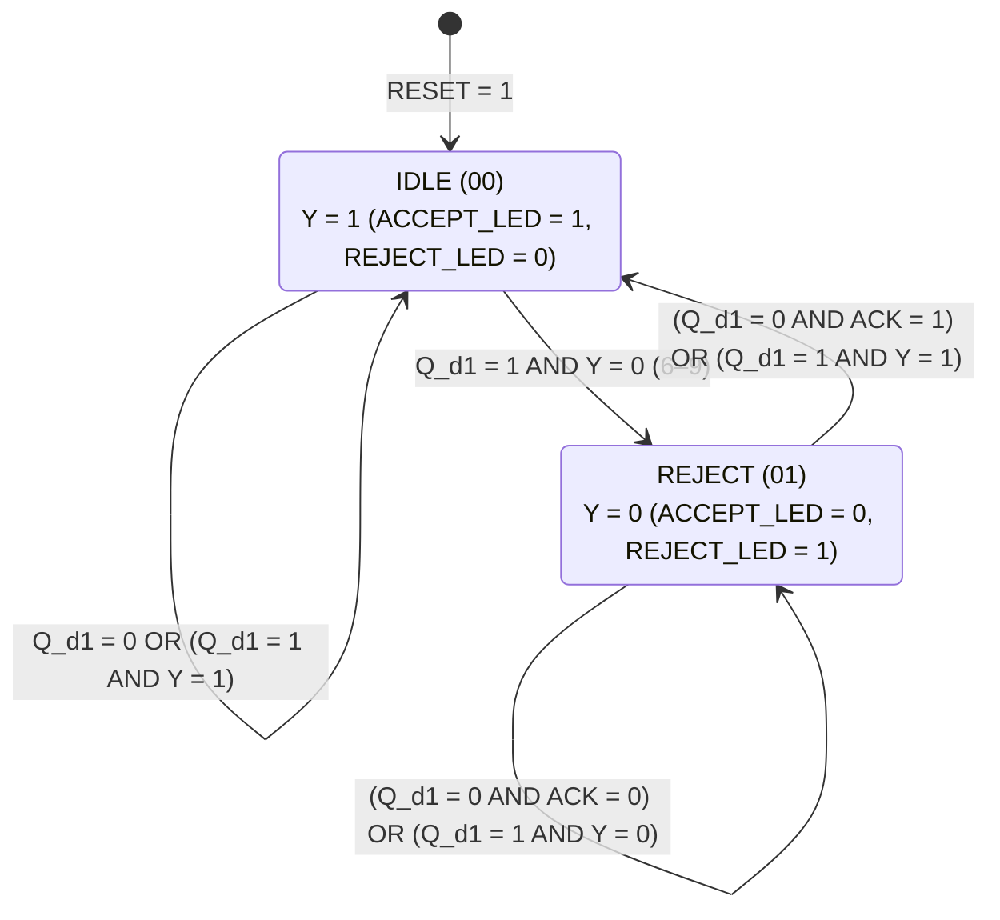

# 02 – FSM Design and Logisim Implementation

**Group:** Group 08 | **Project:** Forbidden Zone Rejector (4-Bit) with H4 Counters

## 1. Moore FSM State Diagram

## 2. State Encoding & Output Equations (Moore Model)

| State Name | 2-Bit Encoding | State FF (`Q`) | `Y_out` / `ACCEPT_LED` (`~Q`) | `REJECT_LED` (`Q`) | Meaning |
| :--- | :---: | :---: | :---: | :---: | :--- |
| **`IDLE`** | `00` | `0` | `1` (Green ON) | `0` (Red OFF) | Default / Allowed zone (`0–5`, `10–15`) |
| **`REJECT`** | `01` | `1` | `0` (Green OFF) | `1` (Red ON) | Forbidden zone detected (`6–9`) |

* **Next-State Equation (`D` input of `FF_STATE`):**
  * `AND_enter = Q_d1 · Y'` *(new forbidden sample enters/stays in `REJECT`)*
  * `AND_hold = Q · Q_d1' · ACK'` *(latches `REJECT` until `ACK = 1` or new sample arrives)*
  * **`Q+ = (Q_d1 · Y') + (Q · Q_d1' · ACK')`**
* **H4 Counter Enable Equations (Purely Driven by Moore LEDs + Aligned Pulse):**
  * `EN_accept = count_pulse · ACCEPT_LED`
  * `EN_reject = count_pulse · REJECT_LED`

## 3. Complete State Transition Table

| Present State (`Q`) | `Q_d1` | `Y` (Detector) | `ACK` | Next State (`Q+`) | Outputs (`ACCEPT`, `REJECT`) | System Action |
| :--- | :---: | :---: | :---: | :--- | :---: | :--- |
| `00` (`IDLE`, `0`) | `0` | `X` | `X` | `00` (`IDLE`) | `1`, `0` | Wait for `START` |
| `00` (`IDLE`, `0`) | `1` | `1` | `X` | `00` (`IDLE`) | `1`, `0` | Allowed sample; `Accept_Count` increments next cycle |
| `00` (`IDLE`, `0`) | `1` | `0` | `X` | `01` (`REJECT`) | `1`, `0` → `0`, `1` | Forbidden sample; `Reject_Count` increments next cycle |
| `01` (`REJECT`, `1`) | `0` | `X` | `0` | `01` (`REJECT`) | `0`, `1` | Hold `REJECT` LED ON |
| `01` (`REJECT`, `1`) | `0` | `X` | `1` | `00` (`IDLE`) | `0`, `1` → `1`, `0` | `ACK` clears `REJECT` (no counter increment) |
| `01` (`REJECT`, `1`) | `1` | `1` | `X` | `00` (`IDLE`) | `0`, `1` → `1`, `0` | New allowed sample exits `REJECT`; `Accept_Count++` |
| `01` (`REJECT`, `1`) | `1` | `0` | `X` | `01` (`REJECT`) | `0`, `1` | New forbidden sample holds `REJECT`; `Reject_Count++` |

## 4. Logisim-Evolution Circuit Breakdown & Debugging Highlights

The circuit is organized into four clean functional blocks sharing bottom `CLK` and `RESET` bus rails:
1. **Input Register & Combinational Detector (Top-Left):** 4-bit Register (`WE = start_pulse`) feeding `Y = X3'X2' + X2X1' + X3X1` (three 2-input AND gates + one 3-input OR gate + one NOT gate for `Y'`).
2. **Pulse Conditioning & Alignment (Bottom-Left/Center):** 2-FF `START` rising-edge pulse generator feeding `D1` (`Q_d1` & `~Q_d1`) and `D2` (`count_pulse`).
3. **2-State Moore FSM Controller (Top-Center):** `AND_enter`, `AND_hold`, `OR_next`, and `FF_STATE` driving Green `ACCEPT_LED` and Red `REJECT_LED`.
4. **H4 4-Bit Counters (Far Right):** Two 4-bit synchronous counters with `CLK` wired directly, enabled via `ct` (`EN_accept` / `EN_reject`), driving two Hex Digit Displays (`ACCEPT_COUNT`, `REJECT_COUNT`).

**Key Improvements Made During Stage 1 Verification:**
* Upgraded counters from 3-bit (which overflowed at `8`) to **4-bit** to hold the full `0`–`15` sweep (`12` accepted, `4` rejected).
* Replaced gated counter clocks with **dedicated `ct` (Enable)** pins on a single global `CLK` rail to prevent glitching and clock skew.
* Wired `~Q` of `D1` directly into `AND_hold` (`Q · Q_d1' · ACK'`) so `REJECT` stays latched solidly until `ACK = 1` (or a new allowed sample) instead of dropping back to `IDLE` after 1 cycle.

## 5. Logisim Simulation Verification Results

* **Test Method:** Exhaustive sweep of all 16 binary combinations (`0000` to `1111`), verifying `START`, `ACK`, `RESET`, LED outputs, and Hex counter displays.
* **Observed Final Counts:** `ACCEPT_COUNT = C` (`12` decimal for `0–5` and `10–15`) and `REJECT_COUNT = 4` (`4` decimal for `6–9`).
* **Observed Pipeline Latency:** 4 clock cycles from `START` assertion to counter update (clearly observable at 2 Hz simulation speed; instantaneous `40 ns` at 100 MHz on FPGA).
* *Note:* Logisim's built-in flip-flop `R` pin is asynchronous; strict synchronous active-high reset (`always @(posedge clk) if (reset)`) is enforced in Stage 2 Verilog RTL.

## 6. Logisim Circuit Diagram

