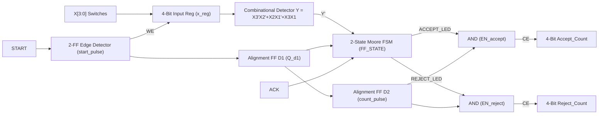
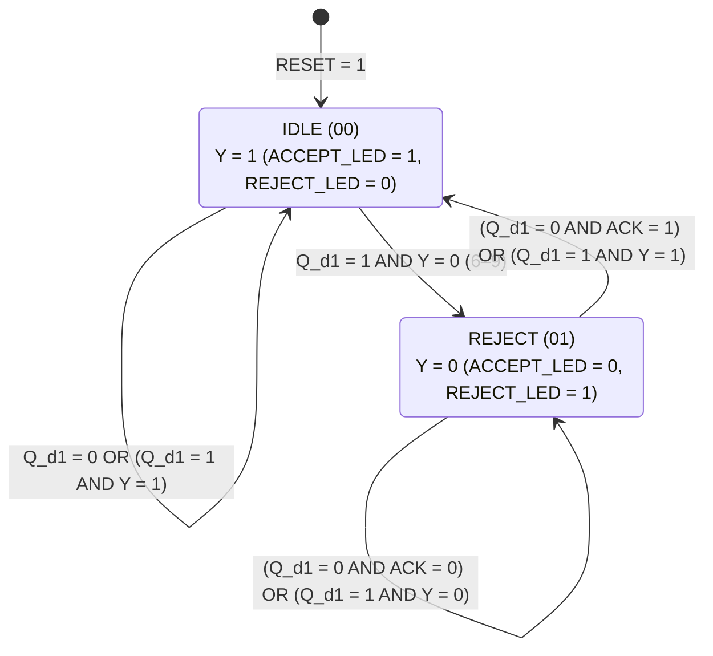

# Digital System Design – Group Project

## 1. Team Details
| Role | Student name | Roll number | GitHub username |
|---|---|---|---|
| Group leader | Tanav Patil | 50 | code-voyager17 |
| Member 2 | Chinmay Keskar | 23 | keskarchinmay7-hub |
| Member 3 | Vedant Patil | 42 | vedantpatil1705 |
| Member 4 | Aditya Yadav | 61 | 2025adityadyadav-byte |

**Class:** D9B  
**Group ID:** D9B-Group08  
**Repository URL:** [https://github.com/code-voyager17/DSD-2026-D9B-Group08]  
**Final Pull Request URL:** [https://github.com/MrugendraVasmatkar/Digital_System_Design_Practical_2026_27_D9A_B/pull/19#event-36747506051]

## 2. Assigned Problem Statement
- **Number/title:** Problem 6 – Forbidden Zone Rejector (4-Bit) with Modification H4 (Add Counters)
- **Problem summary:** Design a 4-bit digital system that evaluates a binary input `X[3:0]` (decimal `0` to `15`) and rejects values from `0110` to `1001` (`6` to `9` inclusive) by outputting `Y = 0` (`REJECT_LED = 1`), while accepting all other values (`0`–`5` and `10`–`15`) by outputting `Y = 1` (`ACCEPT_LED = 1`). Under Modification H4, extend the system with two 4-bit synchronous counters (`Accept_Count` and `Reject_Count`) that count each accepted and rejected sample.
- **Objective:** Build, simulate, verify, and implement on a Spartan-7 FPGA (`xc7s50csga324-1`) a modular, glitch-free synchronous FSMD that latches `X[3:0]` on `START`, classifies it via a minimized combinational detector, updates a 2-state Moore FSM (`IDLE`/`REJECT`) with `ACK` and synchronous active-high `RESET`, and increments the corresponding 4-bit counter without gated clocks.
- **Inputs and outputs:**
  - **Inputs:** `clk`/`mclk` (1-bit, 100 MHz global clock), `reset` (1-bit, synchronous active-high), `start` (1-bit, sample trigger), `ack` (1-bit, clears `REJECT` to `IDLE`), `x_in[3:0]` / `sw[3:0]` (4-bit switch input `X3..X0`).
  - **Outputs:** `accept_led` / `y_out` (1-bit Green LED / `LD0` + `RGB0_G`), `reject_led` (1-bit Red LED / `LD1` + `RGB1_R`), `accept_count[3:0]` (4-bit count on `LD5..LD2` and 7-segment `D0`), `reject_count[3:0]` (4-bit count on `LD9..LD6` and 7-segment `D1`).
- **Constraints and assumptions:**
  - `RESET` must be synchronous and active-high in Verilog RTL (`always @(posedge clk) if (reset)`).
  - Counters must be at least 4-bit (`0`–`15`) because an exhaustive `0`–`15` sweep has `12` allowed values (a 3-bit counter would overflow at `8`).
  - All sequential elements share one global clock (`BUFG`); conditional updates use Clock Enable (`CE`/`WE`) rather than gated clocks.
  - On physical hardware, `START` and `ACK` pushbuttons are debounced for `10 ms` to prevent mechanical contact bounce at `100 MHz`; `START` and `ACK` are assumed not to be pressed within the `20 ns` (`2`-cycle) internal pipeline window.

## 3. Problem Analysis and Proposed Solution
- **Requirements & Edge Cases:** Changing switches `X[3:0]` one bit at a time must not trigger false counts before `START` is pressed. Holding `START` high must count a sample only once (handled by a 2-FF rising-edge detector). Pressing `ACK` in `REJECT` must return to `IDLE` without incrementing either counter. Evaluating `Y` on the same clock edge that loads `x_reg` would read the previous sample (stale-register hazard), and incrementing counters before `FF_STATE` settles would read the previous state.
- **Proposed Solution:**
  1. Derive the minimized combinational Accept equation directly from the 4-bit truth table: **`Y = X3'X2' + X2X1' + X3X1`** (which eliminates `X0` because forbidden pairs `(6, 7)` and `(8, 9)` do not depend on `X0`), with `FZ = Y'`.
  2. Use a 2-FF rising-edge pulse generator (`start_pulse`) to latch `X[3:0]` into `x_reg`.
  3. Add two alignment flip-flops (`D1` → `Q_d1`, `D2` → `count_pulse`) so `FF_STATE` reads settled `Y` on Cycle 2 and the 4-bit H4 counters read settled Moore LEDs (`ACCEPT_LED`, `REJECT_LED`) on Cycle 3 via `CE`.
- **Distinctive Features & Feasibility:** Keeps the exact 2-state Moore FSM from the specification while cleanly separating combinational `Y` from the counters, avoiding gated clocks, and fitting in just `17` `FDRE`s and `9` LUTs (`0.03%` of the Spartan-7 `xc7s50csga324-1`).

## 4. Architecture

- **Data & Control Flow (4-Cycle Synchronous Pipeline):**
  - **Cycle 1 (`start_pulse_gen`):** Captures `START` rising edge and generates a 1-cycle `start_pulse`.
  - **Cycle 2 (`x_reg` & `D1`):** Latches `X[3:0]` so `Y` settles; `D1` outputs `Q_d1 = 1`.
  - **Cycle 3 (`FF_STATE` & `D2`):** Moore FSM updates `ACCEPT_LED` / `REJECT_LED`; `D2` outputs `count_pulse = 1`.
  - **Cycle 4 (`h4_counters`):** Selected 4-bit counter increments via `CE` (`40 ns` total latency at `100 MHz`).
- **Design Trade-off:** Keeping the 2-state Moore FSM with `D1`/`D2` alignment preserves the specification's 2-state diagram and simplifies Logisim gate-level wiring compared to a 5-state FSMD, while using nearly identical FPGA resources (`5` control FFs in both).

## 5. FSM Design
The design uses a **2-state Moore FSM** (`FF_STATE`, where flip-flop `Q` is the LSB of the 2-bit encoding):
- **State Encoding & Moore Outputs:**
  - **`00` (`IDLE`, `Q = 0`):** `Y_out = 1`, `ACCEPT_LED = 1`, `REJECT_LED = 0`.
  - **`01` (`REJECT`, `Q = 1`):** `Y_out = 0`, `ACCEPT_LED = 0`, `REJECT_LED = 1`.
- **Next-State Equation:** **`Q+ = (Q_d1 · Y') + (Q · Q_d1' · ACK')`**
- **Reset Behaviour:** Synchronous active-high `RESET` clears `Q` to `0` (`IDLE`, `ACCEPT_LED = 1`).

| Present State (`Q`) | `Q_d1` | `Y` | `ACK` | Next State (`Q+`) | Moore Outputs (`Acc`, `Rej`) | Action |
| :--- | :---: | :---: | :---: | :--- | :---: | :--- |
| `00` (`IDLE`) | `0` | `X` | `X` | `00` (`IDLE`) | `1`, `0` | Wait for `START` |
| `00` (`IDLE`) | `1` | `1` | `X` | `00` (`IDLE`) | `1`, `0` | Allowed sample (`Accept_Count++`) |
| `00` (`IDLE`) | `1` | `0` | `X` | `01` (`REJECT`) | `1`, `0` → `0`, `1` | Forbidden sample (`Reject_Count++`) |
| `01` (`REJECT`) | `0` | `X` | `0` | `01` (`REJECT`) | `0`, `1` | Hold `REJECT` |
| `01` (`REJECT`) | `0` | `X` | `1` | `00` (`IDLE`) | `0`, `1` → `1`, `0` | `ACK` clears `REJECT` (no count) |
| `01` (`REJECT`) | `1` | `1` | `X` | `00` (`IDLE`) | `0`, `1` → `1`, `0` | New allowed sample exits `REJECT` (`Accept_Count++`) |
| `01` (`REJECT`) | `1` | `0` | `X` | `01` (`REJECT`) | `0`, `1` | New forbidden sample stays `REJECT` (`Reject_Count++`) |

**Diagram:** `02_FSM_Logisim/README.md`  
**State table:** `02_FSM_Logisim/README.md`

## 6. Logisim Implementation
- **Logisim version:** Logisim-evolution v4.1.0
- **Circuit file:** https://drive.google.com/drive/u/4/folders/11ZAlYLtZIfZqkP7gjBKkoZjrsTbID2Iz (`.circ` file and simulation video `Logisim_Circuit_Simulation_6H4_Group08.mp4` available in Drive folder and `02_FSM_Logisim/`)
- **Test cases and expected/observed behaviour:** Verified all `16` binary inputs (`0000`–`1111`), `ACK` (at `01:01` and `02:51`), and `RESET` (at `02:31` and `02:55`). Observed `ACCEPT_COUNT = C` (`12`) for `0–5` and `10–15`, `REJECT_COUNT = 4` for `6–9`, and clean `ACK`/`RESET` behaviour.
- **Issues and corrections:** Upgraded initial 3-bit counters (which overflowed past `7`) to 4-bit counters; replaced gated clocks with `ct` (Enable) on a single `CLK` rail; fixed `AND_hold` by wiring `~Q` of `D1` (`Q_d1'`) so `REJECT` stays latched instead of dropping after 1 cycle.
- **Screenshot/evidence:** https://drive.google.com/drive/u/4/folders/11ZAlYLtZIfZqkP7gjBKkoZjrsTbID2Iz

## 7. Verilog HDL Implementation
- **Tool/version:** AMD Xilinx Vivado 2022.2
- **Top module and submodules:**
  - **Design Core Top:** `forbidden_zone_rejector_h4` (submodules: `start_pulse_gen`, `fz_detector_y`, `h4_counters`)
  - **Simulation Top:** `tb_forbidden_zone_rejector_h4`
  - **FPGA Board Top:** `boolean_top_h4` (submodules: `debounce_10ms`, `hex_to_7seg`, `forbidden_zone_rejector_h4`)
- **Architecture/coding decisions:** 1-to-1 structural correspondence with the verified Logisim schematic; separated board-level debouncing and 7-segment display logic into `boolean_top_h4.v` so core behavioral simulation runs fast (`860 ns`) without simulating `10 ms` debounce counters.
- **Synthesizability considerations:** Pure Verilog-2001 using non-blocking assignments (`<=`) in `always @(posedge clk)` blocks, blocking/continuous assignments (`assign` / `always @(*)`) for combinational logic, synchronous active-high reset (`if (reset)`), `default` branches to prevent latches, and dedicated Clock Enable (`CE`) instead of gated clocks.
- **RTL:** `03_Verilog_Implementation/RTL/`
- **Testbench:** `03_Verilog_Implementation/Testbench/`

## 8. Verification and Simulation Results
| Test ID | Inputs/conditions | Expected output | Observed output | Pass/Fail |
|---|---|---|---|---|
| T01 | `RESET = 1` (2 rising `clk` edges) | `state=00`, `y_out=1`, `Acc=0`, `Rej=0` | `state=0`, `y_out=1`, `Acc=0`, `Rej=0` | PASS |
| T02 | `X[3:0] = 0000`–`0101` (`0`–`5`) + `START` | `state=00`, `accept_led=1`, `Acc=1..6`, `Rej=0` | `state=0`, `accept_led=1`, `Acc=1..6`, `Rej=0` | PASS |
| T03 | `X[3:0] = 0110`–`1001` (`6`–`9`) + `START` | `state=01`, `reject_led=1`, `Acc=6`, `Rej=1..4` | `state=1`, `reject_led=1`, `Acc=6`, `Rej=1..4` | PASS |
| T04 | `ACK = 1` after each forbidden input (`6`–`9`) | Return `state=00`, `accept_led=1`, counts unchanged | Returned `state=0`, counts unchanged | PASS |
| T05 | `X[3:0] = 1010`–`1111` (`10`–`15`) + `START` | `state=00`, `accept_led=1`, `Acc=7..12 (0xC)`, `Rej=4` | `state=0`, `accept_led=1`, `Acc=c`, `Rej=4` (`errors=0`) | PASS |

**Tool/version:** AMD Xilinx Vivado 2022.2 (XSim Behavioral Simulation, `100 MHz` clock)  
**Number passed/failed:** All `16` input values + `RESET` + `4` `ACK` checks passed; **`0` failed** (`errors = 00000000`, completed at `860 ns`).  
**Waveform/log path:** https://drive.google.com/drive/u/4/folders/11ZAlYLtZIfZqkP7gjBKkoZjrsTbID2Iz (Waveform Image In Drive Link)

## 9. FPGA Hardware Implementation
- **FPGA board/device:** RealDigital Boolean Board – Xilinx Spartan-7 `xc7s50csga324-1` (Speed Grade `-1`, CSGA324)
- **Tool/version:** AMD Xilinx Vivado 2022.2
- **Clock/constraints:** `boolean_h4.xdc` (`LVCMOS33`, `CFGBVS = VCCO`, `CONFIG_VOLTAGE = 3.3`): `mclk` (`F14`, `100 MHz`, `10.000 ns`), `sw[3:0]` (`SW3..SW0`), `btn[2:0]` (`BTN0=START`, `BTN1=ACK`, `BTN2=RESET`), `led[9:0]` (`LD0`–`LD9`), `rgb0_g`/`rgb1_r`, and dual active-low Hex 7-segment displays `D0` (`Accept_Count`) & `D1` (`Reject_Count`).
- **Synthesis/implementation summary:**
  - **Core RTL only (`forbidden_zone_rejector_h4`):** `17` `FDRE`s (`0.03%`), `9` LUTs (`0.03%`), `10` `SLICEL` (`0.12%`), `1` `BUFG`, `0` latches (detector + FSM next-state packed into a single `LUT6`).
  - **Full Boolean Board Top (`boolean_top_h4`):** `34` LUTs, `62` FFs, `0` BRAM, `0` DSP, **`WNS = +5.209 ns`**, **`WHS = +0.216 ns`**, **`0` failed routes**, **`0.083 W`** total power, `write_bitstream Complete!`.
- **Programming and hardware test result:** Programmed `boolean_top_h4.bit` via Vivado Hardware Manager (`PROG UART`). Verified live in `VID-20261120-WA0005.mp4`: `0`–`5` (`D0: 1→6`, Green ON), `6`–`9` (`D1: 1→4`, Red ON), `10`–`15` (`D0: 7→C`, Green ON), extra allowed press (`D0 = d` / `13`), binary `LD0`–`LD9` matching `D0`/`D1`, and `BTN2` reset (`0`/`0`).
- **Evidence path:** `04_FPGA_Hardware/`

**Differences between simulation and hardware results:** None in core logic outputs. Hardware adds two `10 ms` pushbutton debouncers (`debounce_10ms`) and dual `hex_to_7seg` decoders inside `boolean_top_h4`, increasing total FFs from `17` to `62` and LUTs from `9` to `34`. In the recorded board video, `REJECT`→`IDLE` was demonstrated via a new allowed input (`1010`), while explicit `ACK` was verified in Logisim and Vivado simulation.

## 10. Challenges, Debugging and Improvements
| Issue | Root cause | Correction | Outcome |
|---|---|---|---|
| `ACCEPT_COUNT` overflowed during `0`–`15` sweep | Initial counters were 3-bit (`0`–`7`) while `12` inputs are allowed | Upgraded both H4 counters to 4-bit (`0`–`F`) | Counts cleanly to `C` (`12`) and `4` |
| Gated-clock hazard on counters | AND gate output was initially wired to counter `CLK` | Routed global `CLK` (`BUFG`) directly; wired logic to `CE` (`ct`) | Glitch-free synchronous counting (`0` timing issues) |
| `REJECT` state auto-reset after 1 cycle | `AND_hold` was wired to `Q_d1` instead of `~Q_d1` | Connected `~Q` of `D1` to `AND_hold` (`Q · Q_d1' · ACK'`) and made `AND_enter = Q_d1 · Y'` | `REJECT` latches solidly until `ACK` or new allowed sample |
| Vivado `[Common 17-55]` XDC port errors | Core module was still set as Design Top instead of `boolean_top_h4` | Set `boolean_top_h4` as Top and added `CFGBVS`/`CONFIG_VOLTAGE` | Clean implementation and bitstream generation |

**Future improvements:** Increase `COUNT_WIDTH` (or add a saturation flag) to prevent rollover past `15`; replace fixed `6`–`9` K-map gates with comparator bounds `[L, H]` for runtime configurability; fold `D1`/`D2` into explicit FSM states if ever driven by an automated high-speed controller instead of manual buttons.

## 11. Task Allocation and Individual Contribution
| Student | Assigned responsibility | Actual contribution/evidence |
|---|---|---|
| Tanav Patil (Group leader) | Coordinated Across all Workflows | https://drive.google.com/drive/u/4/folders/11ZAlYLtZIfZqkP7gjBKkoZjrsTbID2Iz |
| Chinmay Keskar (Member 2) | - | - |
| Vedant Patil (Member 3) | PPT and Report Drafting | https://drive.google.com/drive/u/4/folders/11ZAlYLtZIfZqkP7gjBKkoZjrsTbID2Iz  |
| Aditya Yadav (Member 4) | - | - |

Every student must be ready to explain the complete design.

## 12. Progress Log
Maintain time-wise updates in `STATUS.md`.

## 13. Final Results and Conclusion
The 4-bit Forbidden Zone Rejector (rejecting `6`–`9`) with Modification H4 (4-bit `Accept_Count` and `Reject_Count`) worked as expected across all three stages: Logisim-evolution (`0`–`15`, `ACK`, and `RESET`), Vivado 2022.2 behavioral simulation (`0` errors at `860 ns`), and live hardware testing on the RealDigital Boolean Board (`xc7s50csga324-1`, `34` LUTs, `62` FFs, `WNS = +5.209 ns`, `0.083 W`, `0` failed routes). Core RTL used `17` `FDRE`s and `9` LUTs (`0.03%` utilization). Known limitations are 4-bit counter rollover past `15`, a fixed `6`–`9` range, and a `20 ns` internal `D1`/`D2` window if `START` and `ACK` were driven back-to-back by an automated source.

## 14. Team Reflection
We learned how to take a digital system cleanly from truth-table K-map minimization and Logisim gate-level debugging through modular synthesizable Verilog, self-checking testbenches, and Spartan-7 FPGA bitstream deployment. Key practical lessons were avoiding gated clocks in favor of Clock Enable (`CE`), aligning pipeline stages (`D1`/`D2`) so downstream registers never read stale data, and separating board-level debouncing from core RTL to keep simulation fast while preventing mechanical bounce on hardware. In future projects, we would also record an explicit on-board `ACK` test clip alongside the full sweep and document pin constraints earlier in the workflow.

## 15. Final Submission Checklist
- [x] Team details and problem analysis complete.
- [x] Architecture/block diagram included.
- [x] FSM diagram/table or justified alternative included.
- [x] Logisim source and simulation evidence uploaded.
- [x] Verilog RTL and testbench uploaded.
- [x] Simulation results and test cases documented.
- [x] FPGA implementation and hardware evidence uploaded.
- [x] Results, challenges and conclusion documented.
- [x] Presentation and final report uploaded.
- [ ] STATUS.md is up to date.
- [ ] Final Pull Request created and URL recorded.
