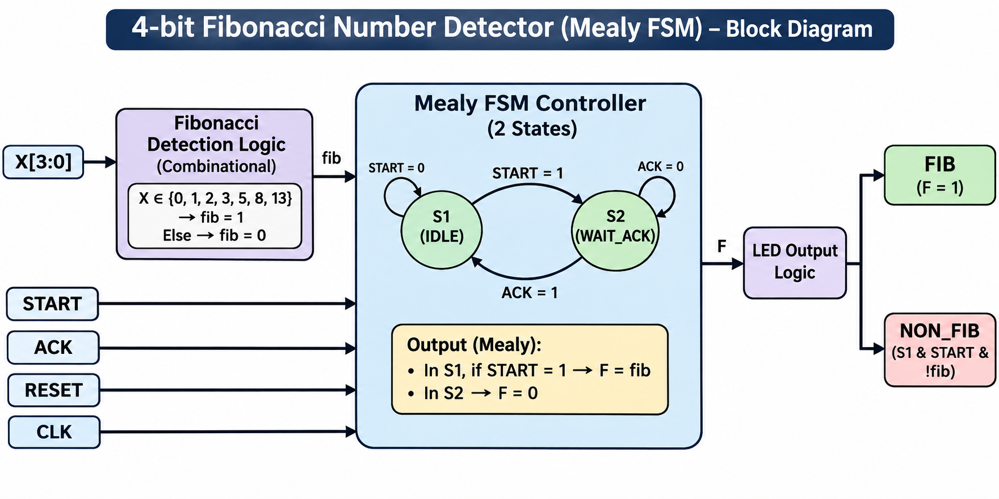

# Digital System Design – Group Project

## 1. Team Details
| Role | Student name | Roll number | GitHub username |
|---|---|---|---|
| Group leader | Adway Patil | 48 | Drummer3425 |
| Member 2 | Rajveer Powar | 54 | RajveerPowar |
| Member 3 | Nirja Bhosle | 5 | NirjaBhosle |
| Member 4 | Abhijit Kumar | 30 | kumarabhijit-eng |

**Class:** [D9A/D9B]  
**Group ID:** [e.g. D9A_B_Group34]  
**Repository URL:** https://github.com/Drummer3425/DSD-2026-D9B-A-GROUP34  
**Final Pull Request URL:** [URL]

## 2. Assigned Problem Statement
- **Number/title:** FINONACCI NUMBER DETECTOR (4-BIT)
- **Problem summary:** The aim of this project is to build a 4-bit Fibonacci Number Detector that checks whether a given number (0–15) is a Fibonacci number (0, 1, 2, 3, 5, 8 or 13). The circuit uses an FSM to control the detection process and displays the result using two LEDs. For the H2 modification, we have to convert the original Moore FSM into a Mealy FSM so that the output is generated immediately based on the input, without waiting for the next clock cycle.
- **Objective:** The system must detect whether a given 4-bit binary input (0–15) is a Fibonacci number (0, 1, 2, 3, 5, 8 or 13) and indicate the result using two LEDs. It must use an FSM controlled by START, ACK and RESET signals to manage the detection process. As part of the H2 modification, the original Moore FSM must be redesigned into a Mealy FSM so that the output is generated immediately based on the input, without waiting for the next clock state.
- **Inputs and outputs:**
- Inputs:
- clk – 1 bit: Clock signal that controls state transitions.
- reset – 1 bit: Resets the FSM to its initial state (S1).
- start – 1 bit: Initiates the Fibonacci detection process.
- ack – 1 bit: Acknowledges the result and returns the FSM to S1.
- X – 4 bits: Binary input number (0–15) to be checked.
Outputs:
- F – 1 bit: Indicates whether the input is a Fibonacci number (1 = Yes, 0 = No).
- FIB – 1 bit: Controls the Fibonacci indicator LED.
- NON_FIB – 1 bit: Controls the Non-Fibonacci indicator LED.
- **Constraints and assumptions:**
Constraints :
- Clock Constraint: The system uses the 100 MHz onboard clock of the Boolean Board (Spartan-7) to synchronize FSM state transitions.
- Reset Constraint: The reset input is connected to a push button to initialise the FSM to state S1 (IDLE).
- Start Constraint: The START input is connected to a push button to initiate the Fibonacci detection process.
- ACK Constraint: The ACK input is connected to a push button to acknowledge the result and return the FSM to S1.
- Input Constraint: The 4-bit input X[3:0] is connected to four slide switches to allow testing of numbers from 0 to 15.
- Output Constraint: The FIB and NON_FIB outputs are connected to two onboard LEDs to indicate whether the input is a Fibonacci or non-Fibonacci number.

Justification: These constraints map the Verilog input and output ports to the physical switches, push buttons, clock and LEDs of the Boolean Board, allowing the Fibonacci detector to be tested directly on the FPGA.

## 3. Problem Analysis and Proposed Solution
Explain the requirements, edge cases, proposed solution, distinctive features and why the design is feasible.

1. Requirements
The system must accept a 4-bit binary input (0–15) and determine whether the given number is a Fibonacci number. The Fibonacci numbers in this range are 0, 1, 2, 3, 5, 8 and 13. The result must be displayed using two LEDs: FIB and NON_FIB. The system also uses START, ACK and RESET signals to control the detection process.
2. Edge Cases
- Input 0000 (0) must be recognised as a Fibonacci number.
- Input 0001 (1) must be recognised as a Fibonacci number.
- Input 1101 (13) must be recognised as a Fibonacci number.
- Inputs such as 4, 6, 7, 9, 10, 11, 12, 14 and 15 must be identified as non-Fibonacci numbers.
- RESET must bring the FSM back to its initial state, while ACK must return it to the IDLE state.
3. Proposed Solution
The proposed solution is to implement a 2-state Mealy FSM using Verilog. The first state (S1) waits for the START signal, while the second state (S2) waits for the ACK signal. A combinational logic block checks the input against the seven Fibonacci numbers. The output is generated based on the current state and input, without waiting for an additional clock cycle.
4. Distinctive Features
- Uses a Mealy FSM for immediate output generation.
- Supports all 16 possible 4-bit input combinations.
- Uses separate Fibonacci and Non-Fibonacci LED indicators.
- Includes START, ACK and RESET signals for controlled operation.
- Uses simple combinational logic for efficient number detection.
5. Feasibility
The design is feasible because it requires only basic combinational logic, two FSM states and a small number of registers. It can be implemented using Verilog, simulated in Vivado, designed in Logisim and tested on the Boolean Board Spartan-7 FPGA using its onboard switches, push buttons and LEDs.

## 4. Architecture
1. Modules Explanation
1. Input Module: Accepts a 4-bit binary number through four slide switches. It can represent numbers from 0 to 15.

2. Fibonacci Detection Module: Compares the input with the seven Fibonacci numbers (0, 1, 2, 3, 5, 8 and 13) and generates a signal indicating whether the number is Fibonacci.

3. FSM Controller: Controls the operation using two states: S1 (IDLE) and S2 (WAIT_ACK). START initiates detection, while ACK returns the FSM to its initial state.

4. State Register: Stores the current state and updates it on the rising edge of the clock. RESET brings the FSM back to S1.

5. Output Module: Generates the FIB and NON_FIB signals to indicate the detection result through the LEDs.
2. Data and Control Flow
The 4-bit input is first given to the Fibonacci detection logic, which checks whether it matches any of the seven Fibonacci numbers. When START is activated in S1, the FSM generates the output based on the detection result. The FSM then moves to S2 and waits for ACK. Once ACK is activated, it returns to S1. RESET can initialise the FSM at any time.
3. Design Trade-offs
- Mealy FSM: Provides immediate output based on the input and current state, reducing output delay.
- Two-state design: Keeps the controller simple and requires fewer state bits.
- Combinational detection: Direct comparison with known Fibonacci values makes the design easy to implement and verify.
- Clock and reset: The clock provides synchronisation, while asynchronous reset allows the FSM to return to its initial state immediately.
- Output duration: In the current Verilog implementation, F is not held in S2. This keeps the logic simple, but the output may be too brief to observe on a physical LED. An additional result register could be used to hold the result until ACK.
Overall, the design uses simple combinational logic and a two-state Mealy FSM, making it suitable for implementation in Verilog, Logisim and the Boolean Board Spartan-7 FPGA.

## 5. FSM Design
The design uses a Finite State Machine (FSM) implemented using a Mealy Model. The FSM consists of two states, S1 and S2, which control the Fibonacci detection process based on the START and ACK inputs.
1. State Encoding
State	Encoding	Description
S1	0	IDLE – waits for START
S2	1	WAIT_ACK – waits for ACK

A single flip-flop is used to store the current state.

2. State Table
Present State	START	ACK	Next State
S1	0	X	S1
S1	1	X	S2
S2	X	0	S2
S2	X	1	S1

Here, X represents a don't-care condition.
3. Output Logic
The output is generated using Mealy logic:
- In S1, when START = 1, F = fib.
- In S2, F = 0.
- FIB = F.
- NON_FIB = 1 when the FSM is in S1, START = 1 and the input is not Fibonacci; otherwise, it is 0.
4. Transition Conditions
- S1 → S1: When START = 0.
- S1 → S2: When START = 1.
- S2 → S2: When ACK = 0.
- S2 → S1: When ACK = 1.
5. Reset Behaviour
The design uses an active-high asynchronous reset. Whenever RESET = 1, the FSM immediately returns to its initial state S1 (IDLE), irrespective of the clock signal.
6. Summary
The design uses a 2-state Mealy FSM with one state bit. Its output depends on the current state and input conditions, allowing the Fibonacci result to be generated without waiting for an additional clock state.

**Diagram:** [Path/link]  
**State table:** [State](Photos/1state.png)

## 6. Logisim Implementation
- Logisim version: [Version]
- Circuit file: [Path to `.circ`]
- Test cases and expected/observed behaviour: [Details]
- Issues and corrections: [Details]
- Screenshot/evidence: [Path/link]

## 7. Verilog HDL Implementation
- Tool/version: [Details]
- Top module and submodules: [Names]
- Architecture/coding decisions: [Details]
- Synthesizability considerations: [Details]
- RTL: `03_Verilog_Implementation/RTL/`
- Testbench: `03_Verilog_Implementation/Testbench/`

## 8. Verification and Simulation Results
| Test ID | Inputs/conditions | Expected output | Observed output | Pass/Fail |
|---|---|---|---|---|
| T01 | [ ] | [ ] | [ ] | [ ] |
| T02 | [ ] | [ ] | [ ] | [ ] |
| T03 | [ ] | [ ] | [ ] | [ ] |

Tool/version: [Details]  
Number passed/failed: [Details]  
Waveform/log path: [Path]

## 9. FPGA Hardware Implementation
- FPGA board/device: [Details]
- Tool/version: [Details]
- Clock/constraints: [Details]
- Synthesis/implementation summary: [Details]
- Programming and hardware test result: [Details]
- Evidence path: `04_FPGA_Hardware/`

Explain differences between simulation and hardware results, if any.

## 10. Challenges, Debugging and Improvements
| Issue | Root cause | Correction | Outcome |
|---|---|---|---|
| [ ] | [ ] | [ ] | [ ] |

Future improvements: [Details]

## 11. Task Allocation and Individual Contribution
| Student | Assigned responsibility | Actual contribution/evidence |
|---|---|---|
| Group leader | [ ] | [ ] |
| Member 2 | [ ] | [ ] |
| Member 3 | [ ] | [ ] |
| Member 4 | [ ] | [ ] |

Every student must be ready to explain the complete design.

## 12. Progress Log
Maintain time-wise updates in `STATUS.md`.

## 13. Final Results and Conclusion
Summarise requirements met, correctness of simulation/hardware results, measured results, limitations and conclusion.

[Write here]

## 14. Team Reflection
What did the team learn? What would you improve?

[Write here]

## 15. Final Submission Checklist
- [ ] Team details and problem analysis complete.
- [ ] Architecture/block diagram included.
- [ ] FSM diagram/table or justified alternative included.
- [ ] Logisim source and simulation evidence uploaded.
- [ ] Verilog RTL and testbench uploaded.
- [ ] Simulation results and test cases documented.
- [ ] FPGA implementation and hardware evidence uploaded.
- [ ] Results, challenges and conclusion documented.
- [ ] Presentation and final report uploaded.
- [ ] STATUS.md is up to date.
- [ ] Final Pull Request created and URL recorded.
# Group Submissions

Each group adds its own folder here, copied from `Group_Template/`. Example: `D9A_Group01/`. Submit only your own group's folder in the final Pull Request.
