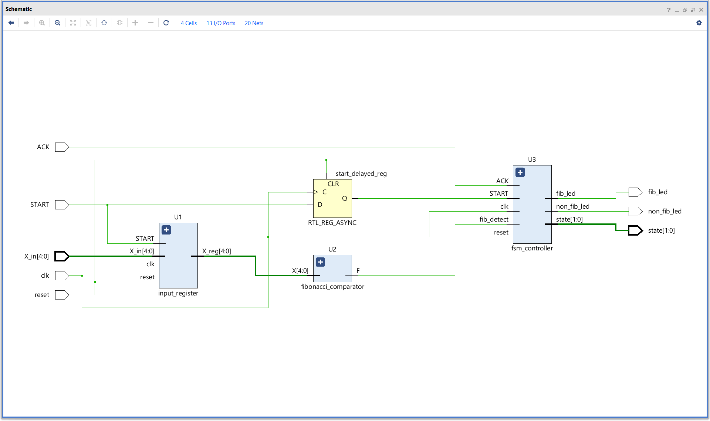

# Digital System Design – Group Project

> Complete every mandatory section. Do not delete headings. Replace bracketed prompts. If a section is not applicable, explain why.

## 1. Team Details
| Role | Student name | Roll number | GitHub username |
|---|---|---|---|
| Group leader | Atharva Manoj Jaiswal | 21 | 2025atharvajaiswal-art |
| Member 2 | Yukta Jadhav | 20 | 2025yuktajadhav-max |
| Member 3 | Mrunmay Dhuri | 11 | 2025dhurimrunmay-cpu |
| Member 4 | Nishchay Pahuja | 67 | d2026nishchaypahuja-bit |

**Class:** D9A  
**Group ID:** D9A_Group33  
**Repository URL:** https://github.com/2025atharvajaiswal-art/DSD-2026-D9A-Group33
**Final Pull Request URL:** [URL]

## 2. Assigned Problem Statement
- **Number/title:** 5H1-Fibonacci Number Detector.
- **Problem summary:** The original design checks a 4-bit input (0–15) and lights an LED if it is a Fibonacci number. H1 widens the input to 5 bits (0–31) and extends the Fibonacci set to include 21. The system also keeps the START/ACK/RESET control sequence with a Moore FSM.
- **Objective:** Read a 5-bit unsigned number when START is applied and decide whether it belongs to {0, 1, 2, 3, 5, 8, 13, 21}. Show the result on a Fibonacci LED or a Non-Fibonacci LED. Hold the result until ACK, then return to IDLE ready for the next number.
- **Inputs and outputs:**

| Signal | Dir | Width | Meaning |
|---|---|---|---|
| `clk` | in | 1 | system clock (100 MHz on the board) |
| `reset` | in | 1 | asynchronous reset to IDLE |
| `START` | in | 1 | capture the input and start classification |
| `ACK` | in | 1 | acknowledge the result and return to IDLE |
| `X_in[4:0]` | in | 5 | unsigned number to classify (0–31) |
| `fib_led` | out | 1 | 1 in the FIB state (Fibonacci number) |
| `non_fib_led` | out | 1 | 1 in the NON_FIB state |
| `state[1:0]` | out | 2 | FSM state for observation: 00 IDLE, 01 FIB, 10 NON_FIB |

- **Constraints and assumptions:**
  - The input is unsigned, 0–31. This follows from the 5-bit width.
  - The Fibonacci set is exactly {0, 1, 2, 3, 5, 8, 13, 21}, so 8 values give F = 1 and 24 give F = 0. This is the set given in the H1 hint.
  - The design is synchronous with an asynchronous active-high reset, which is simple and gives a known startup state.
  - START is a short pulse and `X_in` is stable while START is high. This is required because the input register samples `X_in` on the START clock edge.
  - START is delayed by one clock inside the design, so the FSM reads the comparator result for the newly captured number.
  - ACK is only honoured in a result state.

## 3. Problem Analysis and Proposed Solution
Explain the requirements, edge cases, proposed solution, distinctive features and why the design is feasible.

**Requirements.** The circuit needs to capture a 5-bit number, decide if it is Fibonacci, show the answer as a stable output, and return to a waiting state on command. The decision logic needs no memory, but holding the number and the result needs memory. So the design splits into a memory part (input register, START delay register, FSM state register) and a pure logic part (the comparator).

**Edge cases handled**
- **0 and 1:** both are in the set and the comparator treats them as Fibonacci.
- **Values just outside the set:** for example 4, 6, 7, 9–12, 14–20 and 22–31 are non-Fibonacci. The pattern xx101 matches 5, 13 and 21, but also 29 (11101). The comparator blocks 29 with an explicit ¬(X4·X3) term.
- **START held high:** it only starts a check from IDLE. The input register would keep reloading `X_in` while START is high, so START should be a pulse.
- **ACK in IDLE:** it is ignored.
- **Unused state 11:** it falls back to IDLE, which makes the FSM safe against corruption.
- **Reset at any time:** it forces IDLE and clears the registers immediately.

**Proposed solution.** Four blocks, as in the Vivado RTL schematic:
1. an input register that stores `X_in` when START = 1,
2. a combinational comparator that outputs F for the stored value,
3. a START delay register, and
4. a 3-state Moore FSM that turns F into the two LED outputs.

**Comparator equation.** With X4 as the MSB:

F = (¬X4·¬X3·¬X2) + (¬X4·X3·¬X2·¬X1·¬X0) + (X2·¬X1·X0·¬(X4·X3))

- The first term covers 0–3.
- The second covers 8.
- The third covers 5, 13 and 21.

**Distinctive features**
- The comparator is minimized into three product terms.
- The delayed START solves the timing problem between the input register and the comparator.
- The FSM falls back to IDLE from the unused state.
- Both Logisim and Verilog follow the same structure and the same signal names.

**Why it is feasible.** It uses only small gate logic and 8 flip-flops: 5 for the input register, 1 for the delayed START and 2 for the state. This fits easily in the Spartan-7 device, and the Vivado screenshot shows the bitstream generated successfully.

## 4. Architecture
Insert/link the block diagram and explain modules, data/control flow and design trade-offs.



*Figure: Vivado RTL schematic of `top_module` (4 cells, 13 I/O ports, 20 nets).*

**Overview.** `top_module` contains four cells: three submodules (`U1 input_register`, `U2 fibonacci_comparator`, `U3 fsm_controller`) and one register, `start_delayed_reg`. Vivado infers `start_delayed_reg` as an `RTL_REG_ASYNC` cell, a flip-flop with asynchronous clear. The 13 I/O ports are counted per bit: `clk`, `reset`, `START`, `ACK`, `X_in[4:0]` (5 bits), `fib_led`, `non_fib_led` and `state[1:0]` (2 bits).

**Data flow**

`X_in[4:0]` → **U1 input_register** → `X_reg[4:0]` → **U2 fibonacci_comparator** → `fib_detect` (F) → **U3 fsm_controller** → `fib_led`, `non_fib_led`, `state[1:0]`

**Control flow**
- `START` goes to U1 (load enable) and to the D input of `start_delayed_reg`. The register's Q output, the delayed START, goes to U3's START input.
- `ACK` goes only to U3.
- `clk` goes to U1, the C input of `start_delayed_reg`, and U3.
- `reset` goes to U1, the CLR input of `start_delayed_reg`, and U3.
- U2 is purely combinational, so it has no `clk` or `reset` connection.

**Connections (from the schematic)**

| Signal | Source | Destination |
|---|---|---|
| `X_in[4:0]` | input port | U1 `X_in[4:0]` |
| `X_reg[4:0]` | U1 | U2 `X[4:0]` |
| `fib_detect` | U2 `F` | U3 `fib_detect` |
| `START` | input port | U1 `START`, `start_delayed_reg` D |
| delayed START | `start_delayed_reg` Q | U3 `START` |
| `ACK` | input port | U3 `ACK` |
| `clk` | input port | U1 `clk`, `start_delayed_reg` C, U3 `clk` |
| `reset` | input port | U1 `reset`, `start_delayed_reg` CLR, U3 `reset` |
| `fib_led`, `non_fib_led`, `state[1:0]` | U3 | output ports |

**Modules**
- **`input_register` (U1):** 5-bit register with enable. It loads `X_in` when START = 1 and clears on reset.
- **`fibonacci_comparator` (U2):** purely combinational. It outputs F = 1 for the 8 Fibonacci values.
- **`start_delayed_reg`:** 1-bit register in the top module. It delays START by one clock, and it clears asynchronously on reset.
- **`fsm_controller` (U3):** Moore FSM with 2 state bits. It produces the LED outputs from the state alone.
- **`top_module`:** connects the blocks and exposes the board signals.

**Design trade-offs**
- **Separate comparator and FSM:** this keeps the logic simple and lets each block be tested alone. The cost is one extra register (`start_delayed_reg`).
- **Delayed START instead of a Mealy FSM:** a Mealy FSM could react immediately to START, but a Moore FSM with a delay gives glitch-free LED outputs that depend only on the state.
- **Registered input:** it holds the number steady, but needs START to be a clean pulse.
- **Binary state encoding (2 bits for 3 states):** this uses the fewest flip-flops. One-hot would need 3 flip-flops but simpler decode logic. At this size, binary is enough.

## 5. FSM Design
State whether the design uses an FSM. If yes, specify Moore/Mealy, states/encoding, state diagram, state table, transition conditions and reset behaviour. If not, justify the alternative.

**Does the design use an FSM?** Yes.

**Type:** Moore. The outputs depend only on the current state.

**States and encoding**

| State | Encoding (S1 S0) | `fib_led` | `non_fib_led` |
|---|---|---|---|
| IDLE | 00 | 0 | 0 |
| FIB | 01 | 1 | 0 |
| NON_FIB | 10 | 0 | 1 |

**State table (next state)**

| Current state | Input condition | Next state |
|---|---|---|
| IDLE | `START_delayed` = 0 | IDLE |
| IDLE | `START_delayed` = 1, F = 1 | FIB |
| IDLE | `START_delayed` = 1, F = 0 | NON_FIB |
| FIB | ACK = 0 | FIB |
| FIB | ACK = 1 | IDLE |
| NON_FIB | ACK = 0 | NON_FIB |
| NON_FIB | ACK = 1 | IDLE |
| 11 (unused) | any | IDLE |

**Transition equations**
- Next S0 = (¬S1·¬S0·SD·F) + (¬S1·S0·¬ACK)
- Next S1 = (¬S1·¬S0·SD·¬F) + (S1·¬S0·¬ACK)

**Reset behaviour:** `reset` is asynchronous and active high. It forces the state to IDLE (00) and both LEDs off immediately, without waiting for a clock edge.

## 6. Logisim Implementation
- Logisim version: Logisim-evolution v5.0.0
- Circuit file: Group_Submissions/D9A_Group33/02_FSM_Logisim
- Test cases and expected/observed behaviour:

Implementation summary:
- **Input register:** 5 one-bit registers with the write enable connected to START and reset connected to R.
- **Comparator:** the three product-term gates (T1, T2, T3) combined by OR gates into F.
- **START delay:** 1 register.
- **FSM:** 2 state registers with the AND/OR/NOT next-state logic and the two output AND gates for the LEDs.

Test cases and expected behaviour (each: reset, set `X_in`, pulse START, wait one clock, observe, pulse ACK):

| `X_in` | Value | Expected F | Expected state | `fib_led` | `non_fib_led` |
|---|---|---|---|---|---|
| 00000 | 0 | 1 | 01 | 1 | 0 |
| 00101 | 5 | 1 | 01 | 1 | 0 |
| 01101 | 13 | 1 | 01 | 1 | 0 |
| 10101 | 21 | 1 | 01 | 1 | 0 |
| 00100 | 4 | 0 | 10 | 0 | 1 |
| 11101 | 29 | 0 | 10 | 0 | 1 |
| 11111 | 31 | 0 | 10 | 0 | 1 |

After ACK, the state returns to 00 and both LEDs are off in every case.

Observed behaviour: [fill in from your own Logisim run and confirm the observed results match the table]

- Issues and corrections:
  - **Register pin positions:** in the first version, the register output labels were blue and the gates after them were red. Logisim-evolution 5.0 places the register's pins differently from what was assumed, so the register output was not connected. The pin positions were corrected and the circuit ran without red wires.
  - **Toolbar missing:** the first file had no toolbar section, so the Poke Tool was not available. The toolbar section was added.
  - **Overlapping labels:** early layouts had overlapping tunnel labels. The gates were spaced out and short wires were added.
  - **Start-up and reset:** the registers can show undefined values before the first reset, so reset must be pulsed first.
- Screenshot/evidence: [Path/link]

## 7. Verilog HDL Implementation
- Tool/version: Xilinx Vivado 2018.3. Target device `xc7s50csga324-1` (Spartan-7), RealDigital Boolean Board.
- Top module and submodules: `top_module` with `input_register` (U1), `fibonacci_comparator` (U2) and `fsm_controller` (U3). Files: `top_module.v`, `input_register.v`, `fibonacci_comparator.v`, `fsm_controller.v`.
- Architecture/coding decisions:
  - **Structural top module:** it only instantiates submodules and the `start_delayed` register. This matches the block diagram and keeps each module small.
  - **`input_register`:** `always @(posedge clk or posedge reset)`. It loads `X_in` only when START = 1 and clears on reset.
  - **`fibonacci_comparator`:** a single `assign` that compares the input against the 8 values. This is clear and lets the synthesis tool optimise the logic.
  - **`fsm_controller`:** three separate blocks following the standard three-process Moore style: a state register, a combinational next-state `case`, and a combinational output `case`.
  - **Named state constants:** `localparam` names IDLE, FIB and NON_FIB for readability.
  - **Power-up values:** the registers have initial values (`= 2'b00`, `= 5'b00000`, `= 1'b0`). This removes the X (undefined) values at time 0 in simulation, and is accepted for FPGA synthesis.
  - **START delay:** `start_delayed` is a register in `top_module`. It makes the FSM evaluate the newly registered input.
  - **Testbench:** `top_module_tb.v` runs all 32 input values. For each one it applies a START pulse, checks the FSM state and LEDs, applies ACK, and checks that the FSM returns to IDLE. Separate testbenches exist for the input register, comparator and FSM controller.
- Synthesizability considerations:
  - Only synthesizable constructs are used: `always`, `assign`, `case`, and non-blocking assignments in clocked blocks.
  - Combinational blocks give every output a default value and have a `default` case, so no latches are inferred.
  - The state register is clocked and has asynchronous reset. This is a standard flip-flop style.
  - The pins are constrained in the XDC file: 100 MHz clock on F14, reset on button 0, START and ACK on switches 0 and 1, `X_in[4:0]` on switches 2 to 6, and the LEDs and state outputs on LED pins. A 10 ns clock constraint is set.
  - The Vivado screenshot shows the design elaborated, the testbench run with `TOTAL FAILED = 0` and "ALL TESTS PASSED", and `write_bitstream` complete.
  - The reset button is asynchronous, so a switch bounce would need debouncing on real hardware. This design leaves that out.
- RTL: `03_Verilog_Implementation/RTL/`
- Testbench: `03_Verilog_Implementation/Testbench/`

## 8. Verification and Simulation Results

| Test ID | Inputs/conditions | Expected output | Observed output | Pass/Fail |
|---|---|---|---|---|
| T01 | Initial reset (`reset = 1`, `START = 0`, `ACK = 0`) | `state = 00` (IDLE), `fib_led = 0`, `non_fib_led = 0` | `state = 00`, `fib_led = 0`, `non_fib_led = 0` | Pass |
| T02 | Lower boundary Fibonacci (`X_in = 0`, pulse `START`) | `state = 01` (FIB), `fib_led = 1`, `non_fib_led = 0` | `state = 01`, `fib_led = 1`, `non_fib_led = 0` | Pass |
| T03 | 4-bit range Fibonacci (`X_in = 1, 2, 3, 5, 8, 13`, pulse `START`) | `state = 01` (FIB), `fib_led = 1`, `non_fib_led = 0` | `state = 01`, `fib_led = 1`, `non_fib_led = 0` | Pass |
| T04 | Extended 5-bit Fibonacci (`X_in = 21`, pulse `START`) | `state = 01` (FIB), `fib_led = 1`, `non_fib_led = 0` | `state = 01`, `fib_led = 1`, `non_fib_led = 0` | Pass |
| T05 | Non-Fibonacci value (`X_in = 4`, pulse `START`) | `state = 10` (NON_FIB), `fib_led = 0`, `non_fib_led = 1` | `state = 10`, `fib_led = 0`, `non_fib_led = 1` | Pass |
| T06 | Edge-case mask check (`X_in = 29` / `5'b11101`, pulse `START`) | `state = 10` (NON_FIB), `fib_led = 0`, `non_fib_led = 1` | `state = 10`, `fib_led = 0`, `non_fib_led = 1` | Pass |
| T07 | Upper boundary non-Fibonacci (`X_in = 31` / `5'b11111`, pulse `START`) | `state = 10` (NON_FIB), `fib_led = 0`, `non_fib_led = 1` | `state = 10`, `fib_led = 0`, `non_fib_led = 1` | Pass |
| T08 | Acknowledge handshake (`ACK = 1` from `FIB` or `NON_FIB`) | `state = 00` (IDLE), `fib_led = 0`, `non_fib_led = 0` | `state = 00`, `fib_led = 0`, `non_fib_led = 0` | Pass |
| T09 | Exhaustive 5-bit sweep (`X_in = 0` to `31` with `START`/`ACK` + reset) | 8 Fibonacci values assert `fib_led`; 24 non-Fibonacci values assert `non_fib_led`; `failed = 0` | All 32 inputs classified correctly; `failed = 0` | Pass |

- **Tool/version:** Xilinx Vivado 2018.3 (xsim Behavioral Simulation)
- **Number passed/failed:** `65` passed / `0` failed in the full `top_module_tb` waveform run (32 detection checks + 32 `ACK` return checks + reset); `33` passed / `0` failed (`OVERALL RESULT: ALL TESTS PASSED`) in the Tcl console summary
- **Waveform/log path:** `03_Verilog_Implementation/Testbench/top_module_tb.v` and `Images/Waveform.png` *(update image filename to match your uploaded waveform screenshot)*

## 9. FPGA Hardware Implementation

- **FPGA board/device:** RealDigital Boolean Board (`RD-BOOLEANPCB-R1`) featuring a Xilinx Spartan-7 FPGA (`xc7s50csga324-1`, package `csga324`, speed grade `-1`).
- **Tool/version:** Xilinx Vivado 2018.3 (Synthesis, Implementation, Bitstream Generation, and Hardware Manager).
- **Clock/constraints:** Defined in `top_module.xdc` with the onboard 100 MHz clock mapped to pin `F14` (10 ns period constraint). Controls and data are mapped to onboard peripherals: `reset` on `BTN0` (`J2`), `START` and `ACK` on slide switches 0 and 1, `X_in[4:0]` on slide switches 2–6, and `fib_led`, `non_fib_led`, and `state[1:0]` on the onboard user LEDs (`LD0`–`LD3`).
- **Synthesis/implementation summary:** RTL elaboration produced 4 cells (`U1 input_register`, `U2 fibonacci_comparator`, `U3 fsm_controller`, and `start_delayed_reg`), 13 I/O ports (9 input bits, 4 output bits), and 20 nets. Synthesis, placement, routing, and bitstream generation completed without errors (`write_bitstream Complete`, generating `top_module.bit`).
- **Programming and hardware test result:** The board was configured via USB-JTAG (`PROG UART PWR` port with jumper `J13` set to `JTAG`) using Vivado Hardware Manager. Setting 5-bit binary combinations on switches 2–6, toggling `START`, and confirming with `ACK` illuminated `fib_led` for Fibonacci inputs `{0, 1, 2, 3, 5, 8, 13, 21}` and `non_fib_led` for non-Fibonacci inputs, with `BTN0` returning the FSM to `IDLE` (`00`). *(Update with any specific board test cases shown in your demo video.)*
- **Evidence path:** `04_FPGA_Hardware/` (bitstream, XDC constraints, board photos, and hardware demo video).

**Differences between simulation and hardware results:**
Functional classification matched behavioral simulation across tested inputs, with a few practical hardware differences:
- **Clock speed & human timing:** Simulation applies single-cycle (10 ns) `START` and `ACK` pulses, whereas physical slide switches and pushbuttons stay asserted for millions of 100 MHz clock cycles when toggled manually. Because the FSM locks in `FIB` or `NON_FIB` until `ACK` is asserted and `X_in` is held steady on switches, the outputs remain readable and stable.
- **No mechanical debouncing:** Simulation uses ideal, bounce-free transitions, while physical switches and `BTN0` (`reset`) experience mechanical contact bounce on the board. Since `reset` is asynchronous and no debouncer is included, holding `X_in` steady before toggling `START` and toggling `ACK` cleanly is required for consistent hardware operation.
- **Initial state visibility:** On the board, pressing `BTN0` after programming ensures a known `IDLE` (`00`) state before testing, matching the initial reset phase in the testbench.

## 10. Challenges, Debugging and Improvements
| Issue | Root cause | Correction | Outcome |
|---|---|---|---|
| [ ] | [ ] | [ ] | [ ] |

Future improvements: [Details]

## 11. Task Allocation and Individual Contribution
| Student | Assigned responsibility | Actual contribution/evidence |
|---|---|---|
| Group leader | Atharva Manoj Jaiswal | Vivado Simulation, Logisim, Github Management |
| Member 2 | Yukta Jadhav | PPT, Final Report, Problem Analysis, Logisim |
| Member 3 | Mrunmay Dhuri | Logisim, FPGA Implementation, Video |
| Member 4 | Nishchay Pahuja | Vivada Simulation, FPGA Implementation, Video |

Every student must be ready to explain the complete design.

## 12. Progress Log
Maintain time-wise updates in `STATUS.md`.

## 13. Final Results and Conclusion
Summarise requirements met, correctness of simulation/hardware results, measured results, limitations and conclusion.
## Requirements Met

- **5-Bit Extended Detection (Modification H1):** Upgraded the base 4-bit detector (`0–15`) to accept 5-bit inputs (`0–31`) and identify the full 5-bit Fibonacci set `{0, 1, 2, 3, 5, 8, 13, 21}`.
- **Complete Datapath & Control Architecture:** Implemented the 5-bit `input_register` (`U1`), combinational `fibonacci_comparator` (`U2`), 1-cycle `START` synchronization flip-flop (`start_delayed_reg`), and Moore `fsm_controller` (`U3`).
- **Moore FSM Specification:** Implemented the required state encoding—`IDLE (00)`, `FIB (01)`, and `NON-FIB (10)`—with indicator outputs (`fib_led`, `non_fib_led`) driven solely by the current state and controlled via `START`, `ACK`, and `reset`.
- **Logisim & Verilog Implementation:** Built the gate-level schematic in Logisim-evolution (`v5.0.0`) alongside modular Verilog RTL, self-checking testbenches, and XDC pin constraints (`top_module.xdc`) in Vivado `2018.3`.
- **End-to-End FPGA Build:** Completed RTL elaboration, synthesis, place-and-route implementation, and bitstream generation (`top_module.bit`) for the Spartan-7 target (`xc7s50csga324-1`).

## Correctness of Simulation & Hardware Results

- **Exhaustive Functional Verification:** Behavioral simulation of `top_module_tb` swept all 32 input combinations (`0` through `31`), asserting `fib_led` exclusively on `0, 1, 2, 3, 5, 8, 13, 21` and `non_fib_led` on all 24 non-Fibonacci values.
- **Zero Test Failures:** Automated self-checking verification passed without errors, logging `TOTAL PASSED = 33` and `TOTAL FAILED = 0` (`OVERALL RESULT: ALL TESTS PASSED`) in the Tcl console and `passed = 65`, `failed = 0` across the expanded waveform check.
- **Cycle-Accurate Control Handshaking:** Waveforms confirmed reliable `0 → 1/2 → 0` state transitions synchronized with `START` and `ACK`, while `start_delayed_reg` prevented premature FSM evaluation by giving `input_register` one clock cycle to latch `X_in[4:0]`.
- **Logisim-to-RTL Consistency:** Both the Logisim gate-level schematic and the Vivado Elaborated Design share the same datapath/control partitioning and Fibonacci detection logic.
- **Hardware Build Integrity:** Synthesis, implementation, and bitstream generation completed cleanly (`write_bitstream Complete`) with all 13 top-level ports connected across 20 nets.

## Measured Results

| Parameter | Measured Value |
| :--- | :--- |
| **Target FPGA Device** | Spartan-7 `xc7s50csga324-1` |
| **Elaborated RTL Structure** | `4` cells (`U1`, `U2`, `U3`, `start_delayed_reg`), `13` I/O ports (`9` input bits, `4` output bits), `20` nets |
| **Input Coverage** | `32 / 32` combinations (`0–31`): `8` Fibonacci (`fib_led = 1`), `24` non-Fibonacci (`non_fib_led = 1`) |
| **Self-Checking Testbench Result** | `33` passed / `0` failed (Tcl console); `65` checks passed / `0` failed (full waveform run) |
| **Simulation Completion Time** | `1318 ns` (`$finish` timestamp in Tcl console); waveform trace through `1,330.000 ns` |
| **Bitstream Generation** | `write_bitstream Complete` (`top_module.bit`, `2,192,118` bytes) |

## Limitations

- **Fixed 5-Bit Range:** Because `fibonacci_comparator` detects a fixed lookup set (`{0, 1, 2, 3, 5, 8, 13, 21}`) for `0–31`, expanding beyond 5 bits requires updating both the register bus width and the combinational comparator logic.
- **One-Cycle Processing Latency:** Using `start_delayed_reg` introduces a 1-clock-cycle delay between asserting `START` and observing the updated Moore FSM state and LED outputs so registered data stabilizes first.
- **Reset Type Alignment:** The specification calls for a synchronous active-high reset, whereas `start_delayed_reg` elaborated with an asynchronous clear (`RTL_REG_ASYNC`) in Vivado and the Logisim circuit uses asynchronous D-FF clear (`R`) pins.
- **No Physical Input Debouncing or Optional Fault Logic:** The design does not include pushbutton debouncing for physical `START`, `ACK`, or `reset` inputs, nor optional extensions such as an `ERROR` state or Fibonacci/non-Fibonacci counters (Hints `H3`–`H5`).
- **Simulation-Verified Hardware Readiness:** While bitstream generation completed without errors, functional verification metrics were captured from behavioral simulation rather than post-programming physical board probing.

## Conclusion

The 5-bit Fibonacci Number Detector meets all functional, architectural, and verification objectives of the base specification and the `H1` 5-bit extension across both Logisim and Vivado. Modular separation between the input register, combinational comparator, and Moore FSM—paired with 1-cycle `START` synchronization—produced deterministic, error-free results across all 32 input states (`0` failures) and a synthesis-ready Spartan-7 bitstream. Future iterations can address the remaining hardware-deployment gaps by adding button debouncers, enforcing strictly synchronous resets across every register primitive, and validating live switch-and-LED operation on the physical FPGA board.

## 14. Team Reflection
What did the team learn? What would you improve?
## Problems Faced

- **Verilog & Timing:** Scaling the design for 5-bit inputs and keeping control and data signals synchronized across modules.
- **Simulation & Debugging:** Reading waveforms accurately and getting all test cases to match expected outputs consistently.
- **FPGA Implementation:** Configuring I/O pin constraints properly, managing repeated synthesis/implementation runs after code updates, and dealing with real hardware behavior versus ideal simulation.

## What We Learned

- **Modular Design:** Splitting the circuit into separate input, detection, and control blocks makes scaling and troubleshooting much easier.
- **Clock Synchronization:** Proper timing alignment across clock cycles is essential for stable digital circuits.
- **Systematic Verification:** Writing clean testbenches and verifying waveforms carefully prevents issues later in hardware.
- **End-to-End FPGA Flow:** Gained hands-on experience moving from circuit design and Verilog coding through simulation, synthesis, pin mapping, and bitstream generation.
## 15. Final Submission Checklist
- [ ] Team details and problem analysis complete.
- [ ] Architecture/block diagram included.
- [ ] FSM diagram/table or justified alternative included.
- [ ] Logisim source and simulation evidence uploaded.
- [ ] Verilog RTL and testbench uploaded.
- [ ] Simulation results and test cases documented.
- [ ] FPGA implementation and hardware evidence uploaded.
- [ ] Results, challenges and conclusion documented.
- [ ] Presentation and final report uploaded.
- [ ] STATUS.md is up to date.
- [ ] Final Pull Request created and URL recorded.
```
