# Digital System Design – Group Project

> Complete every mandatory section. Do not delete headings. Replace bracketed prompts. If a section is not applicable, explain why.

## 1. Team Details
| Role | Student name | Roll number | GitHub username |
|---|---|---|---|
| Group leader | Samruddhi Samant | D9A-49 | planetsamzz77 |
| Member 2 | Siddharth Sanjeev Tiwari | D9A-58 | Siddharthqzz29 |
| Member 3 | Deven Shailendra Bhadane | D9B-2 | DevenBhadane |
| Member 4 | Ojas Nitin Kadam | D9B-20 | OjasKadam07 |

**Class:** D9A / D9B (Group 14)  
**Group ID:** day1_submission_grp14  
**Repository URL:** https://github.com/planetsamzz77/DSD-2026-D9A-B-Group14  
**Final Pull Request URL:** https://github.com/MrugendraVasmatkar/Digital_System_Design_Practical_2026_27_D9A_B/pull/33  

## 2. Assigned Problem Statement
- **Group number:** 14 (Group ID: day1_submission_grp14)
- **Number/title:** Problem statement 3H2 - Game Score Categorizer, hint H2 (Mealy FSM with immediate output)
- **Problem summary:** A 4-bit game score is entered and `start` is pressed. The system classifies the score as LOW, MEDIUM or HIGH and lights the matching LED until the user presses `ack`, then returns to idle.
- **Objective:** Classify the score (LOW 0–4, MEDIUM 5–10, HIGH 11–15), show exactly one LED, hold it until `ack`, using a Mealy FSM.
- **Inputs and outputs:** Inputs `clk`, `reset`, `start`, `ack` (1 bit each) and `score[3:0]`. Outputs `low_led`, `med_led`, `high_led` (1 bit each). Full table with FPGA pins: [`01_Problem_Analysis/io_specification.md`](01_Problem_Analysis/io_specification.md).
- **Constraints and assumptions:** Synchronous active-high reset; `start` only acted on in `IDLE`; `ack` only acted on in result states. Full list in [`01_Problem_Analysis/problem_statement.md`](01_Problem_Analysis/problem_statement.md).

## 3. Problem Analysis and Proposed Solution
Explain the requirements, edge cases, proposed solution, distinctive features and why the design is feasible.

Full analysis: [`01_Problem_Analysis/problem_statement.md`](01_Problem_Analysis/problem_statement.md).

In short: a 4-state Mealy FSM (2 flip-flops plus gates). Boundary scores 4/5 and 10/11, `start` held high, `ack` in `IDLE`, and `reset` mid-round are handled as listed there. Feasible on any FPGA: 11 I/O pins, 2 flip-flops.

## 4. Architecture
Insert/link the block diagram and explain modules, data/control flow and design trade-offs.

Single module `mealy_simple`: a 2-bit state register, next-state logic (score comparators plus `start`/`ack`/`reset`) and combinational Mealy output logic. There is no separate datapath.

- **Block diagram:** `02_FSM_Logisim/block_diagram.png`. Score switches feed a range decoder (comparators giving L, M, H); START, ACK and RESET plus the decoded range feed the next-state logic (D1, D0) and the 2-bit state register, whose Q1 Q0 outputs feed back and go through a state decoder to the output logic. START, ACK and L/M/H also go directly to the output logic, which makes the outputs Mealy.

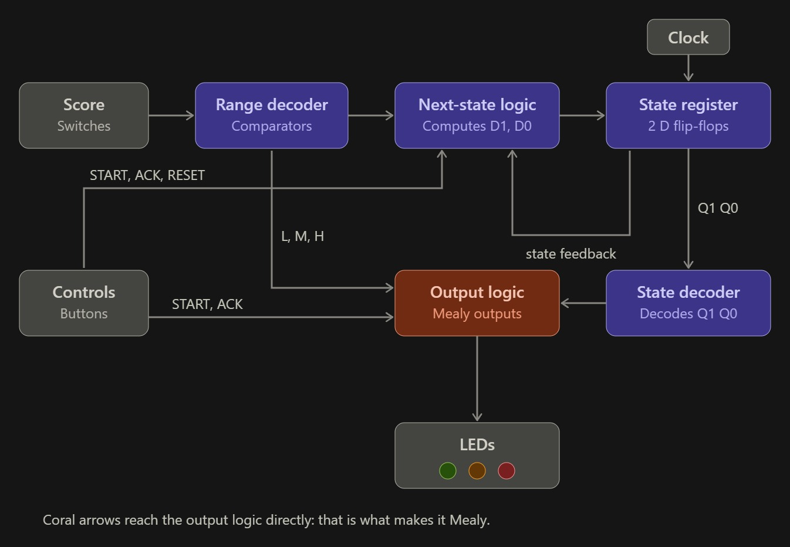

- Gate-level circuit screenshot:

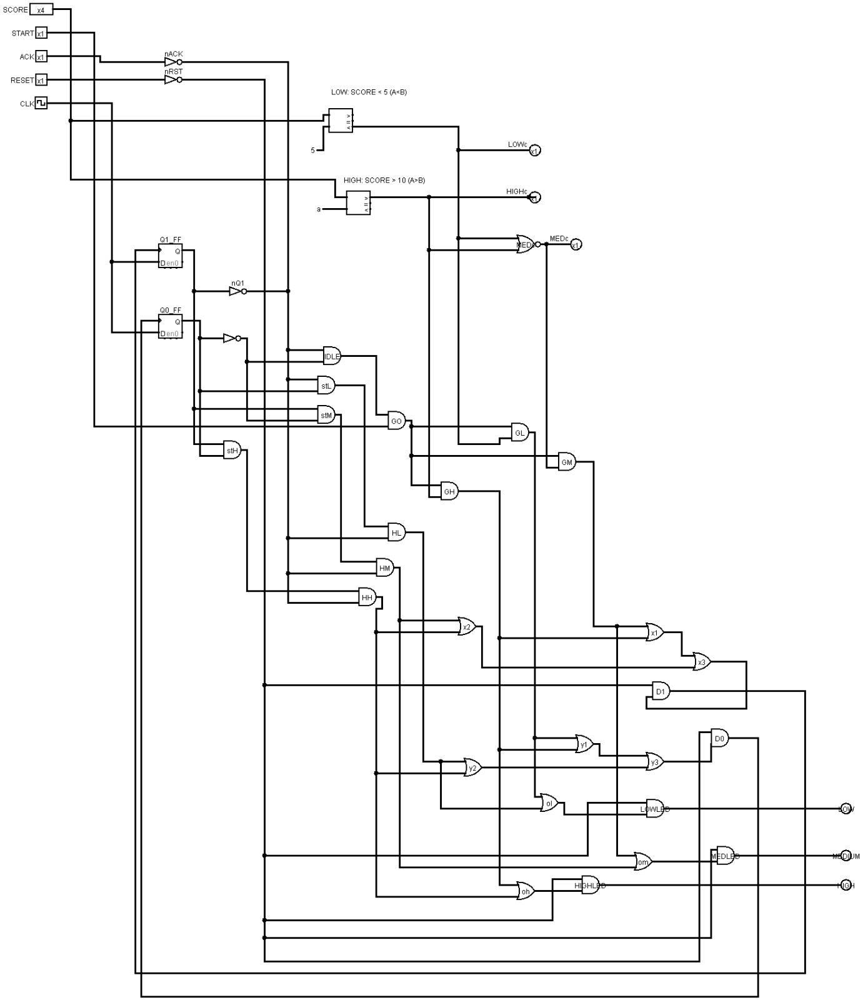

## 5. FSM Design
State whether the design uses an FSM. If yes, specify Moore/Mealy, states/encoding, state diagram, state table, transition conditions and reset behaviour. If not, justify the alternative.

**Type:** Mealy FSM. **Encoding:** `IDLE`=00, `LOW`=01, `MED`=10, `HIGH`=11. **Reset:** synchronous, active-high, returns to `IDLE`.

**State table** (from `mealy_simple.v`):

| Present state | Condition | Next state | Outputs (low, med, high) |
|---|---|---|---|
| IDLE | `start`=0 | IDLE | 0 0 0 |
| IDLE | `start`=1, score ≤ 4 | LOW | 1 0 0 |
| IDLE | `start`=1, 5 ≤ score ≤ 10 | MED | 0 1 0 |
| IDLE | `start`=1, score ≥ 11 | HIGH | 0 0 1 |
| LOW | `ack`=0 | LOW | 1 0 0 |
| LOW | `ack`=1 | IDLE | 0 0 0 |
| MED | `ack`=0 | MED | 0 1 0 |
| MED | `ack`=1 | IDLE | 0 0 0 |
| HIGH | `ack`=0 | HIGH | 0 0 1 |
| HIGH | `ack`=1 | IDLE | 0 0 0 |

**State diagram** (label = input / output as Low, Med, High LED; circle colour = LED colour):

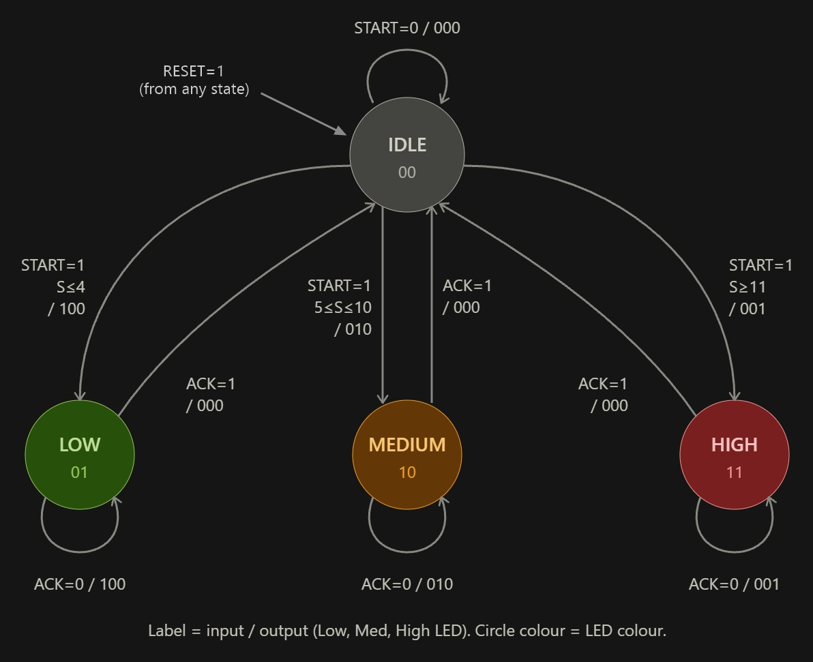

File: `02_FSM_Logisim/fsm_state_diagram.png`

## 6. Logisim Implementation
- Logisim version: file saved in the Logisim 2.7.1 format (`project source="2.7.1"`)
- Circuit file: `02_FSM_Logisim/Game_Score_Categorizer_H2_Mealy_Machine_v2_comparators.circ` (final version; earlier version `Game_Score_Categorizer_H2_Mealy_Machine.circ` kept for reference)
- Test cases and expected/observed behaviour (screenshots by Siddharth and Deven, taken with the Poke tool): SCORE = 3 (0011): expected LOW LED, observed LOW LED lit (`low.png`); SCORE = 5 (0101): expected MEDIUM LED, observed MEDIUM LED lit (`medium.png`); SCORE = 13 (1101): expected HIGH LED, observed HIGH LED lit (`high.png`, also `sim_score13_high.png`); IDLE with START = 0: all LEDs off (`idle.png`). Still to simulate and document: the other scores (0-15), ACK and RESET.

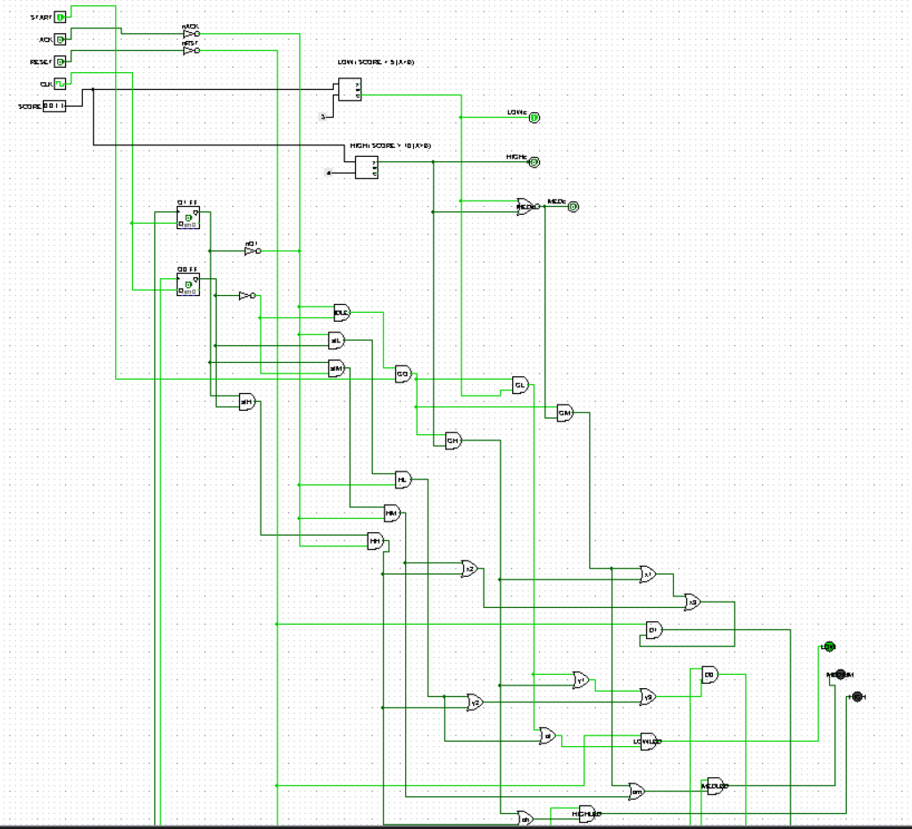

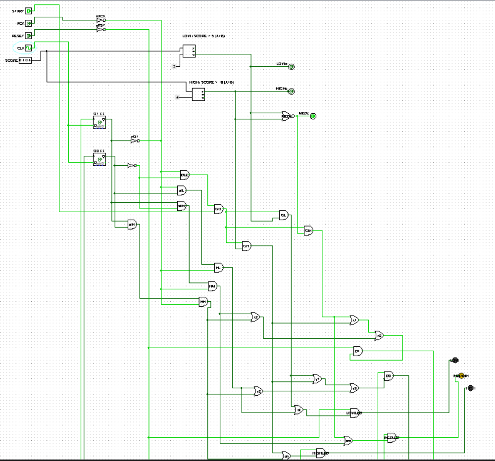

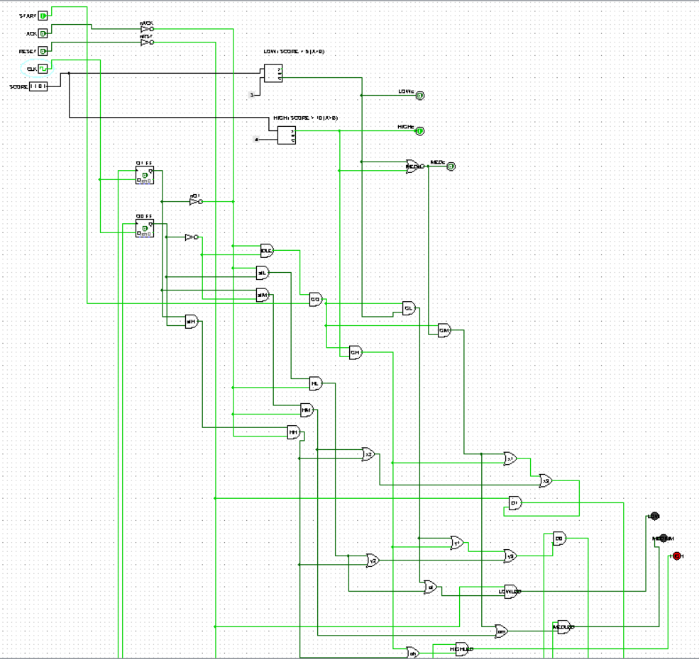

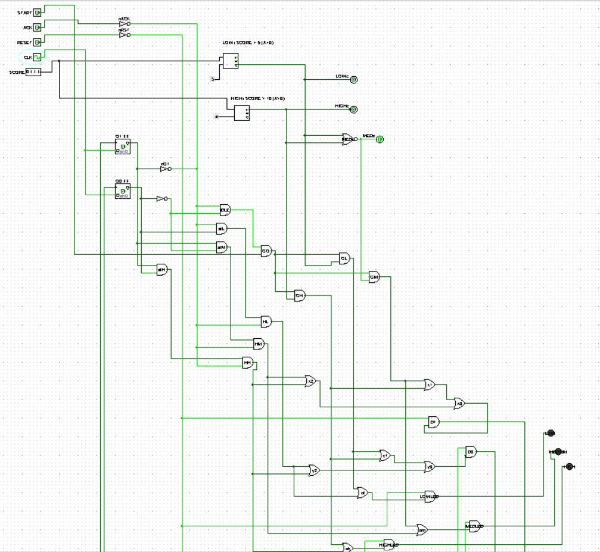

- Issues and corrections: the Logisim design was complex at first, because we built the comparator from its internal gate circuit. We later used Logisim's built-in comparator block, which made the circuit simpler.
- Screenshot/evidence: `02_FSM_Logisim/circuit_overview_v2_comparators.png` (circuit only; simulation screenshots pending)

## 7. Verilog HDL Implementation
- Tool/version: Xilinx Vivado 2018.3
- Top module and submodules: `mealy_simple` (single module, no submodules)
- Architecture/coding decisions: 2-bit state register with synchronous reset; Mealy outputs as continuous assignments from state and inputs.
- Synthesizability considerations: only synthesizable constructs (`always @(posedge clk)`, `assign`); `state` has no power-up value, so reset must be applied after power-up.
- RTL schematic: Vivado 2018.3 elaborated design for `xc7s50csga324-1` (23 cells, 11 I/O ports, 39 nets). It shows the 2-bit state register, comparators on `score`, multiplexers for the next state, and AND/OR logic for the three LED outputs.

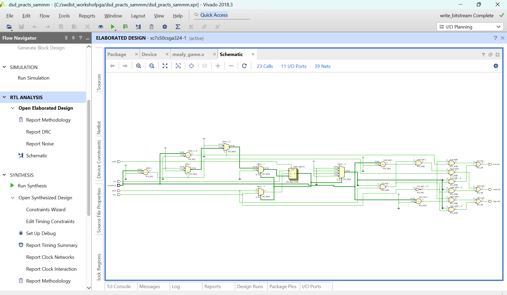
- Logisim vs Verilog structure: the Logisim circuit (v2) is built from comparators, AND/OR/NOT gates and two D flip-flops, with no multiplexers. In the Verilog design, Vivado's elaborated (RTL) schematic above shows multiplexers (`RTL_MUX`), because the next-state `if / else if` chain is a priority selection. Synthesis then maps the logic to LUTs, flip-flops and I/O buffers, so the implemented design contains no multiplexers either. The behaviour is the same (see the state table); only the structure differs.
- Reset and LED outputs: in the Verilog, reset acts only on the state register (at the clock edge); the LED outputs are not gated by reset. In the Logisim circuit every LED output is additionally ANDed with NOT reset, so all LEDs are off whenever reset is high. The two designs have the same states and transitions, and differ only in this detail: with START held high, an LED can light during reset in the Verilog design. The Vivado reports, bitstream and board photos in this repository come from this Verilog version.
- RTL: `03_Verilog_Implementation/RTL/mealy_simple.v`
- Testbench: `03_Verilog_Implementation/Testbench/game_tb.v` (scores 2, 7 and 13, each followed by ACK; simulated in Vivado, see section 8)

## 8. Verification and Simulation Results
**Limitation:** the handout (Q3) asks for a testbench that covers all 16 scores, all four states, reset and START/ACK with self-checking and pass/fail messages. Our testbench `game_tb.v` covers scores 2, 7 and 13 only.

Testbench `game_tb.v` has 3 test cases, simulated in the Vivado Simulator (Behavioral Simulation, top `game_tb`). The observed values below are read from the waveform; they are confirmed by the Tcl console log (`simulation_log.txt`, `tcl_console_log.png`): all 9 printed lines match the expected values.

| Test ID | Inputs/conditions | Expected output | Observed output | Pass/Fail |
|---|---|---|---|---|
| T01 | score=2, `start`=1 (then `ack`) | LOW LED on (1 0 0); all off after `ack` | Waveform: `low_led` high while `start` is high with score 2; goes low when `ack` rises (start of the window is cropped) | Pass |
| T02 | score=7, `start`=1 (then `ack`) | MEDIUM LED on (0 1 0); all off after `ack` | Waveform: `med_led` high while `start` is high with score 7; low after `ack` | Pass |
| T03 | score=13, `start`=1 (then `ack`) | HIGH LED on (0 0 1); all off after `ack` | Waveform: `high_led` high while `start` is high with score 13 (`d`); low after `ack` | Pass |

Tool/version: Vivado 2018.3 Simulator (behavioral, functional)  
Number passed/failed: 3 passed, 0 failed (by waveform inspection)  
Waveform/log path: `03_Verilog_Implementation/Simulation_Results/behavioral_simulation_waveform.png`, `tcl_console_log.png` and `simulation_log.txt`

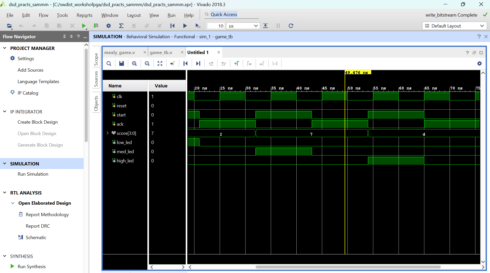
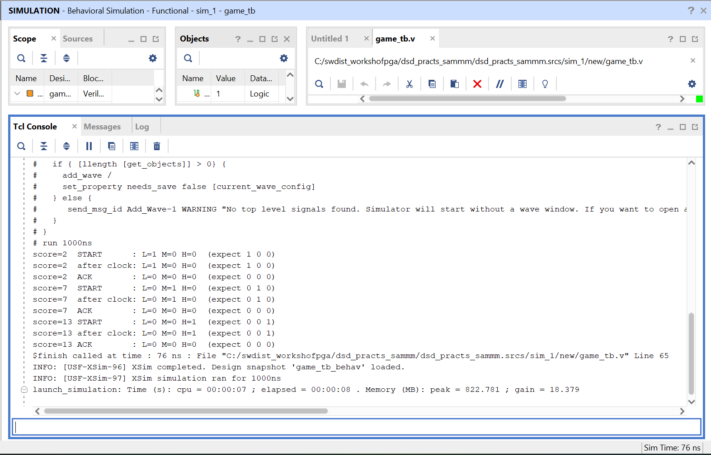

## 9. FPGA Hardware Implementation
- FPGA board/device: RealDigital Boolean Board, Xilinx Spartan-7 XC7S50-CSGA324-1 (part `xc7s50csga324-1`)
- Tool/version: Xilinx Vivado 2018.3 (project `dsd_practs_sammm`)
- Clock/constraints: `04_FPGA_Hardware/constraints.xdc` (LVCMOS33; clk F14, reset T1, start J2, ack J1, score V2/U2/U1/T2, LEDs G1/G2/F1). Clock constraint added: `create_clock -period 10.000 [get_ports clk]` (10 ns, 100 MHz).
- Synthesis/implementation summary: Synthesis, implementation and bitstream generation completed for `xc7s50csga324-1` (Vivado status bar: "write_bitstream Complete"). Implemented design: 24 cells, 11 I/O ports, 32 nets. Vivado re-encoded the FSM as one-hot (`FSM_onehot_state_reg`, 4 flip-flops) with LUTs and I/O buffers. Pin assignments match `constraints.xdc` (score T2/U1/U2/V2, ack J1, clk F14, high_led F1; LVCMOS33, outputs 12 mA slow slew). Utilisation (Vivado, post-implementation): 6 Slice LUTs of 32600, 4 slice registers of 65200, 2 slices of 8150, 11 bonded IOBs of 210, 1 BUFGCTRL of 32 (LUTs, registers and slices under 1%; IOBs about 5%; BUFGCTRL about 3%). Power (Vivado estimate, default activity): total 3.43 W = 3.348 W dynamic (I/O 3.229 W, signals 0.077 W, logic 0.043 W) + 0.082 W static; junction temperature 41.9 °C, thermal margin 43.1 °C. Timing (after adding `create_clock -period 10.000`): WNS = 7.665 ns, WHS = 0.540 ns, WPWS = 4.500 ns, 0 failing endpoints, "All user specified timing constraints are met" (`timing_summary.png`; the first run, before the clock constraint, showed inf slack).
- Programming and hardware test result: the board was programmed (DONE LED lit) and the correct LED lit for each category: LOW LED (LD0, pin G1) in `hardware_low_led.jpg`, MEDIUM LED (LD1, pin G2) in `hardware_medium_led.jpg`, HIGH LED (LD2, pin F1) in `hardware_high_led.jpg`. The exact score values set on the switches are not visible in the photos.
- FPGA implementation recording (Google Drive): https://drive.google.com/file/d/1PTbTQEMCe9i1WaIGIoaBvH1JUCAgzeba/view?usp=drive_link

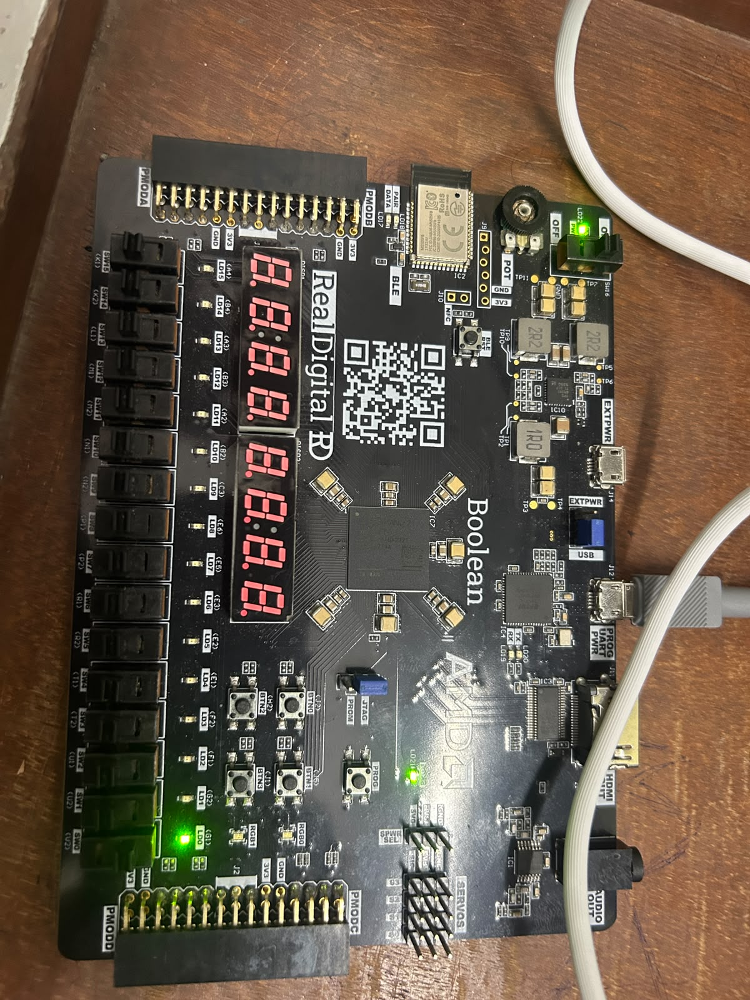

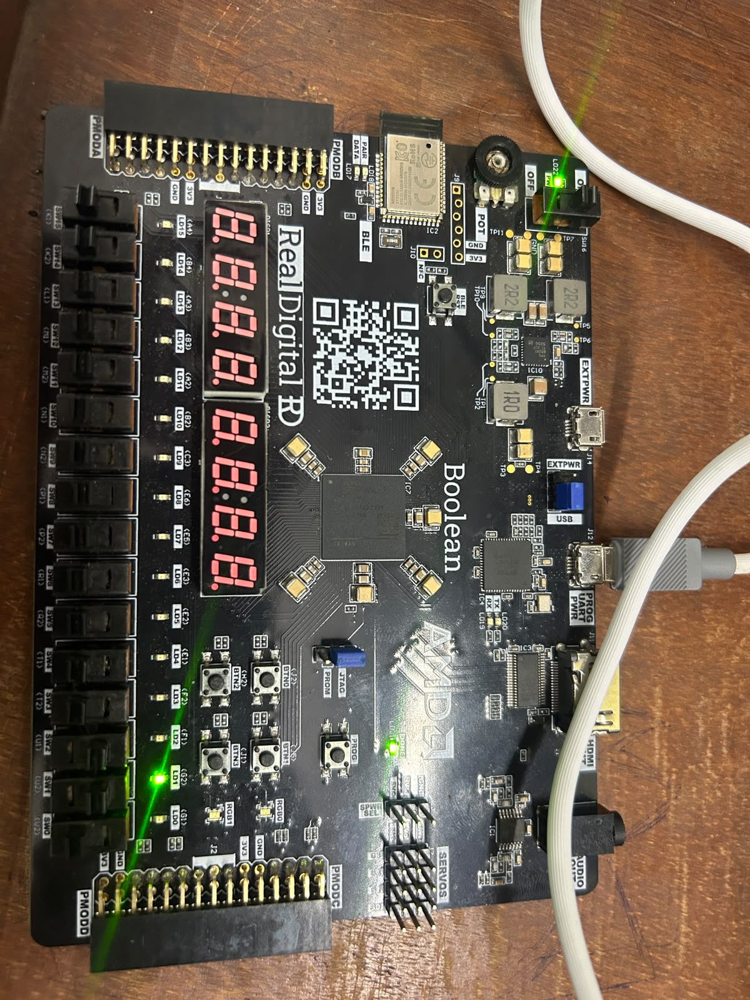

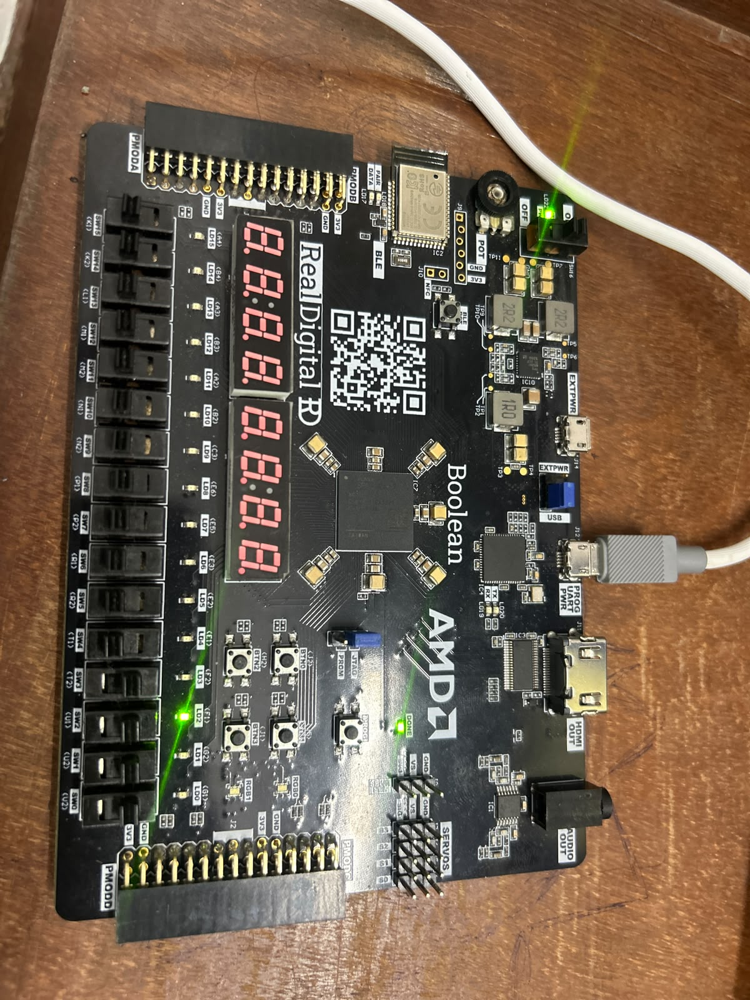
- Evidence path: `04_FPGA_Hardware/`

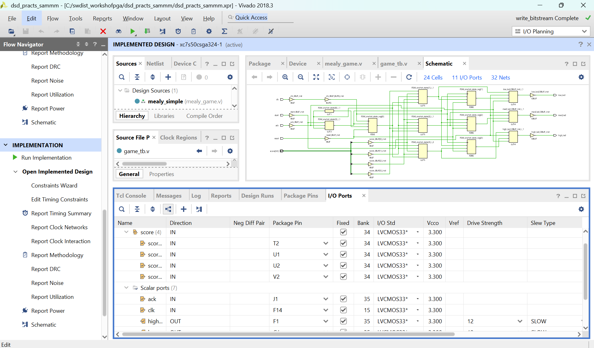

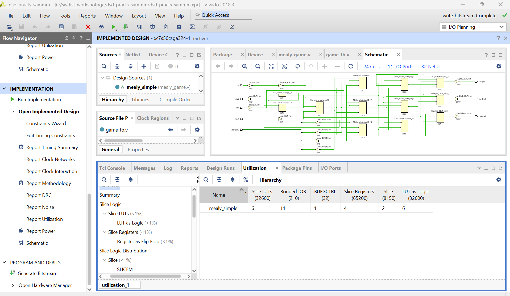

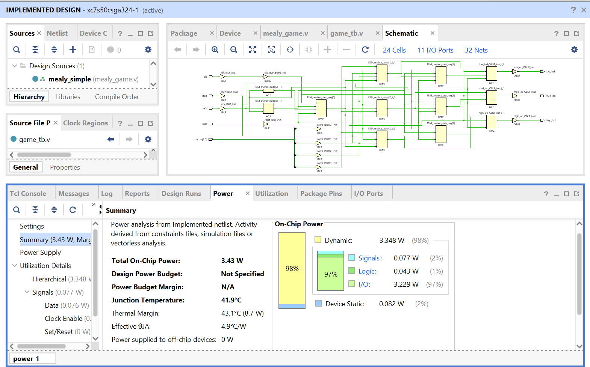

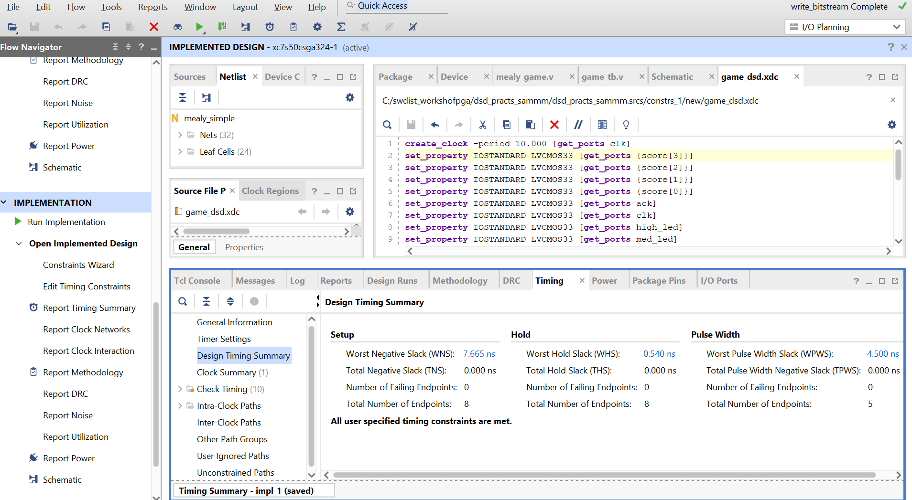

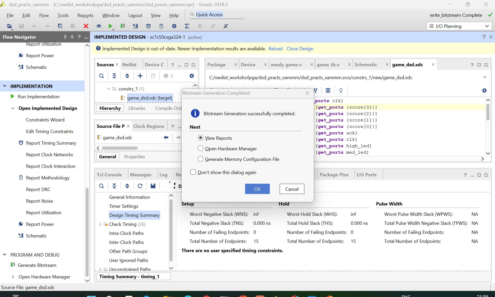

Explain differences between simulation and hardware results, if any.

## 10. Challenges, Debugging and Improvements
| Issue | Root cause | Correction | Outcome |
|---|---|---|---|
| Design was unconstrained: Timing Summary showed WNS/WHS = inf and "no user specified timing constraints" | The constraints file had only pin and I/O-standard lines, with no clock definition | Added `create_clock -period 10.000 [get_ports clk]` to the constraints, re-ran implementation and regenerated the bitstream | Timing met at 10 ns (WNS 7.665 ns, WHS 0.540 ns, 0 failing endpoints); bitstream regenerated |
| Logisim design was complex at first | The comparator was built from its internal gate circuit | Used Logisim's built-in comparator block instead | Simpler circuit that behaves the same |
| Logisim reset behaviour differs from the Verilog | The Logisim circuit ANDs every LED output with NOT reset, but the Verilog LED outputs are not gated by reset, so with START held an LED can light during reset | Kept the Verilog that was used for the Vivado reports, bitstream and board demo, and documented the difference (section 7) | Known difference documented; states and transitions are the same |

Future improvements: debouncing/synchronising `start` and `ack`; seven-segment display of the score; parameterised thresholds.

## 11. Task Allocation and Individual Contribution
| Student | Assigned responsibility | Actual contribution/evidence |
|---|---|---|
| Samruddhi Samant (Group leader) | Source code, testbench, FPGA constraints, bitstream, FPGA implementation, final report, documentation, state diagram, presentation | `03_Verilog_Implementation/`, `04_FPGA_Hardware/constraints.xdc` (constraints), `04_FPGA_Hardware/` (bitstream and implementation reports), `07_Final_Report/` (final report), `02_FSM_Logisim/fsm_state_diagram.png`, `06_Presentation/` |
| Siddharth Sanjeev Tiwari | Logisim circuit design and simulation | `02_FSM_Logisim/Game_Score_Categorizer_H2_Mealy_Machine_v2_comparators.circ`, `02_FSM_Logisim/low.png`, `medium.png`, `high.png`, `idle.png` |
| Deven Shailendra Bhadane | Logisim circuit design and simulation, FPGA implementation | `02_FSM_Logisim/Game_Score_Categorizer_H2_Mealy_Machine_v2_comparators.circ`, `04_FPGA_Hardware/` |
| Ojas Nitin Kadam | Source code, testbench, state diagram | `03_Verilog_Implementation/RTL/`, `03_Verilog_Implementation/Testbench/`, `02_FSM_Logisim/fsm_state_diagram.png` |

Every student must be ready to explain the complete design.

## 12. Progress Log
Maintain time-wise updates in `STATUS.md`.

Key milestones (the full, detailed log is in `STATUS.md`, section 7):

| Date and time | Milestone |
|---|---|
| 2026-11-19, 15:53 | Group repository set up; group folder and team details added |
| 2026-11-19, 16:10 | Verilog RTL, testbench and FPGA constraints added |
| 2026-11-19, 16:30 | Logisim circuit added |
| 2026-11-19, 16:45 | Problem analysis and I/O specification added |
| 2026-11-19, 17:15 | README sections filled; FSM state table and diagram added |
| 2026-11-19, 21:30 | Vivado behavioral simulation waveform added |
| 2026-11-19, 22:00 | Vivado implemented design, utilization and power reports added |
| 2026-11-20, 02:30 | Final Logisim circuit (comparator version) uploaded |
| 2026-11-20, 03:30 | Clock constraint added; bitstream regenerated |
| 2026-11-20, 04:30 | Constrained timing run: timing met (WNS 7.665 ns) |
| 2026-11-20, 06:00 | Teammates' Logisim simulation screenshots (LOW, MEDIUM, HIGH, idle) committed |
| 2026-11-20, 11:00 | Hardware demonstration on the Boolean board: LOW, MEDIUM and HIGH LEDs lit |
| 2026-11-20, 12:00 | Presentation reduced to 3 slides; team contributions updated |
| 2026-11-20, 15:00 | Final report added (docx and pdf) |
| 2026-11-20, 18:30 | Logisim issues and team reflection written |
| 2026-11-20, 19:00 | Verilog restored to the version used for the Vivado reports and board demo |

## 13. Final Results and Conclusion
Summarise requirements met, correctness of simulation/hardware results, measured results, limitations and conclusion.

**Requirements met:** the Mealy FSM classifies the score into LOW (0–4), MEDIUM (5–10) and HIGH (11–15), lights exactly one LED, holds it until ACK and clears it afterwards. Verified in Vivado behavioral simulation for scores 2, 7 and 13 (3 of 3 cases pass, from the waveform). Full tables: [`05_Results/README.md`](05_Results/README.md).

**Measured results (Vivado 2018.3, XC7S50-CSGA324-1):** 6 Slice LUTs, 4 flip-flops, 2 slices, 11 IOBs, 1 BUFGCTRL; estimated power 3.43 W (mostly I/O); timing met at a 10 ns clock (WNS 7.665 ns, WHS 0.540 ns, 0 failing endpoints); bitstream generated.

**Hardware results:** demonstrated on the RealDigital Boolean Board: the LOW, MEDIUM and HIGH LEDs (LD0, LD1, LD2) each lit for a score in the matching range (photos in `04_FPGA_Hardware/`).

**Limitations:** only three scores simulated (boundary scores and reset mid-round untested); timing was checked only at a 10 ns clock constraint; START and ACK are not debounced.

**Conclusion:** the design meets the functional behaviour in simulation and fits easily on the target FPGA. The hardware demonstration remains.

## 14. Team Reflection
What did the team learn? What would you improve?

**What did the team learn?**

- **Mealy FSM.** We learned the difference between Mealy and Moore machines. In a Mealy machine the output depends on the state and the inputs, so the LED lights as soon as START is pressed, without waiting for the next clock.
- **The full flow.** We went from a Logisim circuit, to Verilog, to a simulation in Vivado, to a bitstream on a real FPGA board. The same design can be described in different ways: Logisim uses gates and comparators, and Vivado turns the Verilog into multiplexers and then into LUTs.
- **Constraints matter.** Vivado does not check timing unless the clock is defined. Our first timing report showed no constraints. After adding a 10 ns clock constraint, timing was met.
- **Hardware is different from simulation.** On the board we had to find which switch or button each pin is. We saw that an LED can stay lit during reset if START is also pressed, because the Verilog and the Logisim circuit treated reset differently on the outputs.
- **Teamwork with GitHub.** We worked in one repository with collaborators, a pull request and a status file. We learned to pull before pushing, so we don't overwrite each other.

**What would we improve?**

- Define the clock constraint at the start, before running implementation.
- Keep the Logisim circuit and the Verilog code identical in behaviour from the beginning, including reset.
- Write a testbench that covers all 16 scores, reset and START/ACK and checks the results itself. Ours covers only scores 2, 7 and 13.
- Add debouncing for the START and ACK buttons.
- Take board photos that also show the switch positions, and record ACK and reset.
- Make sure every member commits their own work to the repository from the start.

## 15. Final Submission Checklist
- [x] Team details and problem analysis complete.
- [x] Architecture/block diagram included.
- [x] FSM diagram/table or justified alternative included.
- [x] Logisim source and simulation evidence uploaded.
  - [x] Logisim source uploaded (`02_FSM_Logisim/Game_Score_Categorizer_H2_Mealy_Machine_v2_comparators.circ`).
  - [x] Simulation evidence: LOW (score 3), MEDIUM (score 5), HIGH (score 13) and IDLE uploaded (see `02_FSM_Logisim/`). Not simulated in Logisim: ACK, RESET and the remaining scores (see `02_FSM_Logisim/logisim_test_plan.md`).
- [x] Verilog RTL and testbench uploaded.
- [x] Simulation results and test cases documented.
- [x] FPGA implementation and hardware evidence uploaded.
- [x] Results, challenges and conclusion documented.
- [x] Presentation and final report uploaded.
- [x] STATUS.md is up to date.
- [x] Final Pull Request created and URL recorded (PR #33; the PR stays open for updates).
